# Contributing

Contributions are welcome through issues and pull requests.
Participation follows [CODE_OF_CONDUCT.md](CODE_OF_CONDUCT.md), and project decision-making is described in [GOVERNANCE.md](GOVERNANCE.md).
Use [SUPPORT.md](SUPPORT.md) to choose the correct public support channel and [SECURITY.md](SECURITY.md) for private vulnerability reports.

All changes reach the protected `main` branch through pull requests that pass every required check.
Coding agents find these rules in short in [AGENTS.md](AGENTS.md), with what a change of the template reaches; a change of a rule here changes it there as well.

## Requirements for changes

- Changes need tests, and the checks of `scripts/check.sh` pass.
- Every commit carries a [Developer Certificate of Origin](https://developercertificate.org/) sign-off, `Signed-off-by: Your Name <you@example.com>`, which `git commit -s` adds.
- Name the issue that a pull request fixes with `Fixes #123` in its description. The issue stays open until a release ships the fix and then closes with a link to the release.

## Tests

New functionality comes with tests in the automated test suite, in the same pull request, and so does every change of behavior. A bug fix comes with a test that fails without the fix, so that the bug can't return unnoticed. `scripts/check.sh` fails when a line or a branch of the code runs in no test. A pull request without the tests it needs is not merged.

A change of the template comes with a test in `tests/test_template.py` that renders it, and the Variants workflow runs the checks of every kind of project with its real tools, for a new repository and for one that the update brings from the latest release. A change that the files of a project must follow, which an update never touches, says in the changelog how an existing project makes it.

A new check runs only where it can change a result, as [decision 0009](docs/decisions/0009-run-a-check-only-where-it-can-change-a-result.md) describes: a required check in every pull request and without a path filter, a scanner in the pull requests that change what it reads, and on `main` only what keeps a baseline or publishes.

## Coding standards

- **Python** follows [PEP 8](https://peps.python.org/pep-0008/) in the format of [Ruff](https://docs.astral.sh/ruff/), which matches Black, with the rules of Ruff that `pyproject.toml` selects. The code has type hints, which mypy checks in its strict mode.
- **Shell scripts** pass [ShellCheck](https://www.shellcheck.net/), **workflows** pass actionlint and zizmor's audit of their security, and **Markdown** follows the rules of markdownlint in `.markdownlint.jsonc`.
- **Every text file** has LF line endings, no trailing whitespace and a line break at its end; `.editorconfig` sets up most editors for it.

`scripts/check.sh` and the Lint workflow check these standards on every pull request, which merges only when they pass. An exception to a rule is rare and is marked at its place in the code, with its reason in a comment.

## Workflow

<picture>
  <source media="(prefers-color-scheme: dark)" srcset="docs/images/diagrams/the-way-of-a-contribution.dark.svg">
  
</picture>

1. Open an issue first for anything larger than a small fix, so we can agree on the approach.
2. Create a branch from `main`.
3. Describe what changes for users, in the words of a user, in a new file in `changelog.d/` named after your branch without its type, such as `changelog.d/dark-mode.md` for the branch `feat/dark-mode`, below the heading of its kind of change, such as `### Features` or `### Bug fixes`. The check *changelog* asks for it in every `feat`, `fix` or `perf` pull request, and checks it as the release takes it in. A file of its own conflicts with no other pull request; a line under `## Unreleased` in `CHANGELOG.md` works as well, but conflicts with each pull request that adds one at the same place.
4. A change that makes or changes a decision that shapes the blueprint records it in [`docs/decisions/`](docs/decisions/README.md).
5. Open a pull request whose title is a [Conventional Commit](https://www.conventionalcommits.org/), such as `feat(settings): add a dark mode` or `fix: keep the token secret`. Mark a breaking change with `!`. Pull requests are squashed into one commit named after the title, and the title decides the next version: `fix` a patch, `feat` a minor, `!` a major version.

### The changelog

A fragment holds the entries of one pull request, each below the heading of its kind of change:

```markdown
### Features

- **Dark mode:** the settings follow the theme of the system.
```

The headings are those of the blueprint, `Breaking changes`, `Features`, `Changes`, `Bug fixes` and `Performance`, those of [Keep a Changelog](https://keepachangelog.com/), `Added`, `Changed`, `Deprecated`, `Removed`, `Fixed` and `Security`, and every other one that `CHANGELOG.md` has already. The release bot moves the entries of every fragment and of Unreleased into the section of the next release, each kind of change below one heading, and deletes the fragments in the same commit of the release pull request. `python3 blueprint.py fragments` checks them as the release takes them in.

## Checks

```sh
python3 -m venv .venv
.venv/bin/pip install --require-hashes -r requirements-dev.txt
. .venv/bin/activate && bash scripts/check.sh
```

On Windows, run them in Git Bash, which comes with [Git for Windows](https://gitforwindows.org/), with `py -3` in place of `python3` and `.venv/Scripts/` in place of `.venv/bin/`. The Windows workflow runs them there as well: every week, and for each pull request that changes the code or the tests.

To run them before every push on its own, turn on the hook of the repository once:

```sh
git config core.hooksPath .githooks
```

Git runs the hook only when its file is executable. Windows has no such mode and adds the file as a plain one, which `scripts/check.sh` reports; `git update-index --chmod=+x .githooks/pre-push` and a commit make it executable.

The dev container in `.devcontainer/` has all of this set up, for VS Code and for GitHub Codespaces: open the repository in it, and `bash scripts/check.sh` runs.

## Website

MkDocs builds the website of the blueprint from `mkdocs.yml` and the pages in `docs/`, which include the READMEs and the changelog. The check *docs* builds it strictly in every pull request, and the Dashboard workflow publishes it with the dashboard. To see it while you write, at <http://127.0.0.1:8000>:

```sh
python3 -m venv .venv-docs
.venv-docs/bin/pip install --require-hashes -r stacks/docs/requirements-docs.txt
.venv-docs/bin/mkdocs serve
```

On Windows, use `py -3` in place of `python3` and `.venv-docs/Scripts/` in place of `.venv-docs/bin/`; the dev container sets these tools up on its own. With them, `bash scripts/check.sh` builds the website strictly as well, as the check *docs* does, and without them it leaves that to the CI. The preview cards for social media come from the CI alone, because they need the Cairo library, which Windows doesn't have; where it is installed, `CI=true` before the command draws them too.

Pictures make the documentation easier to follow:

- **Diagrams** are pictures of Mermaid sources, because the GitHub app and other renderers of Markdown show a `mermaid` block as code ([decision 0016](docs/decisions/0016-diagrams-as-pictures-of-their-sources.md)). A source is `docs/diagrams/<name>.mmd`, and `bash scripts/diagrams.sh` draws it, with Docker, as `docs/images/diagrams/<name>.svg` and `<name>.dark.svg`, which the Markdown shows with a `<picture>` and the website draws live from the source; `bash scripts/diagrams.sh --extract` turns a `mermaid` block into a source and its picture. The check *diagrams* draws the pictures anew in a pull request that changes a diagram or adds a `mermaid` block, and on a branch of this repository the diagram bot commits the sources and pictures that it made; on `main`, the Diagrams workflow keeps one pull request from `bot/diagrams` that fixes what is left and merges itself. You need no Docker for a diagram: change its source, push, and let the bot draw it. Diagrams run from top to bottom (`flowchart TB`), so that they keep their size in the column of a page and on a phone, and have `accTitle` and `accDescr` for screen readers, which the `alt` of the picture repeats. Labels are text in the pictures: `<br>` breaks a line, and a label in `` "`…`" `` takes `**bold**` and `*italic*`. Their colors are tints that read in the light and the dark theme: blue (`#526cfe`) the blueprint and its bots, orange (`#f59e0b`) you and what is yours, green (`#16a34a`) what comes out. A diagram in a README comes in English and in German, the German one as `<name>.de.mmd`.
- **Pictures** are files in `docs/images/`. A page of `docs/` names one as `images/…`, a README as `docs/images/…`, and a hook of the website (`.github/mkdocs_project.py`) shows it there too.
- **The recording and the screenshot** of the README, `docs/images/copier-copy.gif` and `docs/images/dashboard.png`, come from `bash scripts/docs-pictures.sh`, with Docker: run it again after the questions of `copier.yml`, the output of Copier or the dashboard change.

## Releases

The release bot keeps a pull request titled `chore: release x.y.z` with the next version, up to date with `main` and decided anew with every merge. Its section of the changelog is the text of the fragments in `changelog.d/` and of Unreleased, and it deletes the fragments; without such text, it lists the pull requests. Merging it creates the release with its package, SBOM and signed provenance. New repositories copy the blueprint from its release tags, and the blueprint bot brings every repository made from it up to the new release. A release of dependency updates merges and publishes itself.

A line `Release-As: 2.0.0-beta.1` in the description of a pull request sets the version of the next release, for a prerelease for example. A prerelease leaves the fragments and the text of Unreleased to the release that follows it.

By contributing, you agree that your contribution is licensed under the MIT-0 license of this project.
