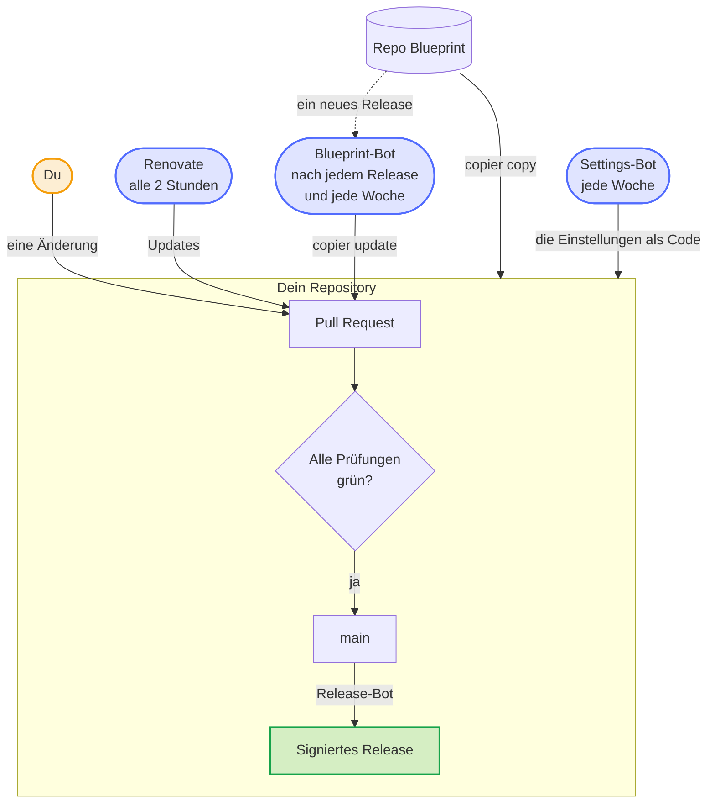
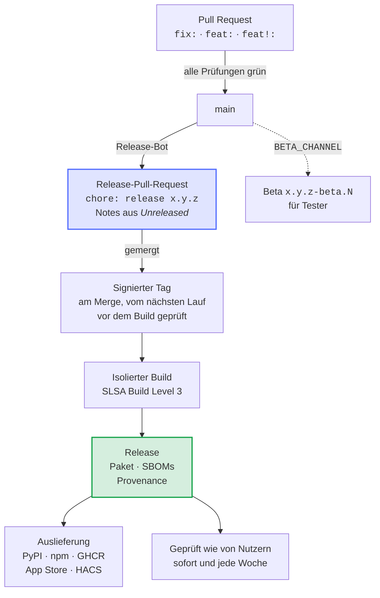
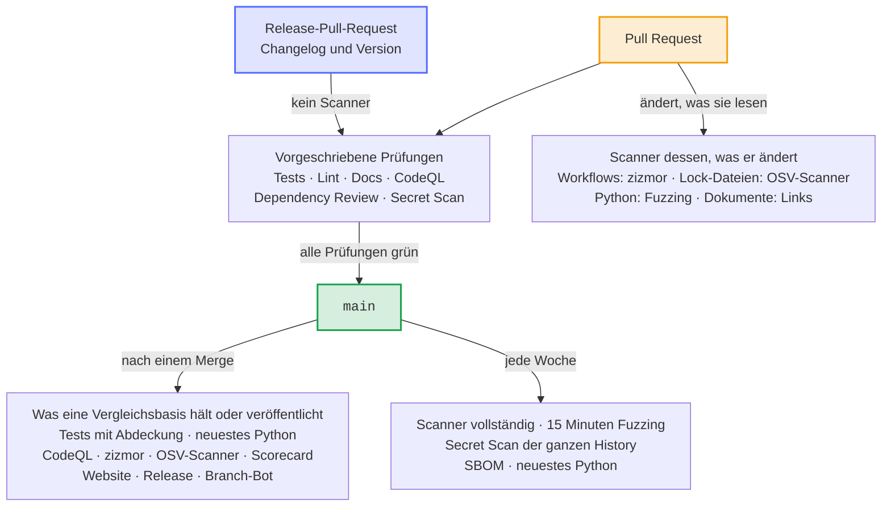
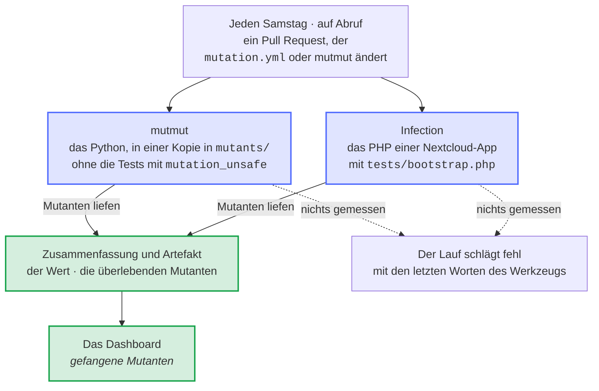
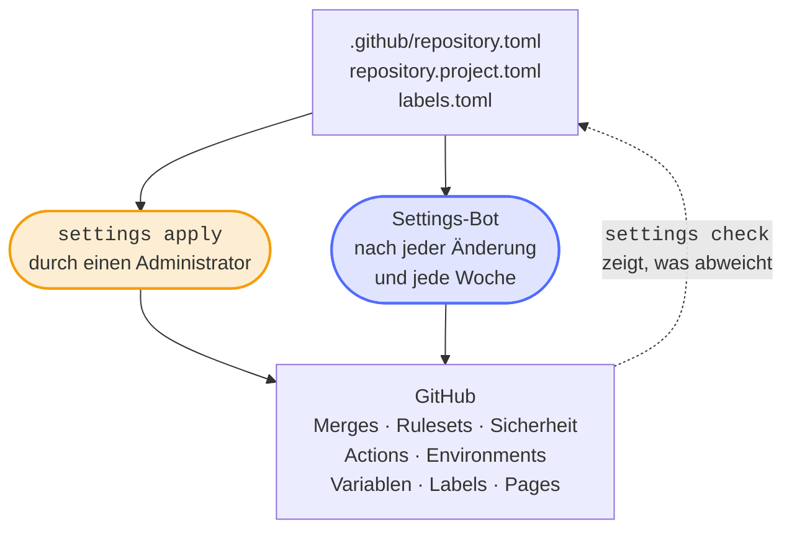
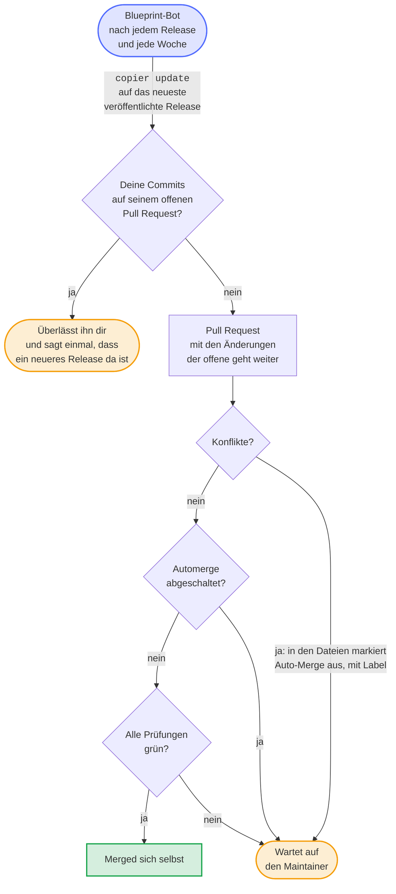
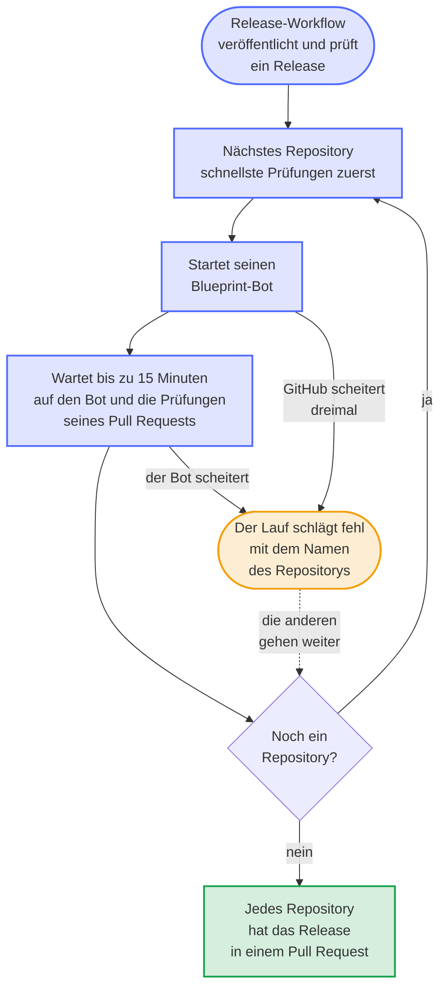
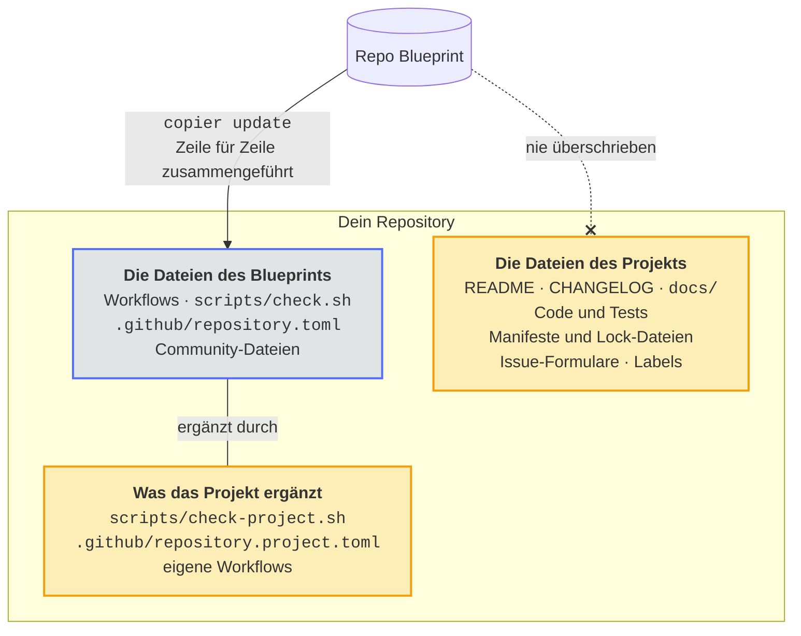
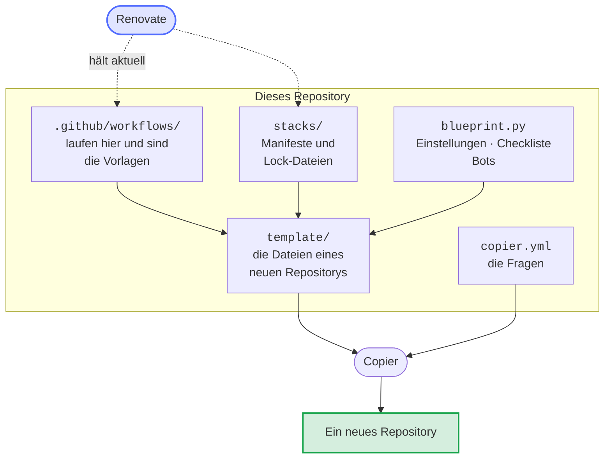

# Repo Blueprint

[](https://dennis-otto.github.io/repo-blueprint/)

[English version](https://github.com/Dennis-Otto/repo-blueprint/blob/main/README.md)


Eine [Copier](https://copier.readthedocs.io/)-Vorlage für GitHub-Repositories, die sich selbst pflegen: Tests bei jeder Änderung, ein Release-Bot, Sicherheitsprüfungen, ein Issue-Assistent und die Einstellungen des Repositorys als Code, für sieben Arten von Projekten. Ein Bot bringt jedes Repository, das aus der Vorlage entstanden ist, auf jede neue Version des Blueprints.

Die [Website des Blueprints](https://dennis-otto.github.io/repo-blueprint/de/) zeigt diese Anleitung auf Deutsch und Englisch, zusammen mit der Roadmap, dem Sicherheitsdesign, den Entscheidungen und dem Dashboard.

<sub>💛 Wenn dir der Blueprint hilft, kannst du [seine Entwicklung unterstützen](https://github.com/sponsors/Dennis-Otto).</sub>

## Wie sich ein Repository selbst pflegt

<!-- --8<-- [start:loop] -->

Jede Änderung, deine oder die eines Bots, ist ein Pull Request, der merged, sobald alle Prüfungen grün sind, und der Release-Bot macht aus dem, was auf `main` ankommt, ein signiertes Release; drei Bots halten das Repository von selbst aktuell. In den Bildern ist Blau der Blueprint mit seinen Bots, Orange bist du mit allem, was dir gehört, und Grün ist das Ergebnis.



<!-- --8<-- [end:loop] -->

## Was ein neues Repository bekommt

| Bereich | Was läuft | Womit |
| --- | --- | --- |
| **Prüfungen** | `scripts/check.sh` bei jeder Änderung, lokal wie in der CI: Tests mit voller Abdeckung, Typen, Lint, Paketbau | die Werkzeuge der jeweiligen Projektart, per Hash gepinnt |
| **Lint** | Workflows (actionlint), Lizenz jeder Datei (REUSE), das Markdown jedes Dokuments (markdownlint), Hinweise zur Rechtschreibung auf Englisch und Deutsch (cspell) und zum Stil des Englischen (Vale) der geänderten Dokumente, Sign-off jedes Commits (DCO), Titel jedes Pull Requests (Conventional Commits), ein Eintrag unter *Unreleased* für jede Änderung für Nutzer | `lint.yml`, `pull-request-title.yml` |
| **Sicherheit** | CodeQL, OpenSSF Scorecard, Dependency Review, Secret Scan, SBOMs als SPDX und CycloneDX, OpenVEX, schlüssellos signierte und vor jedem Build geprüfte Release-Tags (gitsign), Findings-Wächter, die Sicherheitsprüfung der Workflows (zizmor), jede Lock-Datei gegen die OSV-Datenbank (OSV-Scanner), der Netzwerkverkehr jedes Jobs (Harden-Runner) | jede Action auf einen Commit-Hash gepinnt |
| **Releases** | ein Pull Request mit der nächsten Version, bestimmt aus den Titeln der gemergten Pull Requests (`fix` ein Patch, `feat` ein Minor, `!` ein Major), und dem Text von *Unreleased* im Changelog als Notes; sein Merge veröffentlicht das Release mit Paket, SBOM und der signierten Provenance eines isolierten Builds (SLSA Build Level 3), liefert es aus und prüft es danach so, wie es seine Nutzer können, auch jede Woche; wo die Repository-Variable `BETA_CHANNEL` auf true steht, wird außerdem jede Änderung für Nutzer zu einer Beta des nächsten Releases, einem Prerelease für Tester | release-please, die Release-App, unveränderliche Releases, `verify-release.yml` |
| **Abhängigkeiten** | Renovate, das der Blueprint alle zwei Stunden für jedes Repository als Release-App ausführt: Actions, Abhängigkeiten, Images und die Pins der Workflows, eine Woche nach ihrem Release, und sofort ein Update, das eine Schwachstelle behebt, oder den neuen Commit eines Branches, dem eine Action folgt; Routine-Updates und Releases, die nur Abhängigkeiten aktualisieren, mergen sich selbst, sobald alle Prüfungen grün sind, während die wöchentliche Auffrischung jeder Lock-Datei, die die neuesten Versionen ohne die Woche Wartezeit bringt, auf den Maintainer wartet; der Blueprint prüft, dass Renovate jede Lock-Datei liest, die er mitbringt. Dependabot pflegt die Features des Dev-Containers. | `renovate.json5`, `renovate-blueprint.json5`, `dependabot.yml` |
| **Abdeckung** | ein Kommentar an jedem Pull Request mit der Abdeckung seiner Tests im Vergleich zu `main`, Datei für Datei | `after-checks.yml` |
| **Mutationstests** | jede Woche laufen Tausende kleiner Änderungen des Codes gegen die Tests, und die Zusammenfassung zeigt den Anteil, den sie bemerken, und die überlebenden Mutanten; ein niedriger Wert ist ein Bericht, nie ein Fehlschlag, aber ein Lauf, der nichts misst, schlägt fehl; ein Pull Request, der ändert, wie sie laufen, probiert sie aus | `mutation.yml`: mutmut, Infection |
| **Wackelige Tests** | ein Testlauf, der fehlschlägt, führt seine fehlgeschlagenen Jobs einmal neu aus; ein Job, der dann besteht, wird in einem Issue als wackelig gemeldet | `after-checks.yml` |
| **Abgebrochene Prüfungen** | ein Lauf einer vorgeschriebenen Prüfung für den neuesten Commit eines Pull Requests, den ein verspäteter Lauf für einen älteren Commit abgebrochen hat, startet von selbst neu, statt den Merge zu blockieren | `after-checks.yml` |
| **Schnelle Prüfungen** | eine Prüfung läuft nur, wo sie ein Ergebnis ändern kann: ein Scanner in den Pull Requests, die ändern, was er liest, auf `main` nur, was eine Vergleichsbasis hält oder veröffentlicht, der Rest jede Woche, und im Release-Pull-Request gar kein Scanner; das neueste Python prüft `main` eines Python-Projekts nach jeder Änderung und jede Woche | die Auslöser und Pfadfilter der Workflows, `newest-python.yml` |
| **Issues** | eine erste Analyse jedes neuen Issues durch eine KI, die nur liest, Labels, Duplikate, Erinnerungen und das Schließen mit dem Release, das den Fix enthält | der [Issue-Assistent](https://github.com/Dennis-Otto/issue-assistant) |
| **Community** | README, Beitragsleitfaden mit den Coding-Standards und der Regel, dass jede Änderung ihre Tests mitbringt, Verhaltenskodex, Sicherheitsrichtlinie mit der Prüfung eines Releases und einem Assurance Case, das Sicherheitsdesign der Software (`docs/security.md`), Support, Governance mit den Rollen und dem Fortbestand des Projekts, Issue-Formulare, Pull-Request-Vorlage, Aufzeichnungen der Entscheidungen, die das Projekt prägen (`docs/decisions/`), Discussions mit Formularen für Fragen und Ideen und einer Ankündigung jedes Releases, Sponsor-Button, Social Preview | |
| **Website** | die Dokumentation aus `docs/` als Website mit Suche und hellem und dunklem Design, auf Englisch und, mit deutschen Seiten wie `index.de.md` neben den englischen, auf Deutsch: jeder Pull Request baut sie streng, und ebenso `scripts/check.sh`, sobald die Werkzeuge ihrer Vorschau installiert sind, unter Linux, macOS und Windows; jede Änderung an `main` veröffentlicht sie auf GitHub Pages | MkDocs mit dem Material-Theme, `mkdocs.yml`, `docs.yml` |
| **Einstellungen** | die Einstellungen des Repositorys als Code: Merges, Rulesets, Sicherheit, Actions, Environments, Variablen, Labels, GitHub Pages und jede Datei der Community-Standards von GitHub; der Settings-Bot wendet sie nach jeder Änderung und jede Woche an | `.github/repository.toml` und `blueprint.py` |
| **Aufräumen** | jede Woche verschwinden die Branches, die `main` enthält, und die Caches geschlossener Pull Requests; ein Branch mit eigener Arbeit bleibt und wird nach einem Monat aufgelistet | `cleanup.yml` |
| **Entwicklung** | ein Dev-Container für VS Code und GitHub Codespaces mit den Werkzeugen der Prüfungen und der Website, und ein Hook, der sie vor jedem Push ausführt | `.devcontainer/`, `.githooks/pre-push` |
| **Updates** | gleich nach jedem Release des Blueprints, und jede Woche, führt der Blueprint-Bot `copier update` aus und öffnet einen Pull Request | `blueprint-update.yml` |
| **App Store** | für eine Nextcloud-App: die Registrierung ihrer ID mit ihrem Zertifikat, einmal, von Hand | `register-app.yml` |
| **Upstream** | für eine Nextcloud-App, jede Woche: hat Nextcloud eine neue Hauptversion, hebt ein Pull Request `max-version` an und merged sich selbst, sobald jede Prüfung, auch die End-to-End-Tests, dagegen besteht | `upstream.yml` |
| **Bereichs-Labels** | jeder Pull Request bekommt die Labels der Bereiche, deren Dateien er ändert, nach den Pfaden in `.github/labeler.yml`, die dem Projekt gehört | `area-labels.yml` |
| **Branches** | nach jeder Änderung an `main` bringt der Branch-Bot jeden Pull Request, der auf Auto-Merge wartet, auf den neuesten Stand, auch die von Renovate, damit er nach grünen Prüfungen merged | `update-branches.yml` |

### Von einer Änderung zum Release

Der Titel eines Pull Requests bestimmt die nächste Version, und der Merge des Release-Pull-Requests erledigt den Rest:



### Wann die Prüfungen laufen

Eine Prüfung läuft nur, wo sie ein Ergebnis ändern kann, denn ein Konto bei GitHub führt etwa 20 Jobs gleichzeitig aus, und jeder Job, der nicht fehlschlagen kann, lässt einen Pull Request auf einen Runner warten:



- **Nach einem Merge:** `main` nimmt einen Pull Request nur auf, wenn er auf dem neuesten Stand ist, also bekommt `main` durch den Merge die Dateien, mit denen die Prüfungen des Pull Requests bestanden haben. `main` führt nur die Tests aus, mit deren Abdeckung der Abdeckungs-Bot jeden Pull Request vergleicht, die Analysen, mit denen Code Scanning vergleicht, und was veröffentlicht, etwa die Website und das Release. Lint läuft in den Pull Requests, Secret Scan und Fuzzing dort und jede Woche, und die SBOM jede Woche; jedes Release hat eine eigene SBOM.
- **Der Release-Pull-Request** ändert nur den Changelog und die Version, die nichts an dem ändern, was ein Scanner findet. Im Blueprint steht die vorgeschriebene Prüfung *variants* für die Varianten und Updates jeder Projektart: Sie besteht, wenn jede bestanden hat oder keine laufen musste, wie im Release-Pull-Request.
- **Das neueste Python**, Betas eingeschlossen, führt die Prüfungen eines Python-Projekts nach jeder Änderung an `main` und jede Woche aus, in einem eigenen Workflow, der die CI von `main` grün lässt. Ein neues Python bricht jeden Pull Request gleichermaßen, und keiner wartet darauf. Ein Fehlschlag hält ein Issue offen, das der wöchentliche Lauf schließt, sobald die Prüfungen wieder bestehen.

### Mutationstests

Die Mutationstests zeigen die Zeilen, die die Tests ausführen, aber nicht prüfen: Jeden Samstag ändern sie den Code auf Tausende kleine Weisen, die Mutanten, und führen die Tests aus, die jeden davon abdecken. Ein Mutant, den kein Test bemerkt, überlebt.



- **Der Wert ist der Anteil der Mutanten, den ein Test bemerkt hat,** unter denen des Codes, den die Tests ausführen: bei mutmut die getöteten unter den getöteten und den überlebenden, bei Infection sein *Covered Code MSI*. Das Dashboard zeigt ihn als *gefangene Mutanten*.
- **Ein niedriger Wert lässt nichts fehlschlagen,** auch nicht unter einem Minimum, das die eigene Konfiguration des Projekts setzt, aber ein Lauf, in dem kein Mutant lief, schon, mit dem Ende der Ausgabe von mutmut oder Infection in seiner Zusammenfassung: Eine kaputte Konfiguration zeigt sich in der Woche, in der sie kaputtgeht, nicht als leeres Dashboard.
- **Ein Pull Request, der ändert, wie die Mutanten laufen,** `mutation.yml` oder das gepinnte mutmut, probiert sie aus, mutmut eine Viertelstunde lang, und zeigt einen Fehler als roten Check vor dem wöchentlichen Lauf. Der Check ist nicht erforderlich, also wartet ein Pull Request, der sich selbst zusammenführt, etwa ein Update von mutmut, nicht auf ihn: Sein roter Check ist eine Warnung zum Lesen.
- **mutmut führt die Tests in einer Kopie des Repositorys aus,** `mutants/`, mit dem geänderten Code und ohne Git. Ein Test, der dort nicht funktionieren kann, weil er den Code als Text liest oder Git fragt, bekommt die Markierung `@pytest.mark.mutation_unsafe`, und die Mutationstests lassen ihn aus; die `pyproject.toml` eines neuen Python-Projekts registriert die Markierung.
- **Eine Konfiguration des Projekts hat Vorrang:** eine Tabelle `[tool.mutmut]` in `pyproject.toml` oder ein Abschnitt `[mutmut]` in `setup.cfg` für mutmut, eine `infection.json5` für Infection. Ohne sie mutiert mutmut `custom_components/`, `src/` oder die Module und Pakete der Wurzel, und Infection mutiert `lib/` auf PHP 8.3, mit `tests/bootstrap.php`, das die Klassen von Nextcloud lädt.

## Arten von Projekten

| Art | Stack | Prüfungen | Auslieferung |
| --- | --- | --- | --- |
| Home-Assistant-Integration | Python 3.14, pytest-homeassistant-custom-component | Ruff, mypy, Tests, HACS, hassfest | ein Zip-Asset für HACS |
| Nextcloud-App | PHP 8.2, Composer | php-cs-fixer, Psalm mit seiner Taint-Analyse, PHPUnit mit jeder Zeile abgedeckt | signiertes Paket in den App Store |
| GitHub Action | Python 3.12 des Runners, Composite Action | Ruff, mypy, Tests, ein Lauf der Action | Release-Tags und ein mitwandernder Major-Tag |
| Python-Paket | Python 3.12, Hatchling | Ruff, mypy, Tests, Build | PyPI, Trusted Publishing |
| Node-Paket | Node 24, TypeScript | tsc, node:test mit voller Abdeckung, Pack | npm mit Provenance |
| Container-Image | Alpine per Digest | Hadolint, Build, Selbsttest | GHCR, Multi-Arch, mit SBOM und Provenance |
| Repository ohne Build | | Textdateien, Shell-Skripte | nur Releases |

Jede Art startet mit einem kleinen, funktionierenden Beispiel samt Tests, das durch den echten Code ersetzt wird.

## Ein Repository anlegen

<!-- --8<-- [start:quick-start] -->

Copier ab 9.4, Git, die GitHub CLI und ein Checkout des Blueprints (für `blueprint.py`):

```sh
copier copy gh:Dennis-Otto/repo-blueprint mein-projekt
cd mein-projekt
git init && git add --all && git commit --signoff --message "chore: start from the blueprint"
gh repo create Dennis-Otto/mein-projekt --public --source . --push
python3 ../repo-blueprint/blueprint.py settings apply
python3 ../repo-blueprint/blueprint.py checklist
```

Copier fragt nach Name, einer Beschreibung in einem Satz, der Art des Projekts, der Lizenz (MIT, MIT-0, BSD-3-Clause, Apache-2.0, GPL-3.0-or-later oder AGPL-3.0-or-later) und ein paar Details der Art. `settings apply` setzt alles, was die API setzen kann; `checklist` zeigt, was noch eine Person erledigen muss, etwa die Secrets, und welche Schritte schon erledigt sind.


<!-- --8<-- [end:quick-start] -->

### Einmal pro Repository

- **Die Release-App** öffnet die Release- und Update-Pull-Requests, damit ihre Prüfungen laufen. Installiere sie auf dem Repository und hinterlege ihren privaten Schlüssel als Secret `RELEASE_AUTOMATION_PRIVATE_KEY` im Environment `release`. Die App braucht die Berechtigungen *Actions*, *Administration*, *Checks*, *Commit statuses*, *Contents*, *Issues*, *Pages*, *Pull requests* und *Workflows* (Lesen und Schreiben) sowie *Dependabot alerts*, *Environments*, *Secrets* und *Variables* (Lesen): Damit wendet der Settings-Bot die Einstellungen als Code an, Renovate aktualisiert die Abhängigkeiten, und der Rollout des Blueprints startet nach einem Release den Blueprint-Bot jedes Repositorys. Renovate bekommt ein Token ohne *Administration*.
- **Der Issue-Assistent** braucht `CLAUDE_CODE_OAUTH_TOKEN` im Environment `issue-assistant`.
- **Auslieferung:** Trusted Publishing auf PyPI oder npm, das App-Zertifikat einer Nextcloud-App oder die Einreichung bei HACS, wie es die Checkliste sagt.

`checklist` gibt die `gh secret set`-Befehle aus; der Wert wird in die Abfrage der GitHub CLI eingegeben und erscheint nirgends sonst.

### Ein bestehendes Repository

Ein bestehendes Repository übernimmt den Blueprint auf einem Branch, in einem Pull Request:

1. `copier copy --overwrite --vcs-ref vX.Y.Z --data sample_code=false gh:Dennis-Otto/repo-blueprint .` mit den Antworten, die zum Repository passen, ohne den Beispielcode und die Beispieltests eines neuen, etwa Beschreibung, Topics und Homepage wie auf GitHub, damit `settings apply` dort nichts ändert. Die Dateien des Projekts (README, Changelog, Code, Tests, Manifeste, Labels, Issue-Formulare, Icons) bleiben, wie sie sind.
2. Den Diff jeder Datei des Blueprints ansehen und zurückholen, was nur dem Projekt gehört: Abschnitte von SECURITY.md oder CONTRIBUTING.md, Regeln von Renovate (in `.github/renovate.json5`), Hosts des Issue-Assistenten, Ignore-Regeln. `copier update` behält diese Änderungen von da an.
3. Die Version des letzten Releases in `version.txt` und `.release-please-manifest.json` schreiben, `CHANGELOG.md` mit `## Unreleased` beginnen und `.github/labels.toml` die Labels der Bots geben (`autorelease: pending`, `autorelease: tagged`, `merge-conflict`, `maintenance`, `docker`).
4. Die Prüfungen nur dieses Projekts, etwa seine End-to-End-Tests, in `.github/repository.project.toml` und `scripts/check-project.sh` eintragen; die Workflows, Skripte und Tests entfernen, die der Blueprint ersetzt, und Dateien der Vorlage löschen, die das Projekt nicht braucht, etwa einen Beispieltest. Ein Repository ohne `docs/` hat keine Website, bis es `docs/index.md` schreibt; `mkdocs.yml` zeigt, wie deutsche Seiten dazukommen.
5. Den Pull Request öffnen. Sobald seine neuen Prüfungen bestehen, stellt `blueprint.py settings apply` die Pflicht-Prüfungen, Variablen und Labels um, und der Pull Request kann mergen.

## Einstellungen als Code



`.github/repository.toml` enthält die Einstellungen eines Repositorys; `blueprint.py settings check` vergleicht sie mit GitHub, `settings apply` gleicht GitHub an:

- **Repository:** Squash-Merges mit dem Titel des Pull Requests, Auto-Merge, Branch-Updates, gelöschte Branches, Sign-off auch für Commits im Web, kein Wiki, keine Projects.
- **Sicherheit:** unveränderliche Releases, private Meldung von Schwachstellen, Dependabot-Alerts mit den Sicherheitsupdates von Renovate, Secret Scanning mit Push-Schutz.
- **Actions:** standardmäßig nur lesende Tokens, keine Freigaben durch Workflows, Actions nur per Commit-Hash, Freigabe der Workflows jedes externen Beitragenden.
- **Rulesets:** *Protect main* (nur Pull Requests, Squash, lineare Historie, alle Pflichtprüfungen, kein Löschen und kein Force-Push) und *Release tags* (`v*.*.*` bewegt sich nie).
- **Variablen und Environments:** `PUBLISH_TO`, die Release-App und Environments, die nur `main` nutzen darf, mit den Secrets, die sie brauchen.
- **Pages:** GitHub Pages veröffentlicht die Website, die der Docs-Workflow baut.

`blueprint.py` braucht Python 3.12 und die GitHub CLI, angemeldet als Administrator, sonst nichts. Es liest und zeigt nie den Wert eines Secrets. Jedes Repository hat eine Kopie in `.github/blueprint.py` und `.github/blueprint/`, und der Settings-Bot (`settings.yml`) vergleicht seine Einstellungen jede Woche und nach jeder Änderung mit den Einstellungen als Code, damit kein Repository abdriftet.

## Updates



Der Blueprint-Bot (`blueprint-update.yml`) führt jede Woche `copier update` aus, und gleich nach jedem Release des Blueprints, dessen Rollout-Workflow ihn in jedem Repository der Release-App startet. Er nimmt das neueste veröffentlichte Release des Blueprints, den `.copier-answers.yml` nennt, vielleicht eines Forks davon, nie einen Tag, dessen Release noch ein Entwurf ist, und hält einen Pull Request auf dem Branch `blueprint/update`: Ein neueres Release bringt diesen Pull Request weiter, mit seiner Nummer und seinem Auto-Merge, statt ihn zu ersetzen. Ohne Konflikte merged er sich selbst, sobald alle Prüfungen grün sind. Konflikte bleiben als Markierungen für den Maintainer darin, in den Dateien, die das Update geändert hat; sie schalten sein Auto-Merge ab und setzen das Label `merge-conflict`. Die Repository-Variable `BLUEPRINT_AUTOMERGE` mit dem Wert `off` lässt jedes Update auf den Maintainer warten. Von Hand startet er unter *Actions → Blueprint update*, lokal mit `copier update`.



Der Rollout-Workflow des Blueprints bringt jedes Release nacheinander in die Repositorys der Release-App, die mit den schnellsten Prüfungen zuerst: Er startet den Blueprint-Bot eines Repositorys und gibt dem Bot und den Prüfungen seines Update-Pull-Requests bis zu 15 Minuten, bevor er den nächsten startet, damit die Update-Pull-Requests nicht alle zugleich auf die Runner des Kontos warten. Ein Repository, dessen Bot er nicht starten kann oder dessen Bot scheitert, lässt den Lauf mit seinem Namen fehlschlagen; die anderen bekommen das Release trotzdem. Er rollt jedes Release aus, das ein Lauf des Release-Workflows veröffentlicht hat, ob der Merge des Release-Pull-Requests diesen Lauf gestartet hat, der stündliche Zeitplan oder ein Start von Hand; ein Release, das der Lauf eines späteren Merges fertiggestellt hat, weil der Lauf seines eigenen Merges verloren ging, wartet auf einen Start von Hand (Actions → Rollout) oder den wöchentlichen Lauf der Bots. Selbst von Hand gestartet, rollt er das neueste Release aus. Rollouts von Releases, die kurz nacheinander kommen, überlappen sich, aber nie im selben Repository: Dort nimmt das neuere Release den Platz eines älteren ein, das noch wartet.

Sobald du auf den Branch des Pull Requests committest, etwa um die Markierungen aufzulösen, überlässt der Bot dir den Branch: Ist ein neueres Release erschienen, sagt er das in einem Kommentar, und nachdem du den Pull Request gemerged oder geschlossen hast, bringt sein nächster Lauf den Rest. Ein Merge von `main` mit dem Button *Update branch* zählt nicht als dein Commit, und ein Auto-Merge, das du abschaltest, bleibt aus. Ein Update, das nur ein neues Release in `.copier-answers.yml` festhält, kommt ebenfalls als Pull Request, und die Updates bringen auch die Modi von Dateien mit, etwa ein Skript, das ausführbar wird.

Dem Blueprint gehören die Workflows, `scripts/check.sh` und die Community-Dateien: ihre Änderungen kommen mit den Updates. Dateien des Projekts werden nie überschrieben: README, Changelog, das Sicherheitsdesign in `docs/security.md`, Manifeste und Lock-Dateien der Abhängigkeiten (die hält Renovate aktuell), Code und Tests, `mkdocs.yml` und die Seiten der Website, Issue-Formulare, Labels und akzeptierte Findings. Prüfungen, die nur ein Projekt braucht, gehören in `scripts/check-project.sh`, das `scripts/check.sh` zuletzt ausführt.

## Was einem Projekt gehört



Der Blueprint hält die gemeinsamen Teile aller Repositories gleich; ein Projekt ergänzt seine eigenen, ohne sie abzuspalten:

- **Änderungen an den Dateien des Blueprints überstehen Updates:** `copier update` führt die Änderungen des Blueprints und die des Repositorys Zeile für Zeile zusammen und markiert nur dort einen Konflikt, wo beide dieselben Zeilen geändert haben.
- **Einstellungen nur dieses Projekts** gehören in `.github/repository.project.toml`, etwa die Prüfungen seiner End-to-End-Tests oder ein Environment mit seinen Secrets. `blueprint.py` und der Settings-Bot ergänzen damit `.github/repository.toml`.
- **Prüfungen nur dieses Projekts** gehören in `scripts/check-project.sh`, das `scripts/check.sh` zuletzt ausführt; **Workflows nur dieses Projekts** sind eigene Workflow-Dateien.
- **Mehrere Copyright-Inhaber,** etwa die Autoren eines Forks, sind die Antwort `copyright`, durch Semikolons getrennt; LICENSE und REUSE.toml nennen jeden von ihnen.
- **Dateien unter einer anderen Lizenz,** etwa Grafiken Dritter, bekommen eine `.license`-Datei daneben, wie REUSE es beschreibt.
- **Das Paket einer Nextcloud-App** prüft `scripts/check-package.sh ARCHIV unsigned|signed`, wenn das Projekt eines hat: `scripts/check.sh` führt es für das Paket aus, das krankerl baut, das Release für das Paket vor und nach dem Signieren.
- **Die Version in anderen Zeilen einer Datei des Releases,** etwa das Tag in der URL eines Screenshots in `appinfo/info.xml`, folgt jedem Release, wenn die Zeile mit dem Kommentar `x-release-please-version` endet, etwa `<!-- x-release-please-version -->`.

## Werkzeuge in jedem Repository

- `bash scripts/check.sh`: die Prüfungen der CI, lokal.
- `bash scripts/social-preview.sh`: rendert `.github/social-preview.html` in das 1280×640-Bild, das GitHub bei Links auf das Repository zeigt; hochladen unter *Settings → Social preview*.

## Dashboard


[Das Dashboard](https://dennis-otto.github.io/repo-blueprint/dashboard/) zeigt jedes öffentliche Repository des Besitzers auf einen Blick: das Release des Blueprints, auf dem es steht, sein letztes Release und den Pull Request des nächsten, seine offenen Pull Requests und die mit Konflikten, den letzten Lauf seiner wichtigsten Workflows auf `main` und sein OpenSSF Scorecard; eine zweite Tabelle zeigt die Gesundheit jedes Repositorys: die Zeilenabdeckung und den Anteil der Mutanten, die die Tests fangen, die stabilen Releases und die mittlere Zeit bis zur ersten Antwort auf ein Issue über 90 Tage und die mittlere Dauer der CI, jeweils mit einem Pfeil, wenn sich der Wert seit einer Woche bewegt hat, aus dem Verlauf, den das veröffentlichte Dashboard aufbewahrt. Der Dashboard-Workflow baut es alle sechs Stunden mit `dashboard.py` und veröffentlicht es auf GitHub Pages, unter der Website des Blueprints, die diese Dokumentation ist. Es zeigt nur, was ohnehin öffentlich ist, keine Findings des Code Scannings und keine Alerts von Dependabot.

Jeden Montag veröffentlicht der Workflow Weekly report in den [Discussions](https://github.com/Dennis-Otto/repo-blueprint/discussions), was die öffentlichen Repositorys des Besitzers in der Woche veröffentlicht, gemergt und behoben haben: ihre Releases, gemergten Pull Requests und die Updates darunter, geöffnete und geschlossene Issues, fehlgeschlagene Läufe auf `main` und die mittlere Dauer ihrer CI (`weekly.py`). Wie das Dashboard berichtet er nur, was öffentlich ist.

## Wie der Blueprint funktioniert



- `copier.yml` enthält die Fragen. `template/` enthält die Dateien eines neuen Repositorys; ein Datei- oder Ordnername wie `[% if stack == 'php' %]composer.json[% endif %]` trägt seine Bedingung, und ein Name, der leer gerendert wird, entfällt. Die Trennzeichen `{= =}` und `[% %]` kommen in keinem Workflow, Skript oder Manifest vor; so bleiben `${{ }}` von GitHub Actions und `[[ ]]` von Bash und TOML unverändert.
- Die Workflows in `.github/workflows/` laufen in diesem Repository und sind zugleich die Vorlagen der Workflows jedes neuen Repositorys: actionlint prüft sie, und Renovate hält ihre Actions hier aktuell. Eine Zeile mit *Not in the blueprint itself* schaltet einen Job in diesem Repository ab und fehlt in neuen.
- `blueprint.py` startet das Werkzeug der Einstellungen als Code, der Checkliste und der Bots. Sein Code liegt in `blueprint/`, ein Modul für jede Aufgabe, mit einer eigenen `ruff.toml`, damit die Ruff-Einstellungen eines Projekts nicht für ihn gelten.
- `stacks/` enthält Manifeste und Lock-Dateien jeder Projektart, die Renovate aktuell hält; ein neues Projekt startet von ihnen.
- `tests/` prüft `blueprint.py` gegen ein simuliertes GitHub und rendert jede Projektart; der Variants-Workflow rendert jede einzelne und führt ihre eigenen Prüfungen mit den echten Werkzeugen aus. Außerdem bringt er ein Repository jeder Art vom letzten Release auf den Commit; das muss jede Datei des Blueprints so bekommen, wie ein neues Repository sie hat, und dieselben Prüfungen bestehen: in jedem Pull Request außer dem Release-Pull-Request, und jede Woche. Der Windows-Workflow führt `scripts/check.sh` außerdem unter Windows aus, in Git Bash wie auf dem Rechner eines Mitwirkenden, jede Woche und für jeden Pull Request, der den Code oder die Tests ändert.
- `docs/` macht diese Dokumentation zur Website des Blueprints: ihre Seiten binden die READMEs ein, und der Dashboard-Workflow veröffentlicht sie mit dem Dashboard unter `dashboard/`.

Wohin sich der Blueprint entwickelt: [die Roadmap](https://github.com/Dennis-Otto/repo-blueprint/blob/main/docs/roadmap.md) (englisch). Was er schützt und wem er vertraut: [sein Sicherheitsdesign](https://github.com/Dennis-Otto/repo-blueprint/blob/main/docs/security.md) (englisch).

Beiträge sind willkommen: siehe [CONTRIBUTING.md](https://github.com/Dennis-Otto/repo-blueprint/blob/main/CONTRIBUTING.md). Fragen und Probleme: [SUPPORT.md](https://github.com/Dennis-Otto/repo-blueprint/blob/main/SUPPORT.md). Schwachstellen bitte vertraulich melden, wie es [SECURITY.md](https://github.com/Dennis-Otto/repo-blueprint/blob/main/SECURITY.md) beschreibt.

## Lizenz

[MIT No Attribution](https://github.com/Dennis-Otto/repo-blueprint/blob/main/LICENSE): Repositories aus dem Blueprint schulden ihm nichts, nicht einmal einen Hinweis. Jede Datei nennt ihre Lizenz in der maschinenlesbaren Form von [REUSE](https://reuse.software).
