# Repo Blueprint

[](https://dennis-otto.github.io/repo-blueprint/)

[English version](https://github.com/Dennis-Otto/repo-blueprint/blob/main/README.md)


Eine [Copier](https://copier.readthedocs.io/)-Vorlage für GitHub-Repositories, die sich selbst pflegen: Tests bei jeder Änderung, ein Release-Bot, Sicherheitsprüfungen, ein Issue-Assistent und die Einstellungen des Repositorys als Code, für sieben Arten von Projekten. Ein Bot bringt jedes Repository, das aus der Vorlage entstanden ist, auf jede neue Version des Blueprints.

Die [Website des Blueprints](https://dennis-otto.github.io/repo-blueprint/de/) zeigt diese Anleitung auf Deutsch und Englisch, zusammen mit der Roadmap, dem Sicherheitsdesign, den Entscheidungen und dem Dashboard.

<sub>💛 Wenn dir der Blueprint hilft, kannst du [seine Entwicklung unterstützen](https://github.com/sponsors/Dennis-Otto).</sub>

## Wie sich ein Repository selbst pflegt

<!-- --8<-- [start:loop] -->

Jede Änderung, deine oder die eines Bots, ist ein Pull Request, der merged, sobald alle Prüfungen grün sind, und der Release-Bot macht aus dem, was auf `main` ankommt, ein signiertes Release; drei Bots halten das Repository von selbst aktuell. In den Bildern ist Blau der Blueprint mit seinen Bots, Orange bist du mit allem, was dir gehört, und Grün ist das Ergebnis.

<picture>
  <source media="(prefers-color-scheme: dark)" srcset="docs/images/diagrams/how-a-repository-looks-after-itself.de.dark.svg">
  
</picture>

<!-- --8<-- [end:loop] -->

## Was ein neues Repository bekommt

| Bereich | Was läuft | Womit |
| --- | --- | --- |
| **Prüfungen** | `scripts/check.sh` bei jeder Änderung, lokal wie in der CI: Tests mit voller Abdeckung, in Python-Projekten auf jedem Kern, Typen, Lint, Paketbau; die Textdateien in einem Durchgang, in etwa einer Sekunde für Hunderte Dateien auch unter Windows, mit den Konfliktmarkern, die ein Merge zurückließ; ShellCheck, das die CI nie überspringt; ein vorübergehender Fehler eines Downloads lässt keinen Lauf scheitern, weil jeder Download der Workflows es erneut versucht; die CI installiert die Python-Werkzeuge mit uv in Sekunden und hält die Pakete von Composer und npm, krankerl und was mypy über den Code weiß in ihrem Cache, php-cs-fixer prüft nur die geänderten Dateien, Psalm liest den Code einer Nextcloud-App und was er nutzt, nicht ganz `vendor/`, und ein Schritt, der installiert, baut oder herunterlädt, endet nach fünf Minuten, statt einen Pull Request aufzuhalten | die Werkzeuge der jeweiligen Projektart, per Hash gepinnt |
| **Lint** | Workflows (actionlint), Lizenz jeder Datei (REUSE), das Markdown jedes Dokuments (markdownlint), Hinweise zur Rechtschreibung auf Englisch und Deutsch (cspell) und zum Stil des Englischen (Vale) der geänderten Dokumente, Sign-off jedes Commits (DCO), Titel jedes Pull Requests (Conventional Commits), ein Eintrag im Changelog für jede Änderung für Nutzer, ein Fragment in `changelog.d/` oder eine Zeile unter *Unreleased*, geprüft so, wie das Release ihn übernimmt; jeder Linter in einem Job, *lint*, und Titel und Changelog in einem, *conventional title*, die jeden Fund auf einmal melden | `lint.yml`, `pull-request-title.yml` |
| **Sicherheit** | CodeQL, und für das PHP einer Nextcloud-App die Taint-Analyse von Psalm, die die Controller, Dateien und den HTTP-Client von Nextcloud kennt und mit einem Canary in jedem Lauf beweist, dass sie noch sieht, OpenSSF Scorecard, Dependency Review, Secret Scan, SBOMs dessen, was ein Release ausliefert, als SPDX und CycloneDX, mit seinem Namen und seiner Version, OpenVEX, schlüssellos signierte und vor jedem Build geprüfte Release-Tags (gitsign), Findings-Wächter, die Sicherheitsprüfung der Workflows (zizmor), jede Lock-Datei gegen die OSV-Datenbank (OSV-Scanner), der Netzwerkverkehr jedes Jobs (Harden-Runner) | jede Action auf einen Commit-Hash gepinnt |
| **Releases** | ein Pull Request mit der nächsten Version, bestimmt aus den Titeln der gemergten Pull Requests (`fix` ein Patch, `feat` ein Minor, `!` ein Major, unter 1.0.0 ein Minor), und dem Text der Fragmente in `changelog.d/` und von *Unreleased* im Changelog als Notes; sein Merge veröffentlicht das Release mit Paket, SBOM und der signierten Provenance eines isolierten Builds (SLSA Build Level 3), liefert es aus und prüft es danach so, wie es seine Nutzer können, auch jede Woche; wo die Repository-Variable `BETA_CHANNEL` auf true steht, wird außerdem jede Änderung für Nutzer zu einer Beta des nächsten Releases, einem Prerelease für Tester | release-please, die Release-App, unveränderliche Releases, `verify-release.yml` |
| **Abhängigkeiten** | Renovate, das der Blueprint mehrmals am Tag für jedes Repository als Release-App ausführt: Actions, Abhängigkeiten, Images und die Pins der Workflows, eine Woche nach ihrem Release, montags, und sofort ein Update, das eine Schwachstelle behebt, oder den neuen Commit eines Branches, dem eine Action folgt; Routine-Updates und Releases, die nur Abhängigkeiten aktualisieren, mergen sich selbst, sobald alle Prüfungen grün sind, während die wöchentliche Auffrischung jeder Lock-Datei, die die neuesten Versionen ohne die Woche Wartezeit bringt, auf den Maintainer wartet; ein Update dessen, was die Nutzer ausführen, etwa der Requirements einer Home-Assistant-Integration, der Abhängigkeiten eines Python-Pakets oder des Basis-Images eines Containers, führt zu einem Patch-Release; das Issue *Dependency dashboard* listet jedes Update, das wartet oder fehlschlug, mit einer Checkbox, um es erneut zu versuchen; die Werkzeuge, die die Workflows anhand ihrer SHA-256 herunterladen, etwa gitsign, ziehen mit ihrer Prüfsumme nach; der Blueprint prüft, dass Renovate jede Lock-Datei liest, die er mitbringt. Dependabot pflegt die Features des Dev-Containers. | `renovate.json5`, `renovate-blueprint.json5`, `dependabot.yml` |
| **Abdeckung** | die Abdeckung der Tests eines Pull Requests im Vergleich zu `main`, Datei für Datei, für seinen neuesten Commit, im Bericht des PR-Coachs, und kein Kommentar dafür, wenn keine Datei ihre Abdeckung ändert; der Name jeder Datei steht als reiner Code da, sodass ein Bericht aus einem Fork damit weder Markdown noch Links noch Erwähnungen posten kann | `after-checks.yml` |
| **PR-Coach** | jede Prüfung, die scheitert, sagt, was sie gefunden hat, warum das wichtig ist und wie man es behebt, mit den Befehlen dafür: in der Zusammenfassung der Prüfung, als ihre Annotation und in einem Kommentar am Pull Request, der jedem Push folgt, auch an einem Pull Request aus einem Fork; ein Titel, der kein Conventional Commit ist, bekommt einen, der besteht, und `scripts/check.sh` erklärt den Schritt, an dem es scheitert, auch auf deinem Rechner. Derselbe Kommentar sagt, was ein Pull Request einer Person bewirkt: die nächste Version und den Eintrag im Changelog, die Abdeckung und die Website, die er gebaut hat, mit den Seiten, die er ändert | `.github/checks.toml`, `.github/checks.project.toml`, `after-checks.yml`, `docs.yml` |
| **Fix-Bot** | eine Prüfung, die scheitert, behebt, was ein Befehl beheben kann, etwa das Format des Codes, Leerzeichen am Zeilenende und Zeilenenden, die Regeln von markdownlint und die Seiten in einer Spalte: Der Bot committet die Behebungen als einen Commit auf einen Branch des Repositorys, auch einen von Renovate, schlägt sie an einem Pull Request aus einem Fork an ihren Zeilen vor und hält einen Pull Request mit den Behebungen von `main`, der sich selbst merged; `python3 .github/blueprint.py fix run` macht dieselben Behebungen auf deinem Rechner | `autofix` in `.github/checks.toml`, `after-checks.yml` |
| **Mutationstests** | jede Woche laufen Tausende kleiner Änderungen des Codes gegen die Tests, ein großes Projekt in Teilen von je einem Job, und die Zusammenfassung zeigt den Anteil, den sie bemerken, und zuerst die Überlebenden, die die Logik ändern, mit ihren Änderungen; ein niedriger Wert ist ein Bericht, nie ein Fehlschlag, aber ein gefallener Wert von main öffnet ein Issue, und ein Lauf, der nichts misst, schlägt fehl, mit den Tests, die ohne jeden Mutanten fehlschlagen; ein Pull Request, der ändert, wie sie laufen, probiert sie aus | `mutation.yml`: mutmut, Infection |
| **Wackelige Tests** | ein Testlauf, der fehlschlägt oder dessen Job sein Zeitlimit erreicht, führt seine fehlgeschlagenen Jobs einmal neu aus, außer dieselben Jobs sind schon für den Commit davor gescheitert; ein Job, der dann besteht, wird in einem Issue als wackelig gemeldet, mit dem Schritt, dem Test und dem Fehler, die gescheitert sind | `after-checks.yml` |
| **Abgebrochene Prüfungen** | die schnellen Prüfungen laufen einmal für jeden Commit, sodass kein Lauf für einen anderen Commit sie abbricht; ein Lauf einer längeren vorgeschriebenen Prüfung für den neuesten Commit eines Pull Requests, den ein verspäteter Lauf für einen älteren Commit abgebrochen hat, startet von selbst neu, statt den Merge zu blockieren | `after-checks.yml` |
| **Gescheiterte Releases** | das Release eines Merges, das scheitert, etwa am Push seines Tags, den GitHub für einen Moment ablehnt, führt seine fehlgeschlagenen Jobs von selbst einmal neu aus, dort, wo sie stehen geblieben sind | `after-checks.yml` |
| **Zustand der Bots** | ein Bot oder ein geplanter Workflow, der auf `main` fehlschlägt, führt seine fehlgeschlagenen Jobs einmal neu aus, wo ein zweiter Versuch bestehen kann, und hält sonst ein Issue pro Workflow offen, mit den fehlgeschlagenen Jobs, ihren Schritten und ihren ersten Fehlern, das der nächste bestandene Lauf schließt; jede Nacht ein Blick auf den letzten Lauf jedes Workflows, auch der des Projekts, der einen Workflow startet, dessen Zeitplan GitHub verpasst oder abgeschaltet hat; im Blueprint ein Issue mit den Warnungen und Fehlern von Renovate | `bot-health.yml`, `blueprint.py bot-health` |
| **Schnelle Prüfungen** | eine Prüfung läuft nur, wo sie ein Ergebnis ändern kann: ein Scanner in den Pull Requests, die ändern, was er liest, auf `main` nur, was eine Vergleichsbasis hält oder veröffentlicht, der Rest jede Woche, und im Release-Pull-Request gar kein Scanner; das neueste Python prüft `main` eines Python-Projekts nach jeder Änderung und jede Woche | die Auslöser und Pfadfilter der Workflows, `newest-python.yml` |
| **Issues** | eine erste Analyse jedes neuen Issues durch eine KI, die nur liest, Labels, Duplikate, Erinnerungen und das Schließen mit dem Release, das den Fix enthält | der [Issue-Assistent](https://github.com/Dennis-Otto/issue-assistant) |
| **Community** | README, Beitragsleitfaden mit den Coding-Standards und der Regel, dass jede Änderung ihre Tests mitbringt, Verhaltenskodex, Sicherheitsrichtlinie mit der Prüfung eines Releases und einem Assurance Case, das Sicherheitsdesign der Software (`docs/security.md`), Support, Governance mit den Rollen und dem Fortbestand des Projekts, Issue-Formulare, Pull-Request-Vorlage, Aufzeichnungen der Entscheidungen, die das Projekt prägen (`docs/decisions/`), Discussions mit Formularen für Fragen und Ideen und einer Ankündigung jedes Releases, Sponsor-Button, Social Preview | |
| **Website** | die Dokumentation aus `docs/` als Website mit Suche und hellem und dunklem Design, auf Englisch und, mit deutschen Seiten wie `index.de.md` neben den englischen, auf Deutsch: jeder Pull Request baut sie streng, und ebenso `scripts/check.sh`, sobald die Werkzeuge ihrer Vorschau installiert sind, unter Linux, macOS und Windows; jede Änderung an `main` veröffentlicht den Build dieses Checks auf GitHub Pages, mit dem, was ein Hook in `site/.well-known/` schreibt, und die Schriften und Skripte, die er herunterlädt, bleiben eine Woche im Cache | MkDocs mit dem Material-Theme, `mkdocs.yml`, `docs.yml` |
| **Diagramme** | jedes Diagramm als Bild, das alle sehen, auch in der GitHub-App, in den Stores und in E-Mails, die kein Mermaid zeichnen: eine Mermaid-Quelle in `docs/diagrams/`, gezeichnet als SVG für das helle und eines für das dunkle Design, während die Website die Quelle live zeichnet; die Prüfung *diagrams* zeichnet die Bilder in jedem Pull Request neu, der ein Diagramm ändert oder einen `mermaid`-Block hinzufügt, und der Diagramm-Bot committet Quellen und Bilder auf seinen Branch; auf `main` behebt ein Pull Request des Diagramm-Bots, was noch fehlt, und merged sich selbst; `bash scripts/diagrams.sh --extract` macht aus den `mermaid`-Blöcken vorhandenen Markdowns Quellen und ihre Bilder | `scripts/diagrams.sh` mit mermaid-cli, `lint.yml`, `after-checks.yml`, `diagrams.yml` |
| **Screenshots** | die Bilder des Projekts, die ein Bot nur erneuert, wenn sich ihre Pixel ändern: nach einer Änderung dessen, was sie zeigen, nach jedem Release und jede Woche führt der Screenshot-Bot `scripts/screenshots.sh` ohne Secrets aus und hält einen Pull Request mit den Bildern, die anders aussehen, der sich selbst merged; ein neues Repository beginnt mit einem Skript, das die Social Preview rendert | `scripts/screenshots.sh`, `.github/screenshots-paths.txt`, `screenshot-bot.yml` |
| **Einstellungen** | die Einstellungen des Repositorys als Code: Merges, Rulesets, Sicherheit, Actions, Environments, Variablen, Labels, GitHub Pages und jede Datei der Community-Standards von GitHub; der Settings-Bot wendet sie nach jeder Änderung und jede Woche an | `.github/repository.toml` und `blueprint.py` |
| **Aufräumen** | jede Woche verschwinden die Branches, die `main` enthält, und die Caches geschlossener Pull Requests; ein Branch mit eigener Arbeit bleibt und wird nach einem Monat aufgelistet | `cleanup.yml` |
| **Entwicklung** | ein Dev-Container für VS Code und GitHub Codespaces mit den Werkzeugen der Prüfungen und der Website, und ein Hook, der sie vor jedem Push ausführt, unter Linux, macOS und Windows: `scripts/check.sh` schlägt fehl, wenn Git ihn überspringen würde | `.devcontainer/`, `.githooks/pre-push` |
| **Coding-Agents** | die Regeln des Repositorys für Claude Code, Codex, GitHub Copilot und Cursor: die Befehle der Prüfungen und Tests seiner Art, die Titel von Pull Requests und die Versionen, die sie ergeben, das Changelog, das Sign-off, und welche Dateien dem Projekt gehören und welche dem Blueprint, eine Liste, die ein Test des Blueprints gleich den Dateien hält, die ein Update nie überschreibt; die Notizen des Projekts kommen aus einer eigenen Datei dazu | `AGENTS.md`, `CLAUDE.md`, `.github/agents.project.md` |
| **Updates** | gleich nach jedem Release des Blueprints, und jede Woche, führt der Blueprint-Bot `copier update` aus und öffnet einen Pull Request | `blueprint-update.yml` |
| **App Store** | für eine Nextcloud-App: die Registrierung ihrer ID mit ihrem Zertifikat, einmal, von Hand | `register-app.yml` |
| **Upstream** | für eine Nextcloud-App, jede Woche: hat Nextcloud eine neue Hauptversion, hebt ein Pull Request `max-version` an und merged sich selbst, sobald jede Prüfung, auch die End-to-End-Tests, dagegen besteht; von Hand als Probelauf gestartet, zeigt er den Pull Request, den er öffnen würde, und ändert nichts | `upstream.yml` |
| **Bereichs-Labels** | jeder Pull Request bekommt die Labels der Bereiche, deren Dateien er ändert, nach den Pfaden in `.github/labeler.yml`, die dem Projekt gehört | `area-labels.yml` |
| **Branches** | der Branch-Bot stellt die Pull Requests, die auf Auto-Merge warten, in eine Reihe, auch die von Renovate, und bringt einen nach dem anderen auf den Stand von `main`, gleich nach einem Merge und wenn Auto-Merge angeschaltet wird, damit jeder nach grünen Prüfungen merged und keine Prüfung für einen Pull Request läuft, der nicht als Nächster mergen kann | `update-branches.yml`, `blueprint.py next-branch` |

### Von einer Änderung zum Release

Der Titel eines Pull Requests bestimmt die nächste Version, und der Merge des Release-Pull-Requests erledigt den Rest:

<picture>
  <source media="(prefers-color-scheme: dark)" srcset="docs/images/diagrams/from-a-change-to-a-release.de.dark.svg">
  
</picture>

Ein Pull Request beschreibt, was er für Nutzer ändert, in einer eigenen Datei, einem Fragment in `changelog.d/`, etwa `changelog.d/dark-mode.md`, unter der Überschrift seiner Art von Änderung, etwa `### Features`. Eine neue Datei kollidiert mit nichts, also mergen Pull Requests, die gleichzeitig laufen, nacheinander, ohne dass jemand `main` in jeden von ihnen mergt, und ein Release kollidiert nicht mehr mit den wartenden Pull Requests. Die Prüfung des Titels, *conventional title*, prüft jedes Fragment eines Pull Requests so, wie das Release es übernimmt, und zählt nur ein neues als seinen Eintrag, `scripts/check.sh` prüft auch jedes Fragment, das auf `main` wartet, und der Release-Bot verschiebt jedes Fragment in den Abschnitt des Releases und löscht es im selben Commit. Eine Zeile unter `## Unreleased` in `CHANGELOG.md` funktioniert weiterhin.

<picture>
  <source media="(prefers-color-scheme: dark)" srcset="docs/images/diagrams/the-changelog-without-conflicts.de.dark.svg">
  
</picture>

Jedes Release beschreibt in seinen SBOMs, als SPDX und als CycloneDX, was es ausliefert: das Paket, das seine Nutzer installieren, oder die Dateien seines Tags ohne die, die das Projekt nur prüfen, testen und dokumentieren, unter dem Namen des Repositorys und der Version des Releases. Ein Scanner eines Nutzers meldet nur die Advisories dessen, was das Release ausliefert, und wendet sein OpenVEX-Dokument darauf an (Entscheidung 0034 der [Entscheidungen](https://github.com/Dennis-Otto/repo-blueprint/blob/main/docs/decisions/README.md)):

<picture>
  <source media="(prefers-color-scheme: dark)" srcset="docs/images/diagrams/what-the-sboms-of-a-release-describe.de.dark.svg">
  
</picture>

### Wann die Prüfungen laufen

Eine Prüfung läuft nur, wo sie ein Ergebnis ändern kann, denn ein Konto bei GitHub führt etwa 20 Jobs gleichzeitig aus, und jeder Job, der nicht fehlschlagen kann, lässt einen Pull Request auf einen Runner warten:

<picture>
  <source media="(prefers-color-scheme: dark)" srcset="docs/images/diagrams/when-the-checks-run.de.dark.svg">
  
</picture>

- **Nach einem Merge:** `main` nimmt einen Pull Request nur auf, wenn er auf dem neuesten Stand ist, also bekommt `main` durch den Merge die Dateien, mit denen die Prüfungen des Pull Requests bestanden haben. `main` führt nur die Tests aus, mit deren Abdeckung der Bericht jedes Pull Requests seine eigene vergleicht, die Analysen, mit denen Code Scanning vergleicht, und was veröffentlicht, etwa die Website und das Release. Lint läuft in den Pull Requests, Secret Scan und Fuzzing dort und jede Woche, und die SBOM jede Woche; jedes Release hat eine eigene SBOM.
- **Wenige Jobs mit mehreren Prüfungen:** Jeder Job eines Pushes wartet auf einen eigenen Runner, und die schnellen Prüfungen warteten viel länger, als sie arbeiteten. Darum führt ein Job, *lint*, jeden Linter aus: die Workflows, die Lizenzen (REUSE, aus seinem Image), das Markdown, den Issue-Assistenten, das Sign-off jedes Commits und die Hinweise zur Sprache; *conventional title* prüft Titel und Eintrag im Changelog; *codeql* analysiert jede Sprache nacheinander, jede unter der Kategorie ihrer Warnungen; und *home-assistant* führt HACS und hassfest aus. Jeder Schritt läuft auch, wenn einer davor fehlschlug, damit eine Prüfung alles auf einmal meldet, und der PR-Coach erklärt jede Prüfung eines Jobs, die fehlschlug, mit ihrer eigenen Lösung. Ein Pull Request des Blueprints startet acht Jobs weniger, einer einer anderen Projektart sieben bis neun (Entscheidung 0027 der [Entscheidungen](https://github.com/Dennis-Otto/repo-blueprint/blob/main/docs/decisions/README.md)); die alten Jobs laufen noch ein Release lang, bis der Einstellungs-Bot jedes Repositorys die neuen verlangt.

<picture>
  <source media="(prefers-color-scheme: dark)" srcset="docs/images/diagrams/the-jobs-of-a-pull-request.de.dark.svg">
  
</picture>

- **Der Release-Pull-Request** ändert nur den Changelog und die Version, die nichts an dem ändern, was ein Scanner findet. Im Blueprint steht die vorgeschriebene Prüfung *variants* für die Varianten und Updates jeder Projektart: Sie besteht, wenn jede bestanden hat oder keine laufen musste, wie im Release-Pull-Request.
- **Das neueste Python**, Betas eingeschlossen, führt die Prüfungen eines Python-Projekts nach jeder Änderung an `main` und jede Woche aus, in einem eigenen Workflow, der die CI von `main` grün lässt. Ein neues Python bricht jeden Pull Request gleichermaßen, und keiner wartet darauf. Ein Fehlschlag hält ein Issue offen, das der wöchentliche Lauf schließt, sobald die Prüfungen wieder bestehen.
- **Die Runner** sind mit ihrer Version benannt, `ubuntu-24.04`, nicht `ubuntu-latest`: GitHub zieht dieses Label über Wochen Job für Job auf ein neues Image um, wie ab dem 19. Oktober 2026 auf Ubuntu 26.04, sodass die Läufe eines Workflows zufällig auf dem einen oder dem anderen Image landen würden, mit einem anderen Python, ShellCheck und Docker, und wie ein flaky Test fehlschlügen. Im Blueprint führt der Workflow Next runner die Varianten jede Woche auf dem nächsten Runner aus, und ein Fehlschlag hält ein Issue offen; sobald sie dort bestehen, zieht ein Release des Blueprints jeden Job dorthin um. Ein eigener Workflow, den ein Update nicht anfasst, behält den Runner, den er nennt: Mit `ubuntu-latest` zieht er mit GitHubs Label um.

### Wenn eine Prüfung scheitert oder abbricht

Eine Prüfung, die ein Runner, eine Website oder GitHub für einen Moment scheitern lässt oder die ein Wettlauf zweier Läufe abbricht, braucht niemanden: Die Bots nach den Prüfungen führen sie einmal neu aus und lassen nur rot, was aus einem Grund scheitert.

<picture>
  <source media="(prefers-color-scheme: dark)" srcset="docs/images/diagrams/when-a-check-fails-or-stops.de.dark.svg">
  
</picture>

- **Einmal, nicht immer wieder:** Der Bot für wackelige Tests führt die fehlgeschlagenen Jobs des ersten Versuchs eines Testlaufs einmal neu aus, ebenso der Bot für gescheiterte Releases mit einem Release, das ein Merge gestartet hat; der Bot für abgebrochene Prüfungen startet einen Lauf höchstens zweimal. Ein Job, den GitHub an seinem Zeitlimit stoppt, endet abgebrochen, nicht fehlgeschlagen, und läuft ebenfalls einmal neu. Ein Lauf, den du oder ein neuerer Lauf abgebrochen hat, bleibt abgebrochen, auch wenn ein Job, der auf die anderen wartet, deshalb fehlgeschlagen ist.
- **Ein Fehler, der sich wiederholt, ist echt:** Wenn dieselben Jobs schon für den Commit davor auf demselben Branch gescheitert sind, nachdem sie einmal neu liefen, laufen sie nicht noch einmal, damit ein kaputter Test keinen Runner umsonst beschäftigt.
- **Das Issue der wackeligen Tests** bekommt für jeden Lauf, der beim Neustart bestanden hat, eine Tabelle: jeden Job, der zuerst fehlgeschlagen ist, mit einem Link zu seinem Log, den Schritt, der gescheitert ist, die Tests, die pytest im Log nennt, und den ersten Fehler. Ein Name oder eine Zeile eines Logs steht dort als reiner Code, sodass ein Pull Request damit weder die Tabelle beenden noch jemanden erwähnen kann, und den Branch eines Forks, den er benennt, wie er will, nennt es nicht.
- **Die schnellen Prüfungen laufen einmal für jeden Commit:** Titel und Changelog, Dependency Review, Secret Scan, Bereichs-Labels und Website. Ein verspäteter Lauf für einen älteren Commit, etwa einer, den eine Änderung des Release-Pull-Requests startet, während release-please in ihn pusht, bricht sie für den neuesten Commit nicht mehr ab. Die Prüfungen, die Minuten dauern, Tests, Lint, CodeQL und die Varianten, brechen den Lauf für einen älteren Commit weiter ab; einen Wettlauf dort repariert der Bot für abgebrochene Prüfungen.
- **Weitere Test-Workflows** eines Repositorys, etwa visuelle Tests, kommen mit `copier update --data "test_workflows=Visual check, Screenshot bot"` zur CI und zu Docker E2E dazu.
- **Die Link-Prüfung eines Pull Requests** liest die Dokumente, die er ändert, und alle Dokumente, wenn er die Regeln ändert oder eine Datei verschiebt oder löscht, auf die ein Dokument verlinken kann. lychee behält die Antworten der Websites einen Tag lang und fragt bei einem Link, der gescheitert ist, erneut nach, sodass eine Website, die für einen Moment nicht erreichbar ist, nur die Pull Requests scheitern lässt, die auf sie verlinken.

### Pull Requests, die auf Auto-Merge warten

`main` nimmt einen Pull Request nur, wenn er auf dem neuesten Stand ist, also kann von den Pull Requests, die auf Auto-Merge warten, nur einer als Nächster mergen, und jeder Merge lässt die anderen wieder zurückfallen. Sie alle nach jedem Merge auf den neuesten Stand zu bringen, ließ jede Prüfung jedes einzelnen für den einen laufen, der merged: etwa n²/2 Läufe der Prüfungen für n Pull Requests, die die Runner des Kontos belegten und jeden Pull Request länger warten ließen. Der Branch-Bot stellt sie stattdessen in eine Reihe, wie Kodiak und Bulldozer, in der Reihenfolge, in der ihr Auto-Merge angeschaltet wurde, und bringt nur den ersten auf den neuesten Stand, der mergen kann:

<picture>
  <source media="(prefers-color-scheme: dark)" srcset="docs/images/diagrams/the-line-of-the-branch-bot.de.dark.svg">
  
</picture>

- **Einer nach dem anderen:** Solange die Prüfungen des Pull Requests vorne in der Reihe laufen, bringt der Bot keinen anderen auf den neuesten Stand. Sein Merge startet den nächsten Lauf des Bots, der den nächsten auf den neuesten Stand bringt; so mergen sie weiter nacheinander, ohne dass jemand eingreift. Jeder Pull Request musste seine Prüfungen nach dem Merge vor ihm ohnehin neu laufen lassen; so verzögert die Reihe einen Merge nur, wenn der Pull Request vor ihm scheitert, um einen Lauf der Prüfungen, und mit weniger Jobs gleichzeitig nehmen die Runner des Kontos jeden Job früher an.
- **Sofort:** Auto-Merge anzuschalten startet den Bot, sodass ein Pull Request, der zurückliegt und vorne in der Reihe steht, in etwa einer Minute auf den neuesten Stand kommt; ein Merge in `main`, Auto-Merge auszuschalten und eine vorgeschriebene Prüfung, die scheitert, starten ihn ebenfalls; ein gescheiterter Test erst, wenn er wieder scheitert, denn die Bots nach den Prüfungen lassen ihn noch einmal laufen. Der Zeitplan alle sechs Stunden ist nur ein Sicherheitsnetz, denn GitHub führt Zeitpläne aus, wie es kann, oft Stunden zu spät.
- **Eine gescheiterte Prüfung macht Platz:** Ein Pull Request, dessen vorgeschriebene Prüfung gescheitert ist, wartet auf eine Korrektur, und der nächste rückt auf; ebenso einer, der auf dem neuesten Stand ist und dessen Prüfungen geendet haben, den aber etwas anderes aufhält, etwa eine Unterhaltung, die noch zu klären ist. Einer, der auf ein Review wartet oder eine offene Unterhaltung hat, wo die Regeln von `main` sie geklärt verlangen, kommt auch nicht auf den neuesten Stand, denn er könnte nach seinen Prüfungen nicht mergen. Eine Prüfung, die nicht vorgeschrieben ist, hält nichts auf. Nach einer Korrektur nimmt der Pull Request im nächsten Lauf des Bots seinen Platz wieder ein.
- **Konflikte und Fehler:** Ein Pull Request mit Konflikten zu `main` bekommt das Label `merge-conflict` und einen Kommentar, und der nächste rückt auf; einen eigenen Branch mit Konflikten baut Renovate neu. Ein Update, das GitHub wegen eines Konflikts ablehnt, ist ebenfalls ein Konflikt, und einer, auf den seit der Liste jemand gepusht hat, lässt seine Prüfungen ohnehin laufen und ist damit der, der gerade läuft. Jede andere Anfrage, die GitHub ablehnt, ist eine Warnung zu diesem Pull Request, und der Bot macht mit dem nächsten weiter; der Lauf scheitert dann, damit der Bot-Health-Bot davon erfährt. Ein Lauf, weil Auto-Merge an- oder ausgeschaltet wurde, erscheint als Prüfung dieses Pull Requests, und der Bot-Health-Bot übergeht solche Läufe; er besteht daher mit den Warnungen, und der nächste Lauf meldet sie erneut.
- **Die Zusammenfassung jedes Laufs** zeigt die Reihe: welchen Pull Request der Bot auf den neuesten Stand gebracht hat oder dessen Prüfungen laufen, und warum jeder andere wartet. `blueprint.py next-branch` enthält die Logik, und der Workflow checkt dafür nur `main` aus, auch wenn Auto-Merge angeschaltet wird.

### Der PR-Coach

Eine Prüfung, die scheitert, erklärt sich selbst, dir und allen, die einen Pull Request schicken, auch aus einem Fork: was sie gefunden hat, warum das wichtig ist und wie man es behebt, mit den Befehlen dafür.

<picture>
  <source media="(prefers-color-scheme: dark)" srcset="docs/images/diagrams/the-pr-coach.de.dark.svg">
  
</picture>

- **In der Prüfung:** Ein Job, der scheitert, endet mit einem Schritt, der die Erklärung seiner Prüfung in die Zusammenfassung und als Annotation schreibt, die die Liste der Prüfungen zeigt. `scripts/check.sh` macht dasselbe für den Schritt, an dem es scheitert, auch auf deinem Rechner, und in der CI zeigen die Dateien des Pull Requests die Probleme der Textdateien, von Ruff und von actionlint an ihren Zeilen.
- **Ein Kommentar, auch für einen Fork:** Die Läufe eines Pull Requests aus einem Fork können nicht in ihn schreiben, deshalb läuft der Coach nach den Prüfungen, im Repository selbst. Er hält einen Kommentar mit einem Abschnitt für jede gescheiterte Prüfung, den Funden ihrer Annotationen und einem Link zu ihrem Log, und einem Vorschlag für den Titel, wenn der Titel kein Conventional Commit ist. Sobald jede Prüfung besteht, wird ein Kommentar, der Fehler gezeigt hat, zu einer kurzen Entwarnung.
- **Sicher mit jedem Pull Request:** Der Coach liest die Check-Runs und ihre Annotationen über die API und checkt nur die Erklärungen des Standard-Branches aus; er führt keinen Code des Pull Requests aus. Text, den ein Pull Request bestimmt, etwa ein Dateiname, eine Meldung oder ein Titel, erscheint nur als Code, auf eine kurze Länge gekürzt, sodass er niemanden erwähnen, nirgendwohin verlinken und den Kommentar nicht kaputt machen kann.
- **Jede Prüfung erklärt sich:** Die Erklärungen stehen in `.github/checks.toml`, die der Blueprint aktuell hält, und die der eigenen Prüfungen eines Projekts in `.github/checks.project.toml`, die dem Projekt gehört und Vorrang hat. Ein Test des Blueprints scheitert an einer vorgeschriebenen Prüfung oder einem Schritt von `scripts/check.sh` ohne Erklärung, und `python3 .github/blueprint.py coach verify` listet sie in einem Repository auf.
- **Was der Pull Request bewirkt:** An einem Pull Request einer Person sagt derselbe Kommentar nach den gescheiterten Prüfungen, was der Merge mit dem nächsten Release macht, etwa *macht das nächste Release zu 0.13.0, einem Minor-Release nach 0.12.0*, aus dem Titel, einer Zeile `BREAKING CHANGE:` oder `Release-As:` der Beschreibung und den release-please-Dateien von `main`; den Eintrag, den er dem Changelog hinzufügt, so wie das Release ihn übernimmt; die Abdeckung seiner Tests im Vergleich zu `main`, Datei für Datei; und, wenn er die Website ändert, einen Link zu der Website, die die Prüfung *docs* gebaut hat, eine Woche lang als Artefakt `website` aufbewahrt, mit der Adresse jeder Seite, die er ändert. Ein Pull Request, dessen Prüfungen bestehen, bekommt den Kommentar nur, wenn er davon etwas zu sagen hat, und einer eines Bots nur für eine gescheiterte Prüfung (Entscheidung 0030 der [Entscheidungen](https://github.com/Dennis-Otto/repo-blueprint/blob/main/docs/decisions/README.md)).

<picture>
  <source media="(prefers-color-scheme: dark)" srcset="docs/images/diagrams/the-report-of-a-pull-request.de.dark.svg">
  
</picture>

### Pull Requests reparieren sich selbst

Erst beheben, dann erklären: Was ein Befehl an einer gescheiterten Prüfung beheben kann, behebt der Pull Request selbst, auch ein Pull Request von Renovate, und `main` ebenso.

<picture>
  <source media="(prefers-color-scheme: dark)" srcset="docs/images/diagrams/pull-requests-fix-themselves.de.dark.svg">
  
</picture>

- **Die Prüfung behebt:** Jede Erklärung in `.github/checks.toml` sagt in `autofix`, welche Befehle beheben, was ihre Prüfung findet, oder warum kein Befehl das kann; ein Test des Blueprints scheitert an einer, die es nicht sagt. Scheitert eine Prüfung, führt ihr Job diese Befehle auf dem Head des Pull Requests aus, mit den Werkzeugen, die er schon installiert hat: die Textdateien, die Seiten in einer Spalte und Ruff oder php-cs-fixer für `scripts/check.sh`, markdownlint für das Markdown. Er behält die Dateien, die sie geändert haben, als Artefakt.
- **Ein Commit auf einem Branch des Repositorys:** Sobald die Prüfungen des Commits, die beheben, fertig sind, committet der Fix-Bot alle ihre Behebungen als einen Commit auf den Branch, als die Release-App, mit ihrem Sign-off, und die Prüfungen laufen erneut; der Kommentar des PR-Coachs nennt die Dateien. Das klappt auch auf den Branches von Renovate und den anderen Bots, sodass ein Update eines Formatierers grün bleibt und sich selbst merged.
- **Vorschläge an einem Fork:** Kein Bot pusht in einen Fork, deshalb schlägt der Bot die Behebungen an ihren Zeilen des Pull Requests vor, höchstens zehn in einem Review und keinen zweimal; **Commit suggestion** übernimmt einen. Eine Behebung, die kein Vorschlag zeigen kann, etwa Zeilenenden, nennt ihre Datei, und der PR-Coach den Befehl.
- **main repariert sich selbst:** Scheitert eine Prüfung von `main` mit Behebungen, hält sie ein Pull Request von `bot/self-heal`, der sich selbst merged, sobald jede Prüfung besteht; der Bot schließt ihn, sobald `main` keine mehr braucht, und ein Fehler des Bots hält ein Issue offen.
- **Sicher mit jedem Pull Request:** Der Bot führt nichts eines Pull Requests mit einem Token aus, das schreiben darf. Er nimmt die Behebungen als Daten, mit `blueprint.py` von `main`, und lässt nur Textdateien durch, die der Commit schon hat, unter einfachen Pfaden, außerhalb von `.git` und der Workflows. Er committet höchstens zweimal hintereinander (einmal mehr für einen Check, der später endet), nie ein drittes Mal, und ein Pull Request mit dem Label `no-bot-fixes` bekommt keinen Commit.
- **Auf deinem Rechner:** `python3 .github/blueprint.py fix run` führt die Befehle jedes Schritts von `scripts/check.sh` aus, und `python3 .github/blueprint.py fix text` behebt nur die Textdateien.

### Diagramme, die sich selbst reparieren

Die GitHub-App, HACS, der Nextcloud App Store, PyPI und die E-Mails von GitHub zeichnen kein Mermaid und zeigen einen `mermaid`-Block als Code. Darum ist jedes Diagramm ein Bild seiner Quelle, und die Bots halten das ohne einen Menschen so.

<picture>
  <source media="(prefers-color-scheme: dark)" srcset="docs/images/diagrams/how-the-diagrams-fix-themselves.de.dark.svg">
  
</picture>

- **Ein Pull Request repariert sich selbst:** Fügt ein Pull Request von einem Branch des Repositorys einen `mermaid`-Block hinzu oder ändert er eine Quelle, führt die Prüfung *diagrams* `bash scripts/diagrams.sh --extract` aus, und der Diagramm-Bot committet die Quellen und Bilder, die dabei entstehen, als Release-App auf den Branch, mit einem Kommentar, der die geänderten Seiten nennt. Die Prüfungen dieses Commits bestehen. Ein Pull Request aus einem Fork bekommt die fehlschlagende Prüfung, deren Zusammenfassung die Dateien und den Befehl nennt.
- **`main` repariert sich selbst:** Nach jeder Änderung von `main`, die ein Diagramm betrifft oder einen `mermaid`-Block hinzufügt, und jede Woche zeichnet der Workflow Diagrams alle Diagramme von `main`. Fehlt etwas, etwa die Blöcke eines Repositorys direkt nach dem Update des Blueprints, hält er einen Pull Request vom Branch `bot/diagrams` mit der Korrektur, der sich selbst merged, sobald alle Prüfungen bestehen, und schließt ihn, wenn `main` anders repariert wurde. Ein fehlgeschlagener Lauf öffnet ein Issue, das der wöchentliche Lauf schließt, sobald der Bot wieder besteht.
- **Ein neuer Renderer zeichnet neu:** Renovate hält das Image von mermaid-cli in `scripts/diagrams.sh` aktuell; die Prüfung zeichnet die Bilder auf seinem Branch neu, und der Diagramm-Bot committet sie, sodass das Update weiterhin von selbst merged.
- **Nur Diagramme:** Der Bot führt keinen Code eines Pull Requests aus. Er committet nur Quellen in `docs/diagrams/`, SVG-Bilder in `docs/images/diagrams/` und Markdown-Seiten, mit einfachen Pfaden, auf genau den Commit, den die Prüfung gezeichnet hat, und nur für einen Branch des Repositorys.

### Screenshots, die sich selbst erneuern

Die Bilder eines Projekts, in seiner README, auf seiner Website und in den Stores, zeigen es so, wie es war, als jemand sie zuletzt aufgenommen hat. Der Screenshot-Bot nimmt sie neu auf, sobald sich ändern kann, was sie zeigen, und ändert eine Datei nur, wenn sich ihre Pixel ändern.

<picture>
  <source media="(prefers-color-scheme: dark)" srcset="docs/images/diagrams/how-the-screenshots-renew-themselves.de.dark.svg">
  
</picture>

- **Ein Skript schaltet ihn ein:** Jedes Repository hat den Workflow Screenshots (`screenshot-bot.yml`), der nichts rendert, solange das Projekt kein `scripts/screenshots.sh` hat. Das Skript rendert die Bilder an Ort und Stelle, wo auch immer die Dokumentation, die Stores oder die Social Preview sie hernehmen; ein neues Repository beginnt mit einem, das die Social Preview `.github/social-preview.png` rendert. `.github/screenshots-paths.txt` listet die Dateien, deren Änderung die Bilder ändern kann, wie die Pfade eines Workflows. Beide gehören dem Projekt, ein Update des Blueprints lässt sie also in Ruhe.
- **Wann er rendert:** nach einer Änderung von `main`, die eine Datei der Liste, das Skript oder die Liste betrifft, nach jedem Release, dessen Version ein Bild zeigen kann, jeden Freitag und auf Wunsch. Er führt das Skript ohne Secrets aus, mit einem Token, das nur liest, mit Docker und mit den Werkzeugen der Website in `.venv-docs`, wie `CONTRIBUTING.md` sie einrichtet, für ein Skript, das ihre Seiten fotografiert.
- **Nur Pixel zählen:** `blueprint.py screenshots keep` vergleicht jedes Bild, das das Skript geändert hat, mit dem von `main` nach seinen Pixeln, bei einer Animation Frame für Frame, und gibt jedem, das gleich aussieht, seine committete Datei zurück, sodass ein neuer Encoder, Browser oder Runner keine Datei ändert. Ein Frame, der den vorigen wiederholt, zählt einmal, die Zeit, die jeder Frame zeigt, gar nicht, und ein ganz durchsichtiges Pixel hat keine Farbe.
- **Ein Pull Request, der sich selbst merged:** Haben sich Pixel geändert, hält der Bot einen Pull Request von `bot/screenshots`, *docs: update the screenshots*, als Release-App, mit einer Tabelle der Bilder und dem Anteil der geänderten Pixel in jedem. Er merged sich selbst, sobald alle Prüfungen bestehen, der Bot hält ihn mit `main` aktuell und schließt ihn, wenn `main` ohne ihn aussieht wie gerendert. Eine geänderte Social Preview bekommt die Erinnerung, sie unter **Settings → General → Social preview** hochzuladen. Ohne die Release-App warnt der Lauf und hebt die Bilder drei Tage als Artefakt auf.
- **Nichts als Bilder:** Der Job mit der Release-App führt nichts vom Skript aus. Er nimmt PNG-, JPEG-, GIF- und WebP-Dateien, deren Inhalt so beginnt wie ihre Art, mit einfachen Pfaden, außerhalb von `.git` und der Workflows, und lässt jede andere Datei weg, die das Skript geändert hat, was die Beschreibung des Pull Requests nennt. Viele Bilder gehen in mehreren Commits. Ein fehlgeschlagener Lauf hält ein Issue des Bot-Health-Bots offen, bis ein Lauf wieder besteht.
- **Auf deinem Rechner:** `bash scripts/screenshots.sh`, dann `python3 .github/blueprint.py screenshots restore`, das jedem Bild, das gleich aussieht, seine committete Datei zurückgibt und die anderen auflistet. Es vergleicht die Pixel mit Pillow, das `python3 -m pip install --require-hashes -r .github/screenshots-requirements.txt` installiert.
- **Auch die Bilder des Blueprints erneuern sich selbst:** Nach einem Release, das die Fragen, das Template, die Workflows oder das Dashboard geändert hat, wie `.github/docs-pictures/paths.txt` sie listet, und auf Wunsch führt der Workflow Docs pictures `scripts/docs-pictures.sh` aus, das `copier copy` aufnimmt und das Dashboard fotografiert, und hält auf dieselbe Weise einen Pull Request von `bot/pictures`, *docs: renew the pictures*.

### Mutationstests

Die Mutationstests zeigen die Zeilen, die die Tests ausführen, aber nicht prüfen: Jeden Samstag ändern sie den Code auf Tausende kleine Weisen, die Mutanten, und führen die Tests aus, die jeden davon abdecken. Ein Mutant, den kein Test bemerkt, überlebt.

<picture>
  <source media="(prefers-color-scheme: dark)" srcset="docs/images/diagrams/how-the-mutation-tests-run.de.dark.svg">
  
</picture>

- **Der Wert ist der Anteil der Mutanten, den ein Test bemerkt hat,** unter denen des Codes, den die Tests ausführen: bei mutmut die getöteten unter den getöteten und den überlebenden, bei Infection sein *Covered Code MSI*. Das Dashboard zeigt ihn als *gefangene Mutanten*.
- **Die Überlebenden, die die Logik ändern, kommen zuerst:** Die Zusammenfassung ordnet jeden Überlebenden von mutmut nach seiner Änderung, wie `mutmut show` sie ausgibt. Zuerst kommen die, die die Logik ändern, einen Operator, einen Vergleich, eine Zahl oder eine Bedingung, die ein Test bemerken sollte, nach Funktion, die meisten zuerst, jeder mit seiner Änderung; dann eine Tabelle der Funktionen, deren Überlebende None übergeben oder ein Argument auslassen, und eine derer, die nur einen Text ändern, etwa eine Meldung, eine Hilfe oder eine Zeile des Logs. Der *Wert der Logik* zählt nur die Überlebenden der Logik, und `survivors.md` im Artefakt *mutation* enthält die Änderung jedes Überlebenden. Eine Zeile, deren Text kein Test prüfen muss, bekommt `# pragma: no mutate`, und mutmut lässt sie in Ruhe.
- **Ein großes Projekt läuft in Teilen:** Der Job *plan* schätzt die Mutanten jeder Funktion und teilt den Code in Teile mit etwa 3.000 Mutanten, höchstens acht: ganze Module, und die Funktionen eines Moduls, das größer ist als ein Teil. Jeder Teil ist ein eigener Job, der nur seine Mutanten ausführt, damit ein Projekt mit 10.000 Mutanten innerhalb der sechs Stunden eines Jobs von GitHub fertig wird, und der Job *report* fügt die Teile zu einem Wert zusammen. Die Variable `MUTATION_PARTS` des Repositorys setzt die Zahl der Teile anstelle der Schätzung.
- **Ein gefallener Wert öffnet ein Issue:** Der Bericht vergleicht einen vollständigen Lauf des Standard-Branches mit dem Lauf davor, aus `mutation.json` seines Artefakts. Fällt der Wert oder der Wert der Logik um mehr als einen halben Punkt, öffnet er das Issue *Mutation score dropped*, mit beiden Werten und den Funktionen, die Überlebende der Logik dazubekamen, hält es aktuell, solange der Wert darunter bleibt, und schließt es, sobald ein Lauf wieder beim Wert vor dem Fall ist. Ein Lauf, der an seinem Zeitlimit stoppte oder einen Teil verlor, wird mit keinem anderen verglichen.
- **Ein niedriger Wert lässt nichts fehlschlagen,** auch nicht unter einem Minimum, das die eigene Konfiguration des Projekts setzt, aber ein Lauf, in dem kein Mutant lief, schon: mutmut führt jeden Test zuerst einmal ohne Mutanten aus, und schlägt einer dort fehl, nennt ihn die Zusammenfassung unter *The tests fail without any mutant*, mit dem Ende der Ausgabe von mutmut oder Infection. Eine kaputte Konfiguration oder ein Test, der in der Kopie nicht laufen kann, zeigt sich in der Woche, in der sie kaputtgeht, und der Bot-Health-Bot öffnet sein Issue.
- **Ein Pull Request, der ändert, wie die Mutanten laufen,** `mutation.yml` oder das gepinnte mutmut, probiert sie aus, jeden Teil 25 Minuten lang, und zeigt einen Fehler als roten Check vor dem wöchentlichen Lauf. Der Check ist nicht erforderlich, also wartet ein Pull Request, der sich selbst zusammenführt, etwa ein Update von mutmut, nicht auf ihn: Sein roter Check ist eine Warnung zum Lesen.
- **mutmut führt die Tests in einer Kopie des Repositorys aus,** `mutants/`, mit dem geänderten Code und ohne Git. Ein Test, der dort nicht funktionieren kann, weil er den Code als Text liest, Git fragt oder das Werkzeug startet, das in der Kopie der Code mit den Mutanten ist, bekommt die Markierung `@pytest.mark.mutation_unsafe`, und die Mutationstests lassen ihn aus; die `pyproject.toml` eines neuen Python-Projekts registriert die Markierung, und `MUTANT_UNDER_TEST`, das mutmut setzt, sagt einem Test, dass er dort läuft. mutmut lernt, welche Tests eine Funktion abdecken, indem es alle in einem Prozess ausführt: Ein Test einer Funktion mit einem Cache von `functools`, etwa `@functools.cache`, leert ihn mit `cache_clear()`, damit er den Code ausführt und nicht das Ergebnis, das ein anderer Test hinterließ.
- **Eine Konfiguration des Projekts hat Vorrang:** eine Tabelle `[tool.mutmut]` in `pyproject.toml` oder ein Abschnitt `[mutmut]` in `setup.cfg` für mutmut, eine `infection.json5` für Infection. Ohne sie mutiert mutmut `custom_components/`, `src/` oder die Module und Pakete der Wurzel, und Infection mutiert `lib/` auf PHP 8.3, mit `tests/bootstrap.php`, das die Klassen von Nextcloud lädt. Der Plan folgt `source_paths`, `only_mutate` und `do_not_mutate` von mutmut.

### Wenn ein Bot fehlschlägt

GitHub schickt den Fehlschlag eines geplanten Laufs nur an den, der seinen Zeitplan zuletzt geändert hat, und den eines anderen Laufs an den, der ihn gestartet hat, in diesen Repositorys meist die Release-App: Ein roter Bot zeigte sich nur im Actions-Tab, so wie Findings, Mutation und Renovate tagelang fehlschlugen. Der Bot für den Zustand der Bots (`bot-health.yml`) macht aus jedem solchen Fehlschlag ein Issue und schließt es, sobald der Bot wieder besteht.

<picture>
  <source media="(prefers-color-scheme: dark)" srcset="docs/images/diagrams/what-the-bot-health-bot-does-when-a-bot-fails.de.dark.svg">
  
</picture>

- **Ein Issue pro Workflow,** mit einem Titel wie *Findings fails on main* und den Labels `bot-failure` und `maintenance`. Es nennt den letzten fehlgeschlagenen Lauf, seinen Versuch und seinen Auslöser und eine Tabelle der fehlgeschlagenen Jobs mit dem Schritt, der fehlschlug, und dem ersten Fehler eines jeden, aus den Annotationen des Laufs. Ein späterer Fehlschlag an derselben Stelle aktualisiert es nur, ohne Benachrichtigung; ein Fehlschlag in einem anderen Job oder Schritt fügt einen Kommentar hinzu. Der nächste Lauf, der besteht, schließt es mit einem Link auf diesen Lauf.
- **Ein zweiter Versuch nur, wo er bestehen kann:** Ein erster Fehlschlag führt seine fehlgeschlagenen Jobs einmal neu aus, wie es der Bot für wackelige Tests bei den Tests tut, außer ein anderer Bot hat das schon getan. Findings, das fehlschlägt, solange ein Alarm offen ist, Mutation, das Stunden braucht, um dasselbe noch einmal zu messen, und die Property-Tests und das Fuzzing, die an einer Eingabe fehlschlugen, die sie gefunden haben, werden sofort gemeldet. Ein Lauf, den GitHub nicht starten konnte, weil seine Workflow-Datei ungültig ist, ebenso.
- **Welche Läufe zählen:** die der Bots und geplanten Workflows, die `bot-health.yml` aufzählt, auf dem Standardbranch, von einem Zeitplan, einem Push, einem Start von Hand oder einem anderen Workflow, nie von einem Pull Request oder einem Fork. Die Prüfungen, die in Pull Requests laufen, etwa die CI, die Website oder CodeQL, und die Workflows des Projekts zählen im nächtlichen Blick, der den letzten beendeten Lauf jedes Workflows auf dem Standardbranch nimmt, sodass keiner ihrer Läufe für einen Pull Request einen Lauf des Bots startet. Einem Lauf, den das Ende einer Prüfung eines Pull Requests startet, wie bei After the checks, gibt GitHub ebenfalls den Standardbranch, deshalb zählt der nächtliche Blick bei einem solchen Workflow nur dessen andere Läufe. Der Workflow Diagrams, Newest Python und Next runner halten je ein eigenes Issue.
- **Verpasste Zeitpläne:** GitHub führt einen Zeitplan zu Stoßzeiten verspätet aus, manchmal gar nicht, und schaltet die Zeitpläne eines Repositorys nach 60 Tagen ohne Aktivität ab. Jede Nacht startet ein Workflow von Hand, dessen letzter Lauf älter ist als die letzte Zeit seines Zeitplans, die sechs Stunden oder länger her ist, höchstens vier pro Nacht, damit die Pull Requests ihre Runner behalten; Findings, Issue lifecycle und der Issue assistant sync des Blueprints starten mit abgeschaltetem `dry_run`, wie ihr Zeitplan sie ausführt. Einen Zeitplan, den GitHub abgeschaltet hat, schaltet der Bot wieder ein.
- **Die Probleme von Renovate:** Renovate läuft zentral im Blueprint und protokolliert eine Lock-Datei, die es nicht lesen kann, als Warnung, ohne fehlzuschlagen. Der Renovate-Workflow hält ein Issue, *Renovate logs problems*, mit den Warnungen und Fehlern seines letzten Laufs, der welche hatte, nach Repository, und schließt es nach drei Läufen in Folge ohne eines. Ein öffentliches Issue nennt nur öffentliche Repositorys.
- Der Bot liest Läufe, Jobs und Annotationen und schreibt Issues mit dem `GITHUB_TOKEN` seines Jobs, und er checkt nur den Standardbranch aus, nie den Code eines Pull Requests. Ein Repository, dessen `.github/labels.toml`, die dem Projekt gehört, kein `bot-failure` hat, bekommt das Label vom Bot; trag es in die Datei ein, damit Farbe und Beschreibung an einem Ort bleiben.

### Was die Bots kosten

Jeder Bot startet von einem Ereignis, etwa einem Merge in `main`, einem Pull Request oder dem Ende einer Prüfung. Ein Merge, den Auto-Merge mit dem Token eines Workflows macht, startet keinen Workflow, also mergen Renovate, die Updates von Dependabot für den Dev-Container, der Release-Bot und der Branch-Bot als Release-App, und jeder Merge in `main` ist ein Push, der den Release-Bot und den Branch-Bot sofort startet:

<picture>
  <source media="(prefers-color-scheme: dark)" srcset="docs/images/diagrams/what-starts-the-bots.de.dark.svg">
  
</picture>

- **Zeitpläne sind nur ein Sicherheitsnetz:** GitHub führt sie aus, wie es kann, in Schüben alle vier bis sieben Stunden, oft Stunden zu spät und manchmal gar nicht. Vom 7. bis 12. Oktober 2026 führte es den stündlichen Zeitplan des Release-Bots des Blueprints 21-mal statt etwa 117-mal aus und den halbstündlichen des Branch-Bots 22-mal statt etwa 240-mal, und keiner von 279 geplanten Läufen des Release-Bots machte ein Release. Also sieht der Release-Bot nach seinem Zeitplan einmal am Tag nach und der Branch-Bot alle sechs Stunden, der Bot für den Zustand der Bots startet einen Workflow, dessen Zeitplan GitHub verpasst hat, kein Zeitplan startet zur vollen Stunde, wenn GitHub am meisten zu starten hat, und kein Kommentar eines Workflows verspricht eine Zeit (Entscheidung 0033 der [Entscheidungen](https://github.com/Dennis-Otto/repo-blueprint/blob/main/docs/decisions/README.md)).
- **Läufe pro Woche:** Die Zeitpläne eines Projekts starten 68 bis 78 Läufe pro Woche, etwa zehn am Tag, wo sie vorher etwa 540 starteten. Ein Test hält jede Art von Projekt bei höchstens zwölf am Tag.

| Workflow | Zeitplan, in UTC | Läufe pro Woche |
| --- | --- | --- |
| Update branches | alle sechs Stunden, um zehn nach | 28, vorher 336 |
| Release | jeden Tag um 05:25 | 7, vorher 168 |
| Bot health, Findings, Issue lifecycle | jeden Tag | 21 |
| Property tests, in Python- und Home-Assistant-Projekten | jeden Tag | 7 |
| Die Scanner, die SBOM, die Mutationstests, die Prüfung des neuesten Releases, das Aufräumen, die Einstellungen, der Blueprint-Bot und die anderen wöchentlichen Bots | je einmal pro Woche | 12 bis 15 |
| Zusammen | | 68 bis 78, vorher etwa 540 |

- **Der Blueprint:** Seine eigenen Zeitpläne kommen auf 203 Läufe pro Woche, mit Renovate für jedes Repository (84) und dem Dashboard (28), die in einem öffentlichen Repository nichts kosten.
- **Private Repositorys:** Öffentliche Repositorys nutzen Actions kostenlos. Ein privates mit GitHub Free hat 2.000 Minuten im Monat, und GitHub rundet jeden Job auf eine ganze Minute auf. Jeder Lauf eines Bots startet danach einen kurzen Lauf des Bots für den Zustand der Bots, und jeder Lauf des Release-Bots einen von Issue lifecycle, der die geplanten jetzt überspringt, also kamen die Zeitpläne jede Stunde und jede halbe Stunde auf fast 200 Läufe am Tag, etwa 6.000 im Monat, hätte GitHub sie alle ausgeführt, das Dreifache der freien Minuten. Alle Zeitpläne eines Projekts und die Läufe, die sie starten, kommen jetzt auf etwa 20 am Tag, etwa 600 im Monat. Die Prüfungen der Pull Requests kosten mehr; die Entscheidungen 0009 und 0027 halten ihre Jobs gering.

## Arten von Projekten

| Art | Stack | Prüfungen | Auslieferung |
| --- | --- | --- | --- |
| Home-Assistant-Integration | Python 3.14, pytest-homeassistant-custom-component | Ruff, mypy, Tests, HACS, hassfest | ein Zip-Asset für HACS |
| Nextcloud-App | PHP 8.2 und neuer, die Werkzeuge auf PHP 8.3, Composer | php-cs-fixer, Psalm mit seiner Taint-Analyse, der Code und seine Pakete auf PHP 8.2, PHPUnit in zufälliger Reihenfolge mit jeder Zeile abgedeckt | signiertes Paket in den App Store |
| GitHub Action | Python 3.12 des Runners, Composite Action | Ruff, mypy, Tests, ein Lauf der Action | Release-Tags und ein mitwandernder Major-Tag |
| Python-Paket | Python 3.12, Hatchling | Ruff, mypy, Tests, Build | PyPI, Trusted Publishing |
| Node-Paket | Node 24, TypeScript | tsc, node:test mit voller Abdeckung, Pack | npm mit Provenance |
| Container-Image | Alpine per Digest | Hadolint, Build, Selbsttest | GHCR, Multi-Arch, mit SBOM und Provenance |
| Repository ohne Build | | Textdateien, Shell-Skripte | nur Releases |

Jede Art startet mit einem kleinen, funktionierenden Beispiel samt Tests, das durch den echten Code ersetzt wird.

## Ein Repository anlegen

<!-- --8<-- [start:quick-start] -->

Copier ab 9.4, Git, die GitHub CLI ab 2.48 und ein Checkout des Blueprints (für `blueprint.py`):

```sh
copier copy gh:Dennis-Otto/repo-blueprint mein-projekt
cd mein-projekt
git init && git add --all && git commit --signoff --message "chore: start from the blueprint"
gh repo create Dennis-Otto/mein-projekt --public --source . --push
python3 ../repo-blueprint/blueprint.py settings apply
python3 ../repo-blueprint/blueprint.py checklist
```

Copier fragt nach Name, einer Beschreibung in einem Satz, der Art des Projekts, der Lizenz (MIT, MIT-0, BSD-3-Clause, Apache-2.0, GPL-3.0-or-later oder AGPL-3.0-or-later) und ein paar Details der Art. `settings apply` setzt alles, was die API setzen kann; `checklist` zeigt, was noch eine Person erledigen muss, etwa die Secrets, und welche Schritte schon erledigt sind.


<!-- --8<-- [end:quick-start] -->

### Einmal pro Repository

- **Die Release-App** öffnet die Release- und Update-Pull-Requests, damit ihre Prüfungen laufen. Installiere sie auf dem Repository und hinterlege ihren privaten Schlüssel als Secret `RELEASE_AUTOMATION_PRIVATE_KEY` im Environment `release`. Die App braucht die Berechtigungen *Actions*, *Administration*, *Checks*, *Commit statuses*, *Contents*, *Issues*, *Pages*, *Pull requests*, *Variables* und *Workflows* (Lesen und Schreiben) sowie *Dependabot alerts*, *Environments* und *Secrets* (Lesen): Damit wendet der Settings-Bot die Einstellungen als Code an, Renovate aktualisiert die Abhängigkeiten, und der Rollout des Blueprints startet nach einem Release den Blueprint-Bot jedes Repositorys. Renovate bekommt ein Token ohne *Administration*. Der Release-Workflow legt jeden Release-Tag mit der App an, und das Ruleset *Release tag creation* lässt niemand anderen einen anlegen; die Variablen `RELEASE_AUTOMATION_CLIENT_ID` und `RELEASE_AUTOMATION_APP_ID` in `.github/repository.toml` nennen die App, und ein Projekt mit einer eigenen App setzt beide in `.github/repository.project.toml`.
- **Der Issue-Assistent** braucht `CLAUDE_CODE_OAUTH_TOKEN` im Environment `issue-assistant`.
- **Auslieferung:** Trusted Publishing auf PyPI oder npm, das App-Zertifikat einer Nextcloud-App oder die Einreichung bei HACS, wie es die Checkliste sagt.

`checklist` gibt die `gh secret set`-Befehle aus; der Wert wird in die Abfrage der GitHub CLI eingegeben und erscheint nirgends sonst.

### Ein bestehendes Repository

Ein bestehendes Repository übernimmt den Blueprint auf einem Branch, in einem Pull Request:

1. `copier copy --overwrite --vcs-ref vX.Y.Z --data sample_code=false gh:Dennis-Otto/repo-blueprint .` mit den Antworten, die zum Repository passen, ohne den Beispielcode und die Beispieltests eines neuen, etwa Beschreibung, Topics und Homepage wie auf GitHub, damit `settings apply` dort nichts ändert. Die Dateien des Projekts (README, Changelog, Code, Tests, Manifeste, Labels, Issue-Formulare, Icons) bleiben, wie sie sind.
2. Den Diff jeder Datei des Blueprints ansehen und zurückholen, was nur dem Projekt gehört: Abschnitte von SECURITY.md oder CONTRIBUTING.md, Regeln von Renovate (in `.github/renovate.json5`), Hosts des Issue-Assistenten, Ignore-Regeln. `copier update` behält diese Änderungen von da an.
3. Die Version des letzten Releases in `version.txt` und `.release-please-manifest.json` schreiben, `CHANGELOG.md` mit `## Unreleased` beginnen und `.github/labels.toml` die Labels der Bots geben (`autorelease: pending`, `autorelease: tagged`, `merge-conflict`, `maintenance`, `bot-failure`, `docker`).
4. Die Prüfungen nur dieses Projekts, etwa seine End-to-End-Tests, in `.github/repository.project.toml` und `scripts/check-project.sh` eintragen; die Workflows, Skripte und Tests entfernen, die der Blueprint ersetzt, und Dateien der Vorlage löschen, die das Projekt nicht braucht, etwa einen Beispieltest. Ein Repository ohne `docs/` hat keine Website, bis es `docs/index.md` schreibt; `mkdocs.yml` zeigt, wie deutsche Seiten dazukommen.
5. Den Pull Request öffnen. Sobald seine neuen Prüfungen bestehen, stellt `blueprint.py settings apply` die Pflicht-Prüfungen, Variablen und Labels um, und der Pull Request kann mergen.

Die Konfiguration der Prüfungen gehört dem Blueprint und sucht den Code dort, wo ihn ein neues Projekt derselben Art hat. Jede Datei, die sie nennt, kommt mit dem Blueprint, auch ohne den Beispielcode:

| Art | Code | Tests | Vom Blueprint |
| --- | --- | --- | --- |
| Nextcloud-App | `lib/` | PHPUnit-Tests in `tests/Unit/` | `psalm.xml` und `phpunit.xml`, mit den `tests/bootstrap.php` und `tests/stubs/`, die sie laden |
| Node-Paket | `src/`, gebaut nach `dist/` | `test/`, von `tsconfig.json` typgeprüft; das `npm test` eines neuen Projekts führt `test/**/*.test.ts` aus | `tsconfig.json` und `tsconfig.build.json`, die `typescript` und `@types/node` in der `package.json` des Projekts brauchen |

Die anderen Arten legen diese Orte in eigenen Dateien fest, etwa in `pyproject.toml`. Was in `tests/` liegt, gehört dem Projekt: Die Kopie und jedes Update ergänzen dort nur die Dateien, die fehlen, und eine App mit eigenem Bootstrap behält ihn.

## Einstellungen als Code

<picture>
  <source media="(prefers-color-scheme: dark)" srcset="docs/images/diagrams/the-settings-as-code.de.dark.svg">
  
</picture>

`.github/repository.toml` enthält die Einstellungen eines Repositorys; `blueprint.py settings check` vergleicht sie mit GitHub, `settings apply` gleicht GitHub an:

- **Repository:** Squash-Merges mit dem Titel des Pull Requests, Auto-Merge, Branch-Updates, gelöschte Branches, Sign-off auch für Commits im Web, kein Wiki, keine Projects.
- **Sicherheit:** unveränderliche Releases, private Meldung von Schwachstellen, Dependabot-Alerts mit den Sicherheitsupdates von Renovate, Secret Scanning mit Push-Schutz.
- **Actions:** standardmäßig nur lesende Tokens, keine Freigaben durch Workflows, Actions nur per Commit-Hash, Freigabe der Workflows jedes externen Beitragenden.
- **Rulesets:** *Protect main* (nur Pull Requests, Squash, lineare Historie, alle Pflichtprüfungen, kein Löschen und kein Force-Push), *Release tags* (`v*.*.*` bewegt sich nie) und *Release tag creation* (nur die Release-App, deren App-ID `RELEASE_AUTOMATION_APP_ID` nennt, legt einen `v*.*.*`-Tag an, den der Release-Workflow signiert).
- **Variablen und Environments:** `PUBLISH_TO`, die Release-App (`RELEASE_AUTOMATION_CLIENT_ID` und `RELEASE_AUTOMATION_APP_ID`) und Environments, die nur `main` nutzen darf, mit den Secrets, die sie brauchen.
- **Pages:** GitHub Pages veröffentlicht die Website, die der Docs-Workflow baut.

`blueprint.py` braucht Python 3.12 und die GitHub CLI ab 2.48, angemeldet als Administrator, sonst nichts. Es liest und zeigt nie den Wert eines Secrets. Jedes Repository hat eine Kopie in `.github/blueprint.py` und `.github/blueprint/`, und der Settings-Bot (`settings.yml`) vergleicht seine Einstellungen jede Woche, nach jeder Änderung und nach jedem Update seines eigenen Codes mit den Einstellungen als Code, damit kein Repository abdriftet. Eine Änderung, die GitHub ablehnt, lässt den Lauf fehlschlagen, der den Teil und die Berechtigung der Release-App nennt, die sie braucht; nach einem Gateway, das nicht rechtzeitig antwortete, oder einem Rate-Limit versucht eine Anfrage es noch einmal, nach der Wartezeit, die GitHub verlangt (Entscheidung 0036 der [Entscheidungen](https://github.com/Dennis-Otto/repo-blueprint/blob/main/docs/decisions/README.md)).

## Updates

<picture>
  <source media="(prefers-color-scheme: dark)" srcset="docs/images/diagrams/how-an-update-of-the-blueprint-arrives.de.dark.svg">
  
</picture>

Der Blueprint-Bot (`blueprint-update.yml`) führt jede Woche `copier update` aus, und gleich nach jedem Release des Blueprints, dessen Rollout-Workflow ihn in jedem Repository der Release-App startet. Er nimmt das neueste veröffentlichte Release des Blueprints, den `.copier-answers.yml` nennt, vielleicht eines Forks davon, nie einen Tag, dessen Release noch ein Entwurf ist. Vor dem Update prüft er das Release: Es muss unveränderlich sein, sein Tag muss auf einen Commit von `main` des Blueprints zeigen, der nicht älter ist als die Version des Repositorys, und der Release-Workflow des Blueprints muss den Tag signiert haben (gitsign, wie [SECURITY.md](https://github.com/Dennis-Otto/repo-blueprint/blob/main/SECURITY.md#verify-a-release) zeigt). Jedes andere Release lässt den Lauf fehlschlagen, bevor Copier etwas rendert, mit dem Grund und dem, was zu tun ist, in der Zusammenfassung des Laufs, sodass ein Tag, den jemand anderes gepusht hat, kein Repository erreicht; antworten GitHub oder Sigstore nicht, fragt der Bot dreimal und wartet dann auf seinen nächsten Lauf. Einen Blueprint, der nicht auf GitHub liegt, kann er nicht prüfen, also aktualisiert er nicht von ihm. Der Bot hält einen Pull Request auf dem Branch `blueprint/update`: Ein neueres Release bringt diesen Pull Request weiter, mit seiner Nummer und seinem Auto-Merge, statt ihn zu ersetzen. Ohne Konflikte merged er sich selbst, sobald alle Prüfungen grün sind. Konflikte bleiben als Markierungen für den Maintainer darin, in den Dateien, die das Update geändert hat; sie schalten sein Auto-Merge ab und setzen das Label `merge-conflict`. Die Repository-Variable `BLUEPRINT_AUTOMERGE` mit dem Wert `off` lässt jedes Update auf den Maintainer warten. Von Hand startet er unter *Actions → Blueprint update*, lokal mit `copier update`.

<picture>
  <source media="(prefers-color-scheme: dark)" srcset="docs/images/diagrams/how-a-release-of-the-blueprint-rolls-out.de.dark.svg">
  
</picture>

Der Rollout-Workflow des Blueprints bringt jedes Release nacheinander in die Repositorys der Release-App, die mit den schnellsten Prüfungen zuerst: Er startet den Blueprint-Bot eines Repositorys und gibt dem Bot und den Prüfungen seines Update-Pull-Requests bis zu 15 Minuten, bevor er den nächsten startet, damit die Update-Pull-Requests nicht alle zugleich auf die Runner des Kontos warten. Ein Repository, dessen Bot er nicht starten kann oder dessen Bot scheitert, lässt den Lauf mit seinem Namen fehlschlagen; die anderen bekommen das Release trotzdem. Er rollt jedes Release aus, das ein Lauf des Release-Workflows veröffentlicht hat, ob der Merge des Release-Pull-Requests diesen Lauf gestartet hat, der tägliche Zeitplan oder ein Start von Hand; ein Release, das der Lauf eines späteren Merges fertiggestellt hat, weil der Lauf seines eigenen Merges verloren ging, wartet auf einen Start von Hand (Actions → Rollout) oder den wöchentlichen Lauf der Bots. Selbst von Hand gestartet, rollt er das neueste Release aus. Rollouts von Releases, die kurz nacheinander kommen, überlappen sich, aber nie im selben Repository: Dort nimmt das neuere Release den Platz eines älteren ein, das noch wartet.

Sobald du auf den Branch des Pull Requests committest, etwa um die Markierungen aufzulösen, überlässt der Bot dir den Branch: Ist ein neueres Release erschienen, sagt er das in einem Kommentar, und nachdem du den Pull Request gemerged oder geschlossen hast, bringt sein nächster Lauf den Rest. Ein Merge von `main` mit dem Button *Update branch* zählt nicht als dein Commit, und ein Auto-Merge, das du abschaltest, bleibt aus. Ein Update, das nur ein neues Release in `.copier-answers.yml` festhält, kommt ebenfalls als Pull Request, und die Updates bringen auch die Modi von Dateien mit, etwa ein Skript, das ausführbar wird.

Dem Blueprint gehören die Workflows, `scripts/check.sh` und die Community-Dateien: ihre Änderungen kommen mit den Updates. Dateien des Projekts werden nie überschrieben: README, Changelog, das Sicherheitsdesign in `docs/security.md`, Manifeste und Lock-Dateien der Abhängigkeiten (die hält Renovate aktuell), Code und Tests, `mkdocs.yml` und die Seiten der Website, Issue-Formulare, Labels, akzeptierte Findings und die Notizen für Coding-Agents. Prüfungen, die nur ein Projekt braucht, gehören in `scripts/check-project.sh`, das `scripts/check.sh` zuletzt ausführt.

### Der Issue-Assistent

<picture>
  <source media="(prefers-color-scheme: dark)" srcset="docs/images/diagrams/how-a-release-of-the-issue-assistant-reaches-every-repository.de.dark.svg">
  
</picture>

Die vier Workflows des [Issue-Assistenten](https://github.com/Dennis-Otto/issue-assistant) und seine Firewall-Regeln sind Vorlagen seines Releases, mit denen die Prüfung des Issue-Assistenten, ein Schritt von `lint`, jedes Repository vergleicht; ein Pin der Action, der allein weiterrückt, ließe diese Prüfung also fehlschlagen, und Renovate lässt die Action in Ruhe. Stattdessen übernimmt der Sync-Bot des Blueprints (`sync-issue-assistant.yml`, nur im Blueprint) jedes neue Release. Jeden Morgen nimmt er das neueste veröffentlichte Release des Issue-Assistenten und prüft es so, wie der Blueprint-Bot ein Release des Blueprints prüft: Das Release muss unveränderlich sein, GitHubs Attestierung muss stimmen (`gh release verify`), sein Tag muss auf einen Commit des `main` des Issue-Assistenten zeigen, und sein Release-Workflow muss den Tag signiert haben. Jedes andere Release lässt den Lauf mit dem Grund in seiner Zusammenfassung fehlschlagen, und nichts ändert sich; ebenso ein Release, das älter ist als das des Blueprints, denn GitHub nennt ein Release nach seinem Datum das neueste, nicht nach seiner Version. Dann führt der Bot `install` genau des geprüften Commits im Wurzelverzeichnis des Blueprints aus, übernimmt die Firewall-Regeln des Releases, stellt jeden Pin der Action darauf um, auch den der Prüfung im Lint-Workflow, und gibt einem Workflow, der im Release neu ist, die Datei der Vorlage, die ihn in jedem Repository erzeugt; ein Release, dessen `install` noch etwas anderes ändert, lässt den Lauf fehlschlagen, und der Maintainer übernimmt es von Hand. Der Bot hält einen Pull Request auf dem Branch `bot/issue-assistant`, `fix(deps): update the issue assistant to vX.Y.Z`, der sich selbst merged, sobald alle Prüfungen grün sind, und zu einem neueren Release weiterrückt; sobald jemand anderes auf seinen Branch committet, lässt der Bot den Branch in Ruhe, bis der Pull Request gemerged oder geschlossen ist. Das nächste Release des Blueprints, das sich selbst veröffentlicht, wenn es nur Updates enthält, bringt das Release in jedes Repository. Die Installation läuft ohne Secrets; nur der Job des Pull Requests hat die Release-App, und er führt nichts aus dem Release aus. Von Hand startest du ihn unter *Actions → Issue assistant sync*; mit *dry_run* prüft und installiert er das neueste Release und zeigt ohne Pull Request, was sich ändern würde, wie in jedem Pull Request, der den Bot ändert. Der Bot für den Zustand der Bots (`bot-health.yml`) hält zu einem fehlgeschlagenen Lauf ein Issue offen, mit dem Grund einer Ablehnung, und schließt es, sobald ein Lauf besteht.

## Was einem Projekt gehört

<picture>
  <source media="(prefers-color-scheme: dark)" srcset="docs/images/diagrams/what-belongs-to-the-blueprint-and-what-to-the-project.de.dark.svg">
  
</picture>

Der Blueprint hält die gemeinsamen Teile aller Repositories gleich; ein Projekt ergänzt seine eigenen, ohne sie abzuspalten:

- **Änderungen an den Dateien des Blueprints überstehen Updates:** `copier update` führt die Änderungen des Blueprints und die des Repositorys Zeile für Zeile zusammen und markiert nur dort einen Konflikt, wo beide dieselben Zeilen geändert haben.
- **Einstellungen nur dieses Projekts** gehören in `.github/repository.project.toml`, etwa die Prüfungen seiner End-to-End-Tests oder ein Environment mit seinen Secrets. `blueprint.py` und der Settings-Bot ergänzen damit `.github/repository.toml`.
- **Prüfungen nur dieses Projekts** gehören in `scripts/check-project.sh`, das `scripts/check.sh` zuletzt ausführt; **Workflows nur dieses Projekts** sind eigene Workflow-Dateien.
- **Notizen für Coding-Agents** gehören in `.github/agents.project.md`, etwa die Architektur des Projekts und die Befehle seiner eigenen Prüfungen. `AGENTS.md`, das der Blueprint aktuell hält, enthält die Regeln jedes Repositorys und verweist darauf, und `CLAUDE.md` bringt beides zu Claude Code.
- **Erklärungen der Prüfungen nur dieses Projekts,** die der PR-Coach zeigt, wenn eine scheitert, gehören in `.github/checks.project.toml`; sie haben Vorrang vor denen von `.github/checks.toml`.
- **Mehrere Copyright-Inhaber,** etwa die Autoren eines Forks, sind die Antwort `copyright`, durch Semikolons getrennt; LICENSE und REUSE.toml nennen jeden von ihnen.
- **Dateien unter einer anderen Lizenz,** etwa Grafiken Dritter, bekommen eine `.license`-Datei daneben, wie REUSE es beschreibt.
- **Das Paket einer Nextcloud-App** prüft `scripts/check-package.sh ARCHIV unsigned|signed`, wenn das Projekt eines hat: `scripts/check.sh` führt es für das Paket aus, das krankerl baut, das Release für das Paket vor und nach dem Signieren.
- **Die Version in anderen Zeilen einer Datei des Releases,** etwa das Tag in der URL eines Screenshots in `appinfo/info.xml`, folgt jedem Release, wenn die Zeile mit dem Kommentar `x-release-please-version` endet, etwa `<!-- x-release-please-version -->`.

## Werkzeuge in jedem Repository

- `bash scripts/check.sh`: die Prüfungen der CI, lokal.
- `bash scripts/diagrams.sh`: zeichnet jedes Diagramm aus `docs/diagrams/`, das eine Seite zeigt, als seine Bilder in `docs/images/diagrams/`, mit Docker, und lässt die anderen Quellen, wie sie sind; `--extract` macht vorher aus jedem `mermaid`-Block des Markdowns eine Quelle und ihr Bild und schreibt das `alt` jedes Bildes aus seiner Quelle, und `--check` prüft ohne Docker, was `scripts/check.sh` prüft.
- `bash scripts/social-preview.sh`: rendert `.github/social-preview.html` in das 1280×640-Bild, das GitHub bei Links auf das Repository zeigt; hochladen unter *Settings → Social preview*.

## Dashboard


[Das Dashboard](https://dennis-otto.github.io/repo-blueprint/dashboard/) zeigt jedes öffentliche Repository des Besitzers auf einen Blick: das Release des Blueprints, auf dem es steht, sein letztes Release und den Pull Request des nächsten, seine offenen Pull Requests und die mit Konflikten, den letzten Lauf seiner wichtigsten Workflows auf `main` und sein OpenSSF Scorecard; eine zweite Tabelle zeigt die Gesundheit jedes Repositorys: die Zeilenabdeckung und den Anteil der Mutanten, die die Tests fangen, die stabilen Releases und die mittlere Zeit bis zur ersten Antwort auf ein Issue über 90 Tage und die mittlere Dauer der CI, jeweils mit einem Pfeil, wenn sich der Wert seit einer Woche bewegt hat, aus dem Verlauf, den das veröffentlichte Dashboard aufbewahrt. Der Dashboard-Workflow baut es alle sechs Stunden mit `dashboard.py` und veröffentlicht es auf GitHub Pages, unter der Website des Blueprints, die diese Dokumentation ist. Es zeigt nur, was ohnehin öffentlich ist, keine Findings des Code Scannings und keine Alerts von Dependabot.

Jeden Montag veröffentlicht der Workflow Weekly report in den [Discussions](https://github.com/Dennis-Otto/repo-blueprint/discussions), was die öffentlichen Repositorys des Besitzers in der Woche veröffentlicht, gemergt und behoben haben: ihre Releases, gemergten Pull Requests und die Updates darunter, geöffnete und geschlossene Issues, fehlgeschlagene Läufe auf `main` und die mittlere Dauer ihrer CI (`weekly.py`). Wie das Dashboard berichtet er nur, was öffentlich ist.

## Wie der Blueprint funktioniert

<picture>
  <source media="(prefers-color-scheme: dark)" srcset="docs/images/diagrams/how-the-blueprint-works.de.dark.svg">
  
</picture>

- `copier.yml` enthält die Fragen. `template/` enthält die Dateien eines neuen Repositorys; ein Datei- oder Ordnername wie `[% if stack == 'php' %]composer.json[% endif %]` trägt seine Bedingung, und ein Name, der leer gerendert wird, entfällt. Die Trennzeichen `{= =}` und `[% %]` kommen in keinem Workflow, Skript oder Manifest vor; so bleiben `${{ }}` von GitHub Actions und `[[ ]]` von Bash und TOML unverändert.
- Die Workflows in `.github/workflows/` laufen in diesem Repository und sind zugleich die Vorlagen der Workflows jedes neuen Repositorys: actionlint prüft sie, und Renovate hält ihre Actions hier aktuell. Eine Zeile mit *Not in the blueprint itself* schaltet einen Job in diesem Repository ab und fehlt in neuen.
- `blueprint.py` startet das Werkzeug der Einstellungen als Code, der Checkliste und der Bots. Sein Code liegt in `blueprint/`, ein Modul für jede Aufgabe, mit einer eigenen `ruff.toml`, damit die Ruff-Einstellungen eines Projekts nicht für ihn gelten.
- `stacks/` enthält Manifeste und Lock-Dateien jeder Projektart, die Renovate aktuell hält; ein neues Projekt startet von ihnen.
- `tests/` prüft `blueprint.py` gegen ein simuliertes GitHub und rendert jede Projektart; der Variants-Workflow rendert jede einzelne und führt ihre eigenen Prüfungen mit den echten Werkzeugen aus. Außerdem bringt er ein Repository jeder Art vom letzten Release auf den Commit; das muss jede Datei des Blueprints so bekommen, wie ein neues Repository sie hat, und dieselben Prüfungen bestehen: in jedem Pull Request außer dem Release-Pull-Request, und jede Woche. Der Windows-Workflow führt `scripts/check.sh` außerdem unter Windows aus, in Git Bash wie auf dem Rechner eines Mitwirkenden, jede Woche und für jeden Pull Request, der den Code oder die Tests ändert. Der Workflow Next runner führt die Variants jede Woche auf dem Runner aus, auf den die Jobs als Nächstes umziehen.
- `docs/` macht diese Dokumentation zur Website des Blueprints: ihre Seiten binden die READMEs ein, und der Dashboard-Workflow veröffentlicht sie mit dem Dashboard unter `dashboard/`.

Wohin sich der Blueprint entwickelt: [die Roadmap](https://github.com/Dennis-Otto/repo-blueprint/blob/main/docs/roadmap.md) (englisch). Was er schützt und wem er vertraut: [sein Sicherheitsdesign](https://github.com/Dennis-Otto/repo-blueprint/blob/main/docs/security.md) (englisch).

Beiträge sind willkommen: siehe [CONTRIBUTING.md](https://github.com/Dennis-Otto/repo-blueprint/blob/main/CONTRIBUTING.md). Fragen und Probleme: [SUPPORT.md](https://github.com/Dennis-Otto/repo-blueprint/blob/main/SUPPORT.md). Schwachstellen bitte vertraulich melden, wie es [SECURITY.md](https://github.com/Dennis-Otto/repo-blueprint/blob/main/SECURITY.md) beschreibt.

## Lizenz

[MIT No Attribution](https://github.com/Dennis-Otto/repo-blueprint/blob/main/LICENSE): Repositories aus dem Blueprint schulden ihm nichts, nicht einmal einen Hinweis. Jede Datei nennt ihre Lizenz in der maschinenlesbaren Form von [REUSE](https://reuse.software).
