# Repo Blueprint

[](https://dennis-otto.github.io/repo-blueprint/)
[](https://github.com/Dennis-Otto/repo-blueprint/actions/workflows/ci-python.yml)
[](https://github.com/Dennis-Otto/repo-blueprint/actions/workflows/variants.yml)
[](https://github.com/Dennis-Otto/repo-blueprint/actions/workflows/codeql.yml)
[](https://scorecard.dev/viewer/?uri=github.com/Dennis-Otto/repo-blueprint)
[](https://www.bestpractices.dev/projects/15284)
[](https://api.reuse.software/info/github.com/Dennis-Otto/repo-blueprint)
[](https://github.com/Dennis-Otto/repo-blueprint/blob/main/LICENSE)
[](https://github.com/sponsors/Dennis-Otto)


A [Copier](https://copier.readthedocs.io/) template for GitHub repositories that look after themselves: tests on every change, a release bot, security checks, an issue assistant and the settings of the repository as code, for seven kinds of projects. A bot brings every repository made from it up to each new release of the blueprint.

The [website of the blueprint](https://dennis-otto.github.io/repo-blueprint/) has this guide in English and German, together with the roadmap, the security design, the decisions and the dashboard.

<sub>💛 If the blueprint is useful to you, you can [support its development](https://github.com/sponsors/Dennis-Otto). [Deutsche Fassung](https://github.com/Dennis-Otto/repo-blueprint/blob/main/README.de.md).</sub>

## How a repository looks after itself

<!-- --8<-- [start:loop] -->

Every change, yours or a bot's, is a pull request that merges once every check passes, and the release bot makes a signed release of what reaches `main`; three bots keep the repository current on their own. In the pictures, blue is the blueprint and its bots, orange is you and what is yours, and green is what comes out.

<picture>
  <source media="(prefers-color-scheme: dark)" srcset="docs/images/diagrams/how-a-repository-looks-after-itself.dark.svg">
  
</picture>

<!-- --8<-- [end:loop] -->

## What a new repository gets

| Area | What runs | How |
| --- | --- | --- |
| **Checks** | `scripts/check.sh` on every change, the same locally and in the CI: tests with full coverage, on every core in Python projects, types, lint, packaging; a passing error of a download fails no run, because every download of the workflows tries again; the CI installs the Python tools with uv in seconds and keeps the packages of Composer and npm, krankerl and what mypy knows of the code in its cache, php-cs-fixer checks only the files that changed, Psalm reads the code of a Nextcloud app and what it uses, not all of `vendor/`, and a step that installs, builds or downloads ends after five minutes instead of holding a pull request | the tools of each kind of project, hash-pinned |
| **Lint** | the workflows (actionlint), the license of every file (REUSE), the Markdown of every document (markdownlint), hints at the spelling in English and German (cspell) and at the style of the English (Vale) of the changed documents, the sign-off of every commit (DCO), the title of every pull request (Conventional Commits), an entry in the changelog for every change for users, a fragment in `changelog.d/` or a line under *Unreleased*, checked as the release takes it in; every linter in one job, *lint*, and the title with the changelog in one, *conventional title*, which report every finding at once | `lint.yml`, `pull-request-title.yml` |
| **Security** | CodeQL, OpenSSF Scorecard, dependency review, secret scan, SBOMs as SPDX and CycloneDX, OpenVEX, release tags signed without a key (gitsign) and checked before every build, findings watcher, the security audit of the workflows (zizmor), every lock file against the OSV database (OSV-Scanner), the network traffic of every job (Harden-Runner) | every action pinned to a commit hash |
| **Releases** | a pull request with the next version, decided from the titles of the merged pull requests (`fix` a patch, `feat` a minor, `!` a major version, or a minor one while the version is below 1.0.0), and the text of the fragments in `changelog.d/` and of *Unreleased* in the changelog as its notes; merging it publishes the release with its package, SBOM and the signed provenance of an isolated build (SLSA Build Level 3), delivers it, and then verifies it as its users can, also every week; where the repository variable `BETA_CHANNEL` is true, every change for users also becomes a beta of the next release, a prerelease for testers | release-please, the release app, immutable releases, `verify-release.yml` |
| **Dependencies** | Renovate, which the blueprint runs for every repository every two hours as the release app: the actions, the dependencies, the images and the pins of the workflows, a week after their release, on Mondays, and at once an update that fixes a vulnerability or the new commit of a branch that an action follows; routine updates and releases of dependency updates merge themselves once every check passes, while the weekly refresh of every lock file, which brings the newest versions without the week of waiting, waits for the maintainer; an update of what the users run, such as the requirements of a Home Assistant integration, the dependencies of a Python package or the base image of a container, leads to a patch release; the issue *Dependency dashboard* lists every update that waits or failed, with a checkbox to retry it; the tools that the workflows download by their sha256, such as gitsign, move with their checksum; the blueprint checks that Renovate reads every lock file that it brings. Dependabot keeps the Features of the dev container. | `renovate.json5`, `renovate-blueprint.json5`, `dependabot.yml` |
| **Coverage** | one comment on every pull request with the coverage of its tests against that of `main`, file by file, for its latest commit; the name of each file is plain code, so a report from a fork can't post Markdown, links or mentions with it | `after-checks.yml` |
| **PR coach** | every check that fails says what it found, why that matters and how to fix it, with the commands to run: in the summary of the check, as its annotation and in one comment on the pull request that follows every push, also on a pull request from a fork; a title that is no Conventional Commit gets one that passes, and `scripts/check.sh` explains the step that stopped it on your machine too | `.github/checks.toml`, `.github/checks.project.toml`, `after-checks.yml` |
| **Fix bot** | a check that fails fixes what a command can fix, such as the format of the code, trailing whitespace and line endings, the rules of markdownlint and the pages in one column: the bot commits the fixes onto a branch of the repository, also one of Renovate, as one commit, suggests them at their lines on a pull request from a fork, and keeps one pull request with the fixes of `main` that merges itself; `python3 .github/blueprint.py fix run` makes the same fixes on your machine | `autofix` in `.github/checks.toml`, `after-checks.yml` |
| **Mutation tests** | every week, thousands of small changes of the code run against the tests, and the summary shows the share they notice and the mutants that survive; a low score is a report, never a failure, but a run that measures nothing fails; a pull request that changes how they run tries them | `mutation.yml`: mutmut, Infection |
| **Flaky tests** | a test run that fails, or whose job runs out of time, runs its failed jobs once more, unless the same jobs broke for the commit before; a job that passes then is reported as flaky in one issue, with the step, the test and the error that failed | `after-checks.yml` |
| **Cancelled checks** | the quick checks run once for each commit, so that no run for another commit cancels them; a run of a longer required check for the latest commit of a pull request that a late run for an older commit cancelled starts again by itself instead of blocking the merge | `after-checks.yml` |
| **Failed releases** | the release of a merge that fails, as at a push of its tag that GitHub refuses for a moment, runs its failed jobs once more by itself, where they stopped | `after-checks.yml` |
| **Bot health** | a bot or a scheduled workflow that fails on `main` runs its failed jobs once more where a second try can pass, and otherwise keeps one issue per workflow open, with the failed jobs, their steps and their first errors, which the next run that passes closes; every night, a look at the latest run of every workflow, those of the project too, which starts a workflow whose schedule GitHub missed or switched off; in the blueprint, one issue with the warnings and errors of Renovate | `bot-health.yml`, `blueprint.py bot-health` |
| **Fast checks** | a check runs only where it can change a result: a scanner in the pull requests that change what it reads, on `main` only what keeps a baseline or publishes, the rest every week, and in the release pull request no scanner at all; the newest Python checks the `main` of a Python project after every change and every week | the triggers and path filters of the workflows, `newest-python.yml` |
| **Issues** | a first analysis of every new issue by an AI that only reads, labels, duplicates, reminders, and closing with the release that ships the fix | the [issue assistant](https://github.com/Dennis-Otto/issue-assistant) |
| **Community** | README, contributing guide with the coding standards and the rule that every change brings its tests, code of conduct, security policy with how to verify a release and an assurance case, the security design of the software (`docs/security.md`), support, governance with the roles and the continuity of the project, issue forms, pull request template, records of the decisions that shape the project (`docs/decisions/`), discussions with forms for questions and ideas and an announcement of every release, sponsor button, social preview | |
| **Website** | the documentation in `docs/` as a website with search and a light and a dark theme, in English and, with German pages such as `index.de.md` next to the English ones, in German: every pull request builds it strictly, and so does `scripts/check.sh` once the tools of its preview are installed, on Linux, macOS and Windows; every change of `main` publishes the build of that check on GitHub Pages, with what a hook writes into `site/.well-known/`, with the fonts and scripts that it downloads kept in a cache for a week | MkDocs with the Material theme, `mkdocs.yml`, `docs.yml` |
| **Diagrams** | every diagram as a picture that every reader sees, also in the GitHub app, the stores and e-mails, which draw no Mermaid: a Mermaid source in `docs/diagrams/`, drawn as an SVG for the light and one for the dark theme, while the website draws the source live; the check *diagrams* draws the pictures anew in every pull request that changes a diagram or adds a `mermaid` block, and the diagram bot commits the sources and pictures onto its branch; on `main`, a pull request of the diagram bot fixes what is still missing and merges itself; `bash scripts/diagrams.sh --extract` turns the `mermaid` blocks of existing Markdown into sources and their pictures | `scripts/diagrams.sh` with mermaid-cli, `lint.yml`, `after-checks.yml`, `diagrams.yml` |
| **Settings** | the settings of the repository as code: merges, rulesets, security, Actions, environments, variables, labels, GitHub Pages, and every file of the community standards of GitHub; the settings bot applies them after every change and every week | `.github/repository.toml` and `blueprint.py` |
| **Clean-up** | every week, the branches that `main` holds and the caches of closed pull requests go; a branch with work of its own stays and is listed after a month | `cleanup.yml` |
| **Development** | a dev container for VS Code and GitHub Codespaces with the tools of the checks and of the website, and a hook that runs them before every push, on Linux, macOS and Windows: `scripts/check.sh` fails when Git would skip it | `.devcontainer/`, `.githooks/pre-push` |
| **Coding agents** | the rules of the repository for Claude Code, Codex, GitHub Copilot and Cursor: the commands of the checks and tests of its kind, the titles of pull requests and the versions they make, the changelog, the sign-off, and which files belong to the project and which to the blueprint, a list that a test of the blueprint keeps equal to the files an update never overwrites; the notes of the project join them from a file of its own | `AGENTS.md`, `CLAUDE.md`, `.github/agents.project.md` |
| **Updates** | right after every release of the blueprint, and every week, the blueprint bot runs `copier update` and opens a pull request | `blueprint-update.yml` |
| **App Store** | for a Nextcloud app: the registration of its id with its certificate, once, by hand | `register-app.yml` |
| **Upstream** | for a Nextcloud app, every week: when Nextcloud has a new major version, a pull request raises `max-version` and merges itself once every check, the end-to-end tests included, passes against it; started by hand as a dry run, it shows the pull request it would open and changes nothing | `upstream.yml` |
| **Area labels** | every pull request gets the labels of the areas whose files it changes, by the paths in `.github/labeler.yml`, which belongs to the project | `area-labels.yml` |
| **Branches** | the branch bot keeps the pull requests that wait for auto-merge in a line, Renovate's too, and brings one at a time up to date with `main`, right after a merge and when auto-merge is turned on, so that each merges once its checks pass and no check runs for a pull request that can't merge next | `update-branches.yml`, `blueprint.py next-branch` |

### From a change to a release

The title of a pull request decides the next version, and merging the release pull request does the rest:

<picture>
  <source media="(prefers-color-scheme: dark)" srcset="docs/images/diagrams/from-a-change-to-a-release.dark.svg">
  
</picture>

A pull request describes what it changes for users in a file of its own, a fragment in `changelog.d/`, such as `changelog.d/dark-mode.md`, below the heading of its kind of change, such as `### Features`. A new file conflicts with nothing, so pull requests that run at the same time merge one after another, without a person who merges `main` into each of them, and a release no longer conflicts with the pull requests that wait. The check of the title, *conventional title*, checks each fragment of a pull request as the release takes it in and counts only a new one as its entry, `scripts/check.sh` checks every fragment that waits on `main` as well, and the release bot moves every fragment into the section of the release and deletes it in the same commit. A line under `## Unreleased` in `CHANGELOG.md` still works.

<picture>
  <source media="(prefers-color-scheme: dark)" srcset="docs/images/diagrams/the-changelog-without-conflicts.dark.svg">
  
</picture>

### When the checks run

A check runs only where it can change a result, because an account of GitHub runs about 20 jobs at once, and each job that can't fail keeps a pull request waiting for a runner:

<picture>
  <source media="(prefers-color-scheme: dark)" srcset="docs/images/diagrams/when-the-checks-run.dark.svg">
  
</picture>

- **After a merge:** `main` takes a pull request only when it is up to date with it, so the merge gives `main` the files that the checks of the pull request passed. `main` runs only the tests, whose coverage the coverage bot compares every pull request with, the analyses that code scanning compares with, and what publishes, such as the website and the release. Lint runs in the pull requests, the secret scan and the fuzzing there and every week, and the SBOM every week; every release has an SBOM of its own.
- **Few jobs, each with several checks:** each job of a push waits for a runner of its own, and the quick checks waited far longer than they worked. So one job, *lint*, runs every linter, the workflows, the licenses (REUSE, from its image), the Markdown, the issue assistant, the sign-off of every commit and the hints at the prose; *conventional title* checks the title and the entry in the changelog; *codeql* analyzes every language one after the other, each under the category of its alerts; and *home-assistant* runs HACS and hassfest. Each step runs also when one before it failed, so that a check reports everything at once, and the PR coach explains each check of a job that failed, with its own fix. A pull request of the blueprint starts eight jobs fewer, one of another kind of project seven to nine (decision 0027 of the [decisions](https://github.com/Dennis-Otto/repo-blueprint/blob/main/docs/decisions/README.md)); the old jobs run for one more release, until the settings bot of every repository requires the new ones.

<picture>
  <source media="(prefers-color-scheme: dark)" srcset="docs/images/diagrams/the-jobs-of-a-pull-request.dark.svg">
  
</picture>

- **The release pull request** changes only the changelog and the version, which can't change what a scanner finds. In the blueprint, the required check *variants* stands for the variants and updates of every kind of project: it passes when each passed, or when none had to run, as in the release pull request.
- **The newest Python**, beta included, runs the checks of a Python project after every change of `main` and every week, in a workflow of its own that keeps the CI of `main` green. A new Python breaks every pull request alike, and none waits for it. A failure keeps an issue open, which the weekly run closes once the checks pass again.
- **The runners** are named with their version, `ubuntu-24.04`, not `ubuntu-latest`: GitHub moves that label to a new image one job at a time over weeks, as to Ubuntu 26.04 from 19 October 2026, so that the runs of one workflow would land on either image at random, with another Python, ShellCheck and Docker, and fail like a flaky test. In the blueprint, the Next runner workflow runs the variants on the next runner every week, and a failure keeps an issue open; once they pass there, a release of the blueprint moves every job to it. A workflow of your own, which an update leaves alone, keeps the runner it names: with `ubuntu-latest`, it moves with GitHub's label.

### When a check fails or stops

A check that a runner, a site or GitHub fails for a moment, or that a race of two runs cancels, needs no person: the bots after the checks run it once more, and leave red only what fails for a reason.

<picture>
  <source media="(prefers-color-scheme: dark)" srcset="docs/images/diagrams/when-a-check-fails-or-stops.dark.svg">
  
</picture>

- **Once, not again and again:** the flaky-test bot runs the failed jobs of the first attempt of a test run once more, and so does the bot for failed releases with a release that a merge started; the bot for cancelled checks starts a run twice at most. A job that GitHub stops at its time limit ends cancelled, not failed, and runs once more as well. A run that you or a newer run cancelled stays cancelled, even when a job that waits for the others failed because of it.
- **A failure that repeats is real:** when the same jobs broke for the commit before on the same branch, after they ran once more, the jobs don't run again, so that a broken test doesn't keep a runner busy for nothing.
- **The issue of flaky tests** gets a table for each run that passed when it ran again: each job that failed at first, with a link to its log, the step that broke, the tests that pytest names in the log, and the first error. A name or a line of a log is written as plain code, so a pull request can't end the table or mention anybody with it, and the branch of a fork, which it names as it likes, isn't named.
- **The quick checks run once for each commit:** the title and the changelog, the dependency review, the secret scan, the area labels and the website. A late run for an older commit, such as one that an edit of the release pull request starts while release-please pushes to it, no longer cancels them for the head. The checks that take minutes, the tests, Lint, CodeQL and the variants, still cancel the run for an older commit; the bot for cancelled checks repairs a race there.
- **Other workflows of tests** that a repository has, such as visual tests, join the CI and Docker E2E with `copier update --data "test_workflows=Visual check, Screenshot bot"`.
- **The link check of a pull request** reads the documents that it changes, and every document when it changes the rules, or moves or deletes a file that a document may link to. lychee keeps the answers of the sites for a day and asks again for a link that failed, so that a site that is down for a moment fails only the pull requests that link to it.

### Pull requests that wait for auto-merge

`main` takes a pull request only when it is up to date with it, so only one of the pull requests that wait for auto-merge can merge next, and each merge leaves the others behind again. Bringing all of them up to date after every merge ran every check of each of them for the one that merged: about n²/2 runs of the checks for n pull requests, which kept the runners of the account busy and made every pull request wait longer. The branch bot keeps them in a line instead, as Kodiak and Bulldozer do, in the order in which their auto-merge was turned on, and brings only the first one up to date that can merge:

<picture>
  <source media="(prefers-color-scheme: dark)" srcset="docs/images/diagrams/the-line-of-the-branch-bot.dark.svg">
  
</picture>

- **One at a time:** while the checks of the pull request at the front run, the bot brings no other one up to date. Its merge starts the next run of the bot, which brings the next one up to date, so they still merge one after the other without a person. Each pull request had to run its checks again after the merge before it anyway, so the line delays a merge only when the pull request before it fails, by one run of the checks, and with fewer jobs at once the runners of the account take every job sooner.
- **At once:** turning auto-merge on starts the bot, so a pull request that is behind and first in the line is brought up to date within about a minute; a merge into `main`, turning auto-merge off and a required check that fails start it as well; a failed test only once it fails again, since the bots after the checks run it once more. The schedule of every half hour is only a safety net, since GitHub runs schedules as it can, often hours late.
- **A failed check leaves its place:** a pull request whose required check failed waits for a fix, and the next one moves up; so does one that is up to date and whose checks ended, but that something else holds up, such as a conversation to resolve. One that waits for a review or has a conversation to resolve, where the rules of `main` want them resolved, isn't brought up to date either, since it couldn't merge after its checks. A check that isn't required holds up nothing. After a fix, the pull request takes its place again in the next run of the bot.
- **Conflicts and errors:** a pull request that conflicts with `main` gets the label `merge-conflict` and one comment, and the next one moves up; Renovate builds a branch of its own that conflicts anew. An update that GitHub refuses for a conflict is a conflict too, and one that someone pushed to since the list runs its checks anyway, so it is the one in flight. Any other request that GitHub refuses is a warning about that pull request, and the bot goes on with the next one; the run then fails, so that the bot-health bot hears of it. A run for auto-merge turned on or off shows as a check of that pull request, and the bot-health bot ignores such runs, so it passes with the warnings, and the next run reports them again.
- **The summary of every run** shows the line: which pull request the bot brought up to date or runs its checks, and why each other one waits. `blueprint.py next-branch` holds the logic, and the workflow checks out only `main` for it, also when auto-merge is turned on.

### The PR coach

A check that fails explains itself, to you and to everyone who sends a pull request, also from a fork: what it found, why that matters and how to fix it, with the commands to run.

<picture>
  <source media="(prefers-color-scheme: dark)" srcset="docs/images/diagrams/the-pr-coach.dark.svg">
  
</picture>

- **In the check:** a job that fails ends with a step that writes the explanation of its check into the summary and as an annotation, which the list of the checks shows. `scripts/check.sh` does the same for the step that stopped it, on your machine as well, and in the CI the files of the pull request show the problems of the text files, of Ruff and of actionlint at their lines.
- **One comment, also for a fork:** the runs of a pull request from a fork can't write to it, so the coach runs after the checks, in the repository itself. It keeps one comment with a section for each check that failed, the findings of its annotations and a link to its log, and a suggested title when the title is no Conventional Commit. A pull request whose checks never failed gets no comment; once every check passes, a comment that listed failures turns into a short all-clear.
- **Safe with any pull request:** the coach reads the check runs and their annotations from the API and checks out only the explanations of the default branch; it runs no code of the pull request. Text that a pull request controls, such as a file name, a message or a title, appears only as code, cut to a short length, so it can't mention anybody, link anywhere or break the comment.
- **Every check explains itself:** the explanations are in `.github/checks.toml`, which the blueprint keeps current, and those of a project's own checks in `.github/checks.project.toml`, which belongs to the project and wins. A test of the blueprint fails for a required check or a step of `scripts/check.sh` without an explanation, and `python3 .github/blueprint.py coach verify` lists them in a repository.

### Pull requests fix themselves

Fix first, explain second: what a command can fix of a check that failed, the pull request fixes by itself, also a pull request of Renovate, and `main` too.

<picture>
  <source media="(prefers-color-scheme: dark)" srcset="docs/images/diagrams/pull-requests-fix-themselves.dark.svg">
  
</picture>

- **The check fixes:** each explanation of `.github/checks.toml` says in `autofix` which commands fix what its check finds, or why no command can; a test of the blueprint fails for one that doesn't say. When a check fails, its job runs those commands on the head of the pull request, with the tools that it installed already: the text files, the pages in one column and Ruff or php-cs-fixer for `scripts/check.sh`, markdownlint for the Markdown. It keeps the files that they changed as an artifact.
- **One commit on a branch of the repository:** once the checks of the commit that fix have ended, the fix bot commits all their fixes as one commit onto the branch, as the release app, with its sign-off, and the checks run again; the comment of the PR coach names the files. This works on the branches of Renovate and the other bots as well, so that an update of a formatter stays green and merges itself.
- **Suggestions on a fork:** no bot pushes to a fork, so the bot suggests the fixes at their lines of the pull request, ten at most in one review and none twice; **Commit suggestion** takes one. A fix that no suggestion shows, such as line endings, names its file, and the PR coach the command.
- **main heals itself:** when a check of `main` fails with fixes, one pull request from `bot/self-heal` holds them and merges itself once every check passes; the bot closes it once `main` needs none, and a failure of the bot keeps one issue open.
- **Safe with any pull request:** the bot runs nothing of a pull request with a token that can write. It takes the fixes as data, with `blueprint.py` of `main`, and lets through only text files that the commit has already, by plain paths, outside `.git` and the workflows. It commits at most twice in a row (once more for a check that ends later), never a third time, and a pull request with the label `no-bot-fixes` gets no commit.
- **On your machine:** `python3 .github/blueprint.py fix run` runs the commands of every step of `scripts/check.sh`, and `python3 .github/blueprint.py fix text` fixes the text files alone.

### Diagrams that fix themselves

The GitHub app, HACS, the Nextcloud App Store, PyPI and the e-mails of GitHub draw no Mermaid and show a `mermaid` block as code. So every diagram is a picture of its source, and the bots keep it that way without a person.

<picture>
  <source media="(prefers-color-scheme: dark)" srcset="docs/images/diagrams/how-the-diagrams-fix-themselves.dark.svg">
  
</picture>

- **A pull request fixes itself:** when a pull request from a branch of the repository adds a `mermaid` block or changes a source, the check *diagrams* runs `bash scripts/diagrams.sh --extract`, and the diagram bot commits the sources and pictures it made onto the branch, as the release app, with a comment that names the pages it changed. The checks of that commit pass. A pull request from a fork gets the failing check, whose summary lists the files and the command.
- **`main` fixes itself:** after every change of `main` that touches a diagram or adds a `mermaid` block, and every week, the Diagrams workflow draws every diagram of `main`. When something is missing, such as the blocks of a repository right after the update of the blueprint, it keeps one pull request from the branch `bot/diagrams` with the fix, which merges itself once every check passes, and closes it when `main` is fixed otherwise. A failed run opens an issue, which the weekly run closes once the bot passes again.
- **A new renderer draws anew:** Renovate keeps the image of mermaid-cli in `scripts/diagrams.sh` current; the check draws the pictures again on its branch, and the diagram bot commits them, so the update still merges on its own.
- **Nothing but diagrams:** the bot runs no code of a pull request. It commits only sources in `docs/diagrams/`, SVG pictures in `docs/images/diagrams/` and pages of Markdown, by plain paths, onto the very commit that the check drew, and only for a branch of the repository.

### Mutation tests

The mutation tests show the lines that the tests run but don't check: every Saturday they change the code in thousands of small ways, the mutants, and run the tests that cover each one. A mutant that no test notices survives.

<picture>
  <source media="(prefers-color-scheme: dark)" srcset="docs/images/diagrams/how-the-mutation-tests-run.dark.svg">
  
</picture>

- **The score is the share of the mutants that a test noticed,** among those of the code that the tests run: for mutmut the killed among the killed and the survived, for Infection its *Covered Code MSI*. The dashboard shows it as *mutants caught*.
- **A low score fails nothing,** not even below a minimum that the project's own configuration sets, but a run in which no mutant ran does, with the end of the output of mutmut or Infection in its summary: a broken configuration shows up in the week it breaks, not as an empty dashboard.
- **A pull request that changes how the mutants run,** `mutation.yml` or the pinned mutmut, tries them, mutmut for a quarter of an hour, and shows a defect as a red check before the weekly run. The check isn't required, so a pull request that merges itself, such as an update of mutmut, doesn't wait for it: its red check is a warning to read.
- **mutmut runs the tests in a copy of the repository,** `mutants/`, with the changed code and without Git. A test that can't work there, because it reads the code as text or asks Git, gets the marker `@pytest.mark.mutation_unsafe`, and the mutation tests leave it out; the `pyproject.toml` of a new Python project registers the marker.
- **A configuration of the project wins:** a `[tool.mutmut]` table in `pyproject.toml` or a `[mutmut]` section in `setup.cfg` for mutmut, an `infection.json5` for Infection. Without one, mutmut mutates `custom_components/`, `src/` or the modules and packages of the root, and Infection mutates `lib/` on PHP 8.3, with `tests/bootstrap.php`, which loads the classes of Nextcloud.

### When a bot fails

GitHub mails the failure of a scheduled run only to whoever last changed its schedule, and that of another run to whoever started it, in these repositories the release app for most runs: a red bot used to show only in the Actions tab, as when Findings, Mutation and Renovate failed for days. The bot-health bot (`bot-health.yml`) makes each such failure an issue, and closes it once the bot passes again.

<picture>
  <source media="(prefers-color-scheme: dark)" srcset="docs/images/diagrams/what-the-bot-health-bot-does-when-a-bot-fails.dark.svg">
  
</picture>

- **One issue per workflow,** titled like *Findings fails on main*, with the labels `bot-failure` and `maintenance`. It names the latest failed run, its attempt and its trigger, and a table of the failed jobs with the step that failed and the first error of each, from the annotations of the run. A later failure in the same place only updates it, without a notification; a failure in another job or step adds a comment. The next run that passes closes it with a link to that run.
- **A second try only where it can pass:** a first failure runs its failed jobs once more, as the flaky-test bot does for the tests, unless another bot already did. Findings, which fails while an alert is open, Mutation, which takes hours to measure the same again, and the property tests and the fuzzing, which failed on an input that they found, are reported at once. A run that GitHub couldn't start, because its workflow file is invalid, too.
- **Which runs count:** those of the bots and scheduled workflows that `bot-health.yml` lists, on the default branch, from a schedule, a push, a start by hand or another workflow, never from a pull request or a fork. The checks that run in pull requests, such as the CI, the website or CodeQL, and the workflows of the project count in the nightly look, which takes the latest finished run of every workflow on the default branch, so that none of their runs for a pull request starts a run of the bot. GitHub gives a run that the end of a check of a pull request starts, as it starts After the checks, the default branch too, so the nightly look counts only the other runs of such a workflow. The Diagrams workflow, Newest Python and the Next runner keep an issue of their own.
- **Missed schedules:** GitHub runs a schedule late at busy times, sometimes not at all, and switches the schedules of a repository off after 60 days without activity. Every night, a workflow whose last run is older than the latest time of its schedule, six hours ago or more, starts by hand, at most four a night so that the pull requests keep their runners; Findings, Issue lifecycle and the Issue assistant sync of the blueprint start with `dry_run` off, as their schedule runs them. A schedule that GitHub switched off is switched on again.
- **Renovate's problems:** Renovate runs centrally in the blueprint and logs a lock file that it can't read as a warning, without failing. The Renovate workflow keeps one issue, *Renovate logs problems*, with the warnings and errors of its latest run that had any, by repository, and closes it after three runs in a row without one. A public issue names public repositories only.
- The bot reads runs, jobs and annotations and writes issues with the `GITHUB_TOKEN` of its job, and checks out only the default branch, never the code of a pull request. A repository whose `.github/labels.toml`, which belongs to the project, lacks `bot-failure` gets the label from the bot; add it to the file to keep its color and description in one place.

## Kinds of projects

| Kind | Stack | Checks | Delivery |
| --- | --- | --- | --- |
| Home Assistant integration | Python 3.14, pytest-homeassistant-custom-component | Ruff, mypy, tests, HACS, hassfest | a zip asset for HACS |
| Nextcloud app | PHP 8.2, Composer | php-cs-fixer, Psalm with its taint analysis, PHPUnit with every line covered | signed package to the App Store |
| GitHub Action | Python 3.12 of the runner, composite action | Ruff, mypy, tests, a run of the action | release tags and a moving major tag |
| Python package | Python 3.12, Hatchling | Ruff, mypy, tests, build | PyPI, trusted publishing |
| Node package | Node 24, TypeScript | tsc, node:test with full coverage, pack | npm with provenance |
| Container image | Alpine by digest | Hadolint, build, self-test | GHCR, multi-arch, with SBOM and provenance |
| Repository without a build | | text files, shell scripts | releases only |

Every kind starts with a small working example and its tests: replace it with the real code.

## Start a repository

<!-- --8<-- [start:quick-start] -->

Copier 9.4 or later, Git, the GitHub CLI and a checkout of the blueprint (for `blueprint.py`):

```sh
copier copy gh:Dennis-Otto/repo-blueprint my-project
cd my-project
git init && git add --all && git commit --signoff --message "chore: start from the blueprint"
gh repo create Dennis-Otto/my-project --public --source . --push
python3 ../repo-blueprint/blueprint.py settings apply
python3 ../repo-blueprint/blueprint.py checklist
```

Copier asks for the name, a one-sentence description, the kind of project, the license (MIT, MIT-0, BSD-3-Clause, Apache-2.0, GPL-3.0-or-later or AGPL-3.0-or-later) and a few details of the kind. `settings apply` sets everything the API can set; `checklist` shows what is left for a person, such as the secrets, and which steps are done.


<!-- --8<-- [end:quick-start] -->

### Once per repository

- **The release app** opens the release and update pull requests, so that their checks run. Install it on the repository, and set its private key as the secret `RELEASE_AUTOMATION_PRIVATE_KEY` of the environment `release`. The app needs the permissions *Actions*, *Administration*, *Checks*, *Commit statuses*, *Contents*, *Issues*, *Pages*, *Pull requests*, *Variables* and *Workflows* (read and write), and *Dependabot alerts*, *Environments* and *Secrets* (read): with them the settings bot applies the settings as code, Renovate updates the dependencies, and the rollout of the blueprint starts the blueprint bot of every repository after a release. Renovate gets a token without *Administration*. The release workflow creates every release tag with the app, and the ruleset *Release tag creation* lets nobody else create one; the variables `RELEASE_AUTOMATION_CLIENT_ID` and `RELEASE_AUTOMATION_APP_ID` in `.github/repository.toml` name the app, and a project with an app of its own sets both in `.github/repository.project.toml`.
- **The issue assistant** needs `CLAUDE_CODE_OAUTH_TOKEN` in the environment `issue-assistant`.
- **Delivery:** trusted publishing on PyPI or npm, the app certificate of a Nextcloud app, or the HACS submission, as the checklist says.

`checklist` prints the `gh secret set` commands; the value is typed into the prompt of the GitHub CLI and never appears anywhere else.

### An existing repository

An existing repository takes the blueprint on a branch, in one pull request:

1. `copier copy --overwrite --vcs-ref vX.Y.Z --data sample_code=false gh:Dennis-Otto/repo-blueprint .` with the answers that fit the repository, without the sample code and tests of a new one, such as its description, topics and homepage as they are on GitHub, so that `settings apply` changes nothing there. The files of the project (README, changelog, code, tests, manifests, labels, issue forms, icons) stay as they are.
2. Look at the diff of every file of the blueprint and put back what belongs to the project only: sections of SECURITY.md or CONTRIBUTING.md, rules of Renovate (in `.github/renovate.json5`), hosts of the issue assistant, ignore rules. `copier update` keeps these changes from then on.
3. Write the version of the latest release into `version.txt` and `.release-please-manifest.json`, start `CHANGELOG.md` with `## Unreleased`, and give `.github/labels.toml` the labels of the bots (`autorelease: pending`, `autorelease: tagged`, `merge-conflict`, `maintenance`, `bot-failure`, `docker`).
4. Put the checks of the project alone, such as its end-to-end tests, into `.github/repository.project.toml` and `scripts/check-project.sh`; remove the workflows, scripts and tests that the blueprint replaces, and delete files of the template that the project doesn't need, such as a sample test. A repository without `docs/` has no website until it writes `docs/index.md`; `mkdocs.yml` shows how German pages join it.
5. Open the pull request. Once its new checks pass, `blueprint.py settings apply` switches the required checks, the variables and the labels, and the pull request can merge.

The configuration of the checks belongs to the blueprint and looks for the code where a new project of the same kind has it. Every file it names comes with the blueprint, also without the sample code:

| Kind | Code | Tests | From the blueprint |
| --- | --- | --- | --- |
| Nextcloud app | `lib/` | PHPUnit tests in `tests/Unit/` | `psalm.xml` and `phpunit.xml`, with the `tests/bootstrap.php` and `tests/stubs/` that they load |
| Node package | `src/`, built into `dist/` | `test/`, typechecked by `tsconfig.json`; the `npm test` of a new project runs `test/**/*.test.ts` | `tsconfig.json` and `tsconfig.build.json`, which need `typescript` and `@types/node` in the `package.json` of the project |

The other kinds set these places in files of their own, such as `pyproject.toml`. What lies in `tests/` belongs to the project: the copy and every update add only the files that are missing there, so an app with its own bootstrap keeps it.

## Settings as code

<picture>
  <source media="(prefers-color-scheme: dark)" srcset="docs/images/diagrams/the-settings-as-code.dark.svg">
  
</picture>

`.github/repository.toml` holds the settings of a repository; `blueprint.py settings check` compares them with GitHub and `settings apply` makes GitHub match:

- **Repository:** squash merges with the title of the pull request, auto-merge, branch updates, deleted branches, signed-off web commits, no wiki or projects.
- **Security:** immutable releases, private vulnerability reporting, Dependabot alerts with the security updates of Renovate, secret scanning with push protection.
- **Actions:** read-only tokens by default, no approvals by workflows, actions pinned to commit hashes, approval for the workflows of every outside contributor.
- **Rulesets:** *Protect main* (pull requests only, squashed, linear history, every required check, no deletion or force push), *Release tags* (`v*.*.*` never moves) and *Release tag creation* (only the release app, whose App ID `RELEASE_AUTOMATION_APP_ID` names, creates a `v*.*.*` tag, which the release workflow signs).
- **Variables and environments:** `PUBLISH_TO`, the release app (`RELEASE_AUTOMATION_CLIENT_ID` and `RELEASE_AUTOMATION_APP_ID`), and environments that only `main` may use, with the secrets they need.
- **Pages:** GitHub Pages publishes the website that the Docs workflow builds.

`blueprint.py` needs Python 3.12 and the GitHub CLI signed in as an administrator, and nothing else. It never reads or prints the value of a secret. Every repository has a copy in `.github/blueprint.py` and `.github/blueprint/`, and the settings bot (`settings.yml`) compares its settings with the settings as code every week and after every change of them, so that no repository drifts.

## Updates

<picture>
  <source media="(prefers-color-scheme: dark)" srcset="docs/images/diagrams/how-an-update-of-the-blueprint-arrives.dark.svg">
  
</picture>

The blueprint bot (`blueprint-update.yml`) runs `copier update` every week, and right after every release of the blueprint, whose Rollout workflow starts it in every repository of the release app. It takes the latest published release of the blueprint that `.copier-answers.yml` names, a fork of it perhaps, never a tag whose release is still a draft. Before it updates, it verifies the release: the release must be immutable, its tag must point at a commit of the blueprint's `main` no older than the version the repository has, and the release workflow of the blueprint must have signed the tag (gitsign, as [SECURITY.md](https://github.com/Dennis-Otto/repo-blueprint/blob/main/SECURITY.md#verify-a-release) shows). Any other release fails the run before Copier renders anything, with the reason and what to do in the summary of the run, so a tag that someone else pushed reaches no repository; when GitHub or Sigstore doesn't answer, the bot asks three times and then waits for its next run. A blueprint that isn't on GitHub can't be verified, so the bot doesn't update from one. The bot keeps one pull request on the branch `blueprint/update`: a newer release moves that pull request on, with its number and its auto-merge, instead of replacing it. Without conflicts it merges itself once every check passes. Conflicts stay in it as markers for the maintainer, in the files that the update touched; they turn its auto-merge off and add the label `merge-conflict`. The repository variable `BLUEPRINT_AUTOMERGE` set to `off` makes every update wait for the maintainer. Run it by hand under *Actions → Blueprint update*, or locally with `copier update`.

<picture>
  <source media="(prefers-color-scheme: dark)" srcset="docs/images/diagrams/how-a-release-of-the-blueprint-rolls-out.dark.svg">
  
</picture>

The Rollout workflow of the blueprint brings each release to the repositories of the release app one after the other, those with the quickest checks first: it starts the blueprint bot of a repository and gives the bot and the checks of its update pull request up to 15 minutes before it starts the next one, so that the update pull requests don't all wait for the runners of the account at once. A repository whose bot it can't start, or whose bot fails, fails the run by its name; the others still get the release. It rolls out every release that a run of the Release workflow published, whether the merge of the release pull request started that run, the hourly schedule or a start by hand; a release that the run of a later merge finished, because the run of its own merge was lost, waits for a start by hand (Actions → Rollout) or the weekly run of the bots. Started by hand itself, it rolls out the latest release. Rollouts of releases that come close together overlap, but never in the same repository: there, the newer release takes the place of an older one that still waits.

Once you commit to the branch of the pull request, to resolve the markers for example, the bot leaves the branch to you: when a newer release is out, it says so in one comment, and after you merge or close the pull request, its next run brings the rest. A merge of `main` with the button *Update branch* doesn't count as your commit, and an auto-merge that you switch off stays off. An update that only records a new release in `.copier-answers.yml` comes as a pull request too, and the updates carry the modes of files, such as a script that becomes executable.

The blueprint owns the workflows, `scripts/check.sh` and the community files: their changes arrive with the updates. Files that belong to the project are never overwritten: the README, the changelog, the security design in `docs/security.md`, the dependency manifests and lock files (Renovate keeps them current), the code and the tests, the website's `mkdocs.yml` and pages, the issue forms, the labels and their paths, accepted findings, and the notes for coding agents. Checks of a project alone belong in `scripts/check-project.sh`, which `scripts/check.sh` runs last.

### The issue assistant

<picture>
  <source media="(prefers-color-scheme: dark)" srcset="docs/images/diagrams/how-a-release-of-the-issue-assistant-reaches-every-repository.dark.svg">
  
</picture>

The four workflows of the [issue assistant](https://github.com/Dennis-Otto/issue-assistant) and its firewall policy are templates of its release, with which the check of the issue assistant, a step of `lint`, compares every repository, so a pin of the action that moved alone would fail that check; Renovate leaves the action alone. The sync bot of the blueprint (`sync-issue-assistant.yml`, in the blueprint alone) takes over each new release instead. Every morning it takes the latest published release of the issue assistant and verifies it as the blueprint bot verifies a release of the blueprint: the release must be immutable, GitHub's attestation of it must hold (`gh release verify`), its tag must point at a commit of the issue assistant's `main`, and its release workflow must have signed the tag. Any other release fails the run with the reason in its summary, and nothing changes; so does a release older than the one that the blueprint has, since GitHub calls a release latest by its date, not by its version. Then the bot runs `install` of exactly the verified commit in the root of the blueprint, takes over the firewall policy of the release, moves every pin of the action to it, that of the check in the Lint workflow too, and gives a workflow that is new in the release the file of the template that renders it in every repository; a release whose `install` changes anything else fails the run, and the maintainer takes it over by hand. The bot keeps one pull request on the branch `bot/issue-assistant`, `fix(deps): update the issue assistant to vX.Y.Z`, which merges itself once every check passes and moves on to a newer release; once someone else commits to its branch, the bot leaves the branch alone until the pull request is merged or closed. The next release of the blueprint, which publishes itself when it holds only updates, brings the release to every repository. Installing runs without secrets; only the job of the pull request has the release app, and it runs nothing of the release. Run it by hand under *Actions → Issue assistant sync*; with *dry_run*, it verifies and installs the latest release and shows what would change without a pull request, as it does in every pull request that changes the bot. The bot-health bot (`bot-health.yml`) keeps one issue open about a failed run, with the reason of a refusal, and closes it once a run passes.

## What belongs to a project

<picture>
  <source media="(prefers-color-scheme: dark)" srcset="docs/images/diagrams/what-belongs-to-the-blueprint-and-what-to-the-project.dark.svg">
  
</picture>

The blueprint keeps the shared parts of every repository equal; a project adds its own without forking them:

- **Changes in the blueprint's files survive updates:** `copier update` merges the changes of the blueprint with those of the repository, line by line, and marks a conflict only where both changed the same lines.
- **Settings of the project alone** go into `.github/repository.project.toml`, such as the checks of its end-to-end tests or an environment with its secrets. `blueprint.py` and the settings bot add them to `.github/repository.toml`.
- **Checks of the project alone** go into `scripts/check-project.sh`, which `scripts/check.sh` runs last; **workflows of the project alone** are workflow files of their own.
- **Notes for coding agents** go into `.github/agents.project.md`, such as the architecture of the project and the commands of its own checks. `AGENTS.md`, which the blueprint keeps current, has the rules of every repository and points to them, and `CLAUDE.md` brings both to Claude Code.
- **Explanations of the checks of the project alone,** which the PR coach shows when one fails, go into `.github/checks.project.toml`; they win over those of `.github/checks.toml`.
- **Several copyright holders,** such as the authors of a fork, are the answer `copyright`, separated by semicolons; LICENSE and REUSE.toml name each of them.
- **Files under another license,** such as third-party artwork, get a `.license` file next to them, as REUSE describes.
- **The package of a Nextcloud app** is checked by `scripts/check-package.sh ARCHIVE unsigned|signed` if the project has one: `scripts/check.sh` runs it on the package that krankerl builds, the release on the package before and after signing.
- **The version in other lines of a file of the release,** such as the tag in the URL of a screenshot in `appinfo/info.xml`, follows each release when the line ends with the comment `x-release-please-version`, such as `<!-- x-release-please-version -->`.

## Tools in every repository

- `bash scripts/check.sh`: the checks of the CI, locally.
- `bash scripts/diagrams.sh`: draws every diagram of `docs/diagrams/` that a page shows as its pictures in `docs/images/diagrams/`, with Docker, and leaves the other sources alone; `--extract` first turns every `mermaid` block of the Markdown into a source and its picture and writes the `alt` of each picture from its source, and `--check` checks without Docker what `scripts/check.sh` checks.
- `bash scripts/social-preview.sh`: renders `.github/social-preview.html` into the 1280×640 image that GitHub shows for links to the repository; upload it under *Settings → Social preview*.

## Dashboard


[The dashboard](https://dennis-otto.github.io/repo-blueprint/dashboard/) shows every public repository of the owner at a glance: the release of the blueprint it is on, its latest release and the pull request of the next one, its open pull requests and those in conflict, the last run of its main workflows on `main`, and its OpenSSF Scorecard; a second table shows the health of each: the line coverage and the share of mutants that the tests catch, the stable releases and the median time to the first answer to an issue over 90 days, and the median time of the CI, each with an arrow when it moved since a week ago, from the history that the published dashboard keeps. The Dashboard workflow builds it with `dashboard.py` every six hours and publishes it on GitHub Pages, under the website of the blueprint, which is this documentation. It shows only what is public anyway, no finding of code scanning and no alert of Dependabot.

Every Monday, the Weekly report workflow posts in the [discussions](https://github.com/Dennis-Otto/repo-blueprint/discussions) what the public repositories of the owner released, merged and fixed in the week: their releases, merged pull requests and the updates among them, opened and closed issues, failed runs on `main` and the median time of their CI (`weekly.py`). Like the dashboard, it reports only what is public.

## How the blueprint works

<picture>
  <source media="(prefers-color-scheme: dark)" srcset="docs/images/diagrams/how-the-blueprint-works.dark.svg">
  
</picture>

- `copier.yml` holds the questions. `template/` holds the files of a new repository; a file or folder name such as `[% if stack == 'php' %]composer.json[% endif %]` carries its condition, and a name that renders empty is left out. The delimiters `{= =}` and `[% %]` appear in no workflow, script or manifest, so `${{ }}` of GitHub Actions and `[[ ]]` of Bash and TOML stay as they are.
- The workflows in `.github/workflows/` run in this repository and are the templates of the workflows of every new repository: actionlint lints them and Renovate keeps their actions current here. A line marked *Not in the blueprint itself* switches a job off in this repository and disappears in new ones.
- `blueprint.py` starts the tool of the settings as code, the checklist and the bots. Its code is in `blueprint/`, a module for each task, with a `ruff.toml` of its own, so that the Ruff settings of a project don't apply to it.
- `stacks/` holds the dependency manifests and lock files of each kind of project, which Renovate keeps current; a new project starts from them.
- `tests/` checks `blueprint.py` against a simulated GitHub and renders every kind of project; the Variants workflow renders each one and runs its own checks with its real tools, and also updates a repository of each kind from the latest release to the commit, which must bring every file of the blueprint as a new repository has it and pass the same checks: in every pull request but the release pull request, and every week. The Windows workflow runs `scripts/check.sh` on Windows as well, in Git Bash like a contributor there, every week and for each pull request that changes the code or the tests. The Next runner workflow runs the Variants every week on the runner that the jobs move to next.
- `docs/` makes this documentation the website of the blueprint: its pages include the READMEs, and the Dashboard workflow publishes them with the dashboard under `dashboard/`.

Where the blueprint is heading: [the roadmap](https://github.com/Dennis-Otto/repo-blueprint/blob/main/docs/roadmap.md). What it protects and trusts: [its security design](https://github.com/Dennis-Otto/repo-blueprint/blob/main/docs/security.md).

Contributions are welcome: see [CONTRIBUTING.md](https://github.com/Dennis-Otto/repo-blueprint/blob/main/CONTRIBUTING.md). Questions and problems: [SUPPORT.md](https://github.com/Dennis-Otto/repo-blueprint/blob/main/SUPPORT.md). Report vulnerabilities privately, as [SECURITY.md](https://github.com/Dennis-Otto/repo-blueprint/blob/main/SECURITY.md) describes.

## License

[MIT No Attribution](https://github.com/Dennis-Otto/repo-blueprint/blob/main/LICENSE): repositories made from the blueprint owe it nothing, not even a notice. Every file names its license in the machine-readable form of [REUSE](https://reuse.software).
