# Keep one update pull request, move it on with each release, and leave a maintainer's commits alone

- Status: accepted
- Date: 2026-10-13

## Context

The blueprint bot of [0002](0002-copier-and-an-update-bot.md) put its branch `blueprint/update` back on `main` before every update and then committed the update on top. A branch that equals `main` has nothing to merge, so GitHub closed the open pull request of the update before: with releases half an hour apart, as on 2026-10-12, every repository got a new pull request number, new notifications and new checks for each release, and a commit with which a maintainer had resolved the conflicts on the branch was thrown away without a word. Auto-merge, switched on by an earlier update without conflicts, stayed on when a later one brought conflict markers, which merge unnoticed in files that no check reads. GitHub's `createCommitOnBranch` signs the commit, as `main` requires, but it can't set the mode of a file, so a script of the blueprint that became executable never did so in an existing repository.

## Options

1. As before: the branch back on `main`, a new pull request for every release.
2. Commit each new update on top of the branch, as a merge of `main`: no branch is ever reset, but the tree of the commit throws the earlier update away, which makes the history of the branch hard to read, and a maintainer's resolution of the markers is lost all the same.
3. Make the commit of the update on `main` without moving the branch, then move the branch straight from the update before to the new one. The pull request stays open and keeps its number and auto-merge. A branch with a commit of anyone but the release app stays as it is.

## Decision

Option 3. The bot builds the commit with the Git Data API: a tree on the one of `main` with the mode of every file, and a commit without an author of its own, which GitHub signs for the app. When GitHub didn't sign it, or its tree isn't that of the checkout, the bot falls back to `createCommitOnBranch` on a branch of its own, made at `main` and deleted right after, and lists the modes that the commit lacks in the pull request. Only then does it point `blueprint/update` at the commit, after one more look at the branch, in case someone pushed to it meanwhile.

Once the pull request has a commit of a maintainer, the bot no longer touches its branch; when a newer release is out, it says so in one comment, which it keeps current, and brings the rest once the pull request is merged or closed. Conflict markers in a file that the update touched turn auto-merge off and add the label `merge-conflict`, and an update without conflicts takes the label off again. The bot updates to the latest published release, not to the newest tag, whose release may still be a draft. An update that only records the new release in `.copier-answers.yml` comes as a pull request too, so that the repository doesn't count as behind.

The code of the bot moved from the workflow into `blueprint.py update-commit`, with tests of every path against a simulated GitHub. It runs from `main`, copied before `copier update` changes it: updating runs no code of the blueprint before the checks of the repository have passed it.

<picture>
  <source media="(prefers-color-scheme: dark)" srcset="../images/diagrams/how-the-blueprint-bot-brings-a-new-release-to-its-open-pull-request.dark.svg">
  
</picture>

## Consequences

A repository has at most one update pull request, whose number and history last across releases. The bot's merges of `main` into the branch are the release app's and don't count as a maintainer's, nor does a maintainer's merge of `main` that changes nothing else, such as one of the button *Update branch*: the bot makes the update on the newest `main` anyway. When `main` took another update while the bot worked, or the pull request closed, the bot stops before it moves the branch, and a new run brings the release. Auto-merge goes off before the branch moves to changes with conflicts, or to new changes while `BLUEPRINT_AUTOMERGE` is `off`; the bot switches it on again only where it waited for conflicts, so that an auto-merge that a maintainer switched off stays off. A repository made from a fork of the blueprint updates to the fork's releases, as its `.copier-answers.yml` names the fork. A maintainer who committed to the branch merges or closes the pull request to get newer releases; the bot says so. The update that brings this change still runs the bot before it, which closes an open update pull request one last time.
