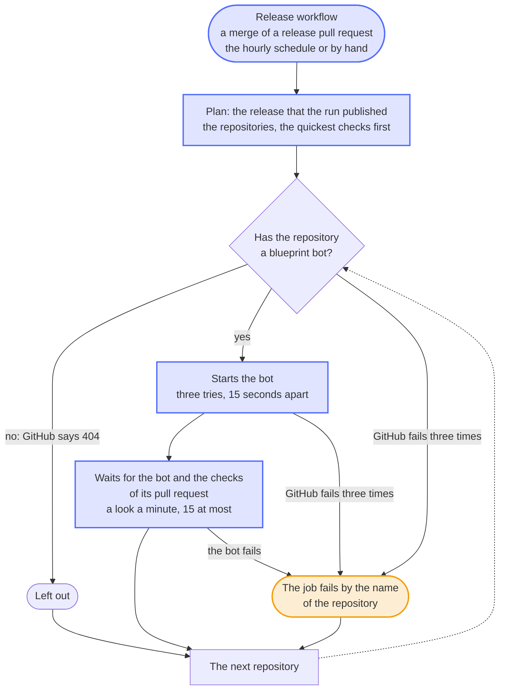

# Roll out each release one repository at a time, and report every repository that misses it

- Status: accepted
- Date: 2026-10-13

## Context

[0002](0002-copier-and-an-update-bot.md) brings the releases of the blueprint to every repository with the weekly run of its blueprint bot, and since 0.9.0 the Rollout workflow starts the bots right after a release. It started all of them in one loop. Three things went wrong with it:

- One repository whose bot GitHub didn't start, with a server error or a workflow that GitHub had switched off, ended the loop: the repositories after it in the list got nothing, and the run failed without naming them. A server error or an exhausted rate limit in the look for a repository's bot counted as "no bot", so that repository was left out without a word, and the run stayed green; the account ran out of requests several times on 2026-10-12.
- It rolled out only a release made by the run for the merge of its release pull request, and only while that merge was still the newest commit. Since every run of the Release workflow signs and releases what a lost run left behind, a release finished by the hourly run or by a run started by hand to take up a draft never rolled out. Every other merge started a runner only for the Rollout to find that nothing was released.
- Five update pull requests of 23 to 30 jobs each, and the end-to-end tests of ha-autodarts, came at the same moment to an account with 20 runners. In the rollouts of 2026-10-12, the account sat at its limit for a quarter to half of the time, the update pull request of issue-assistant took 229 to 456 seconds instead of 71 to 79, and nobody else's pull request got a runner meanwhile.

## Options

1. Keep the loop, guard each start, and collect the failures. It fixes the first point, but every pull request still comes at once, and one job of an hour or more outlives the token of the release app, which GitHub limits to an hour.
2. Start the bots one after the other with a fixed pause, four minutes for example. Simple, but it waits too long for a quick repository and too short for a slow one.
3. One job for each repository, one after the other, each with a token of its own: it starts the bot, waits for it, and waits for the checks of its update pull request before the next repository starts, up to 15 minutes.

## Decision

Option 3. A first job finds the release: the one that the run of the Release workflow published, whatever started that run, which the run's job *publish the release* tells; started by hand, the latest one. It lists the repositories of the release app, the quickest checks first, as a list in the workflow says: dennis-otto.github.io, issue-assistant, the two Nextcloud apps, and ha-autodarts with the longest checks last, since no repository waits for the last one. A repository that the list doesn't name goes first, as a new one has few checks yet.

Then a job for each repository, in that order, one at a time and all of them, also after one that failed. Its token of the release app is for that repository alone and can start workflows and read, nothing else. Only GitHub's answer that the workflow of the bot doesn't exist leaves a repository out; any other answer, and a start that fails three times 15 seconds apart, fails the job by the name of the repository. Then the job waits for the bot, whose failure fails it too, and, except for the last repository, for the checks of the update pull request, with a look every minute and 15 looks at most for both together. Failed checks wait for the maintainer, not for the rollout.

Only a run of the Release workflow that can have made a release starts a runner: the run for the merge of a release pull request, whose commit starts with the title `chore: release x.y.z`, and every run on the hourly schedule or started by hand.

## Consequences

A failure in one repository no longer holds up the others, and the run fails by the names of the repositories that missed the release, in its annotations and its summary. Each update pull request gets the runners of the account to itself, so it merges in about the time its checks take, and the pull requests of people keep runners free during a rollout. The whole rollout takes longer, up to about 15 minutes for each repository but the last; a repository that a later release reaches meanwhile takes that one, as its bot always updates to the latest release. A release that the run of a later merge made, because the run of its own merge was lost, starts no rollout: start the Rollout by hand, or the weekly run of the bots brings it. A new repository of the release app needs no change of the rollout, but belongs in its list once its checks are known. The Rollout reads the job *publish the release* of the Release workflow by its name, which a test keeps.
