# Every download tries again, the checks cache what they download, and the CI skips no check for an unreachable server

- Status: accepted
- Date: 2026-10-13

## Context

The workflows download tools that no package manager brings: krankerl, which packages a Nextcloud app, Infection, gitsign, the certificate of an app and the server of Nextcloud that signs it. They used `curl --fail` without trying again. On 2026-10-12, GitHub answered a download of krankerl with a 504 for a moment, the checks of a Nextcloud app failed on `main`, and the flaky-test bot reported a flaky test that wasn't one (Dennis-Otto/paperless-unified-search#94); the second attempt passed unchanged. The same error in the isolated build of a release leaves a draft that a maintainer has to finish by hand. Scorecard and release-please met other 5xx answers of GitHub the same day.

The opposite also happened: when the schema of the App Store was out of reach, `scripts/check.sh` passed its check of `appinfo/info.xml` with "the CI checks it", and in the CI, which runs the same script, nothing else did.

## Options

1. Run the failed jobs again, by hand or by the flaky-test bot. It costs a full run, and a release can't simply run again.
2. One helper script for every download. A workflow would need a checkout of its own for it, and a release would run code from the repository in the job that holds the signing key.
3. The options of curl that try again, in every download, with a test that keeps them there; a cache for the tools of the checks; and a CI that fails a check it can't make.

## Decision

Option 3. Every download in the workflows and scripts runs `curl --fail --retry 5 --retry-all-errors --connect-timeout 15 --max-time 300 --output FILE`: every error, a reset connection too, brings another try, after a pause that doubles each time (1, 2, 4, 8 and 16 seconds, or what the server asks for); a connection that hangs fails and tries again instead of holding the job until its time limit; and the download goes into a file, which curl empties before it tries again, where in a pipe the start of a broken try would stay in front of the next. Every tool is still checked against its pinned checksum. Uploads, such as a release in the App Store, try again only where the API takes a second one without harm. `test_every_download_tries_again_after_a_passing_error` holds the blueprint and every kind of project to this.

The checks of a Nextcloud app keep krankerl in the cache of GitHub Actions, under a key of its version and checksum, and check the checksum of the cached package too. GitHub saves the cache only after a run that passed. A release builds without any cache, so that nothing a pull request saved can reach a signed package.

<picture>
  <source media="(prefers-color-scheme: dark)" srcset="../images/diagrams/how-the-checks-of-a-nextcloud-app-get-krankerl.dark.svg">
  
</picture>

`scripts/check.sh` still passes a check that needs a server out of reach on a computer of a developer, and says that the CI makes it. In the CI, where `CI` is set, such a check fails and says to run it again later, because no other check would follow.

## Consequences

A passing error of a server costs a few seconds instead of a failed run, and most runs of the checks of a Nextcloud app no longer download krankerl at all. A download that fails for good, such as a wrong address, now fails after about half a minute of tries instead of at once. A check of the CI can fail while the App Store is down; it passes when it runs again. A new download in a workflow or a script needs the same options, which the test asks for.
