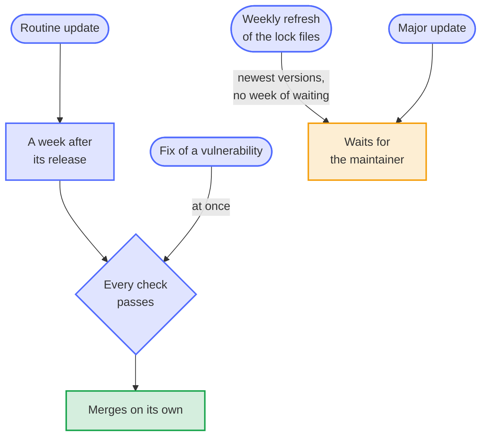

# Refresh every lock file once a week, and let the refresh wait for the maintainer

- Status: accepted
- Date: 2026-10-13

## Context

Renovate waits a week after a release before it proposes the update of a dependency ([0005](0005-renovate-instead-of-dependabot.md)), so that a version published from a hijacked account is usually found and withdrawn before it reaches a repository. The weekly refresh of the lock files bypassed that week: it resolves every indirect dependency again to its newest version, has no release date for Renovate to wait for, and merged on its own once every check passed. On 2026-10-12, pull request #124 brought pydantic 2.14.1, uploaded less than 17 hours before, with five more packages younger than a week; release 0.9.1 took them to every repository, where the blueprint bot installs Copier from that lock file in the job that holds the token of the release app.

The refresh ran only for the lock files of `pip-compile`, whose manager switches it on by itself; `composer.lock` and `package-lock.json` moved only with a direct dependency. And Renovate silently skipped two of the seven lock files of the blueprint, the one of mutmut since it came on 2026-10-08 and the test tools of the Home Assistant integrations since 2026-10-12, because it couldn't read the command in their headers: `--python-version 3.14.8` without the `=` before the value, and `--unsafe-package`, an option of `pip-compile` that Renovate doesn't know. The validator of the rules reads no lock file, so nothing noticed.

## Options

1. As before: the refresh merges on its own.
2. A cooldown in the package managers: `UV_EXCLUDE_NEWER` and `PIP_UPLOADED_PRIOR_TO` set to a week, through Renovate's `env` on the rule of the refresh. Renovate 44 reads `env` for the whole repository only, not in a rule (`setUserEnv` in `lib/workers/repository/init/merge.ts`), so the cooldown would apply to every update and hold back the fixes of vulnerabilities, which come at once; Composer has no cooldown at all.
3. The refresh for every package manager, but it waits for the maintainer, who sees every new version in its diff.
4. A check in the pull request of the refresh that every new version is at least a week old, after which the refresh may merge on its own again.

## Decision

Option 3 now, and option 4 once the check exists. Every package manager refreshes its lock files once a week, in the same window as the other updates; the pull request of the refresh waits for the maintainer, whose review of its diff sees every new version. The two lock files that Renovate skipped are compiled again with `uv pip compile` and an `=` before every value, and the one of mutmut leaves out the pytest of the project with `--no-emit-package=`, which Renovate allows for `uv`. Two checks keep every lock file readable: a test that reads the header of each lock file of the blueprint and of every kind of project as Renovate does, and the job `renovate rules` of the Renovate workflow, in which Renovate itself reads every file of a pull request that changes its rules or a lock file, and which fails on a warning or a lock file that it skips.

## Consequences

A repository gets one or two pull requests of the refresh a week that wait for a review, also for `composer.lock` and `package-lock.json`, which moved only with their direct dependencies before. A lock file that Renovate can't read fails a check in the pull request that changes it, instead of a warning in the log of the bot. A project that compiles a lock file of its own makes sure that Renovate reads its header: options with a value need the `=`, and an option that Renovate doesn't know makes it skip the file.
