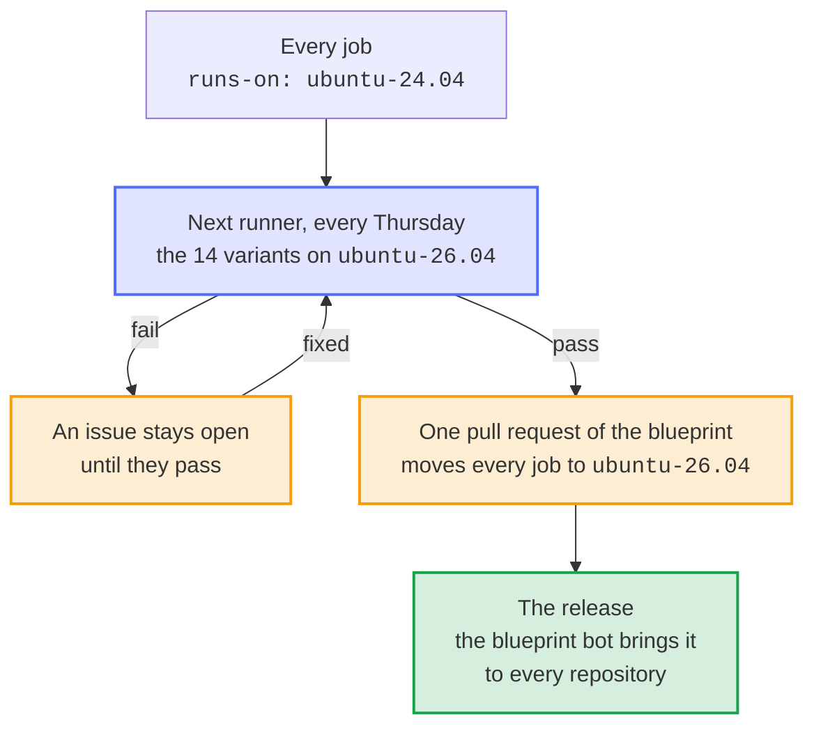

# Name the runner with its version, and try the next one every week before the jobs move

- Status: accepted
- Date: 2026-10-13

## Context

Every job of the blueprint's workflows, and so of every repository made from it, ran on `ubuntu-latest`. GitHub moves that label from Ubuntu 24.04 to Ubuntu 26.04 between 2026-10-19 and 2026-11-19, one job at a time ([actions/runner-images#14748](https://github.com/actions/runner-images/issues/14748)), and every run carried the annotation that says so. For a month, the runs of one workflow would land on either image at random. The new image changes what the jobs take from it rather than set up themselves: `python3` is 3.14 instead of 3.12 in the steps that run `blueprint.py` without setup-python, ShellCheck 0.11 instead of 0.9, Docker 29 instead of 28 and Compose 5 instead of 2. A failure that only the new image causes would come and go like a flaky test, in required checks and in releases of all the repositories, and the flaky-test bot would report it as one.

Renovate leaves the runners alone (its `github-runners` updates are off in `.github/renovate-blueprint.json5`), because the workflows belong to the blueprint: an update of Renovate in a repository would be overwritten by the next update of the blueprint.

## Options

1. Stay on `ubuntu-latest` and fix what breaks as it comes. Nothing to keep current, but a month of failures at random in every repository, without warning, and the same again with each new image.
2. Name `ubuntu-24.04` and nothing else. The jobs stay on the image they pass on, but the later move is a step into the unknown, and it waits until someone remembers it.
3. Name `ubuntu-24.04`, and run the Variants on the next runner every week. The move is one pull request of the blueprint, made when the checks of every kind of project pass there.
4. Let Renovate move the runners. It would open the move in each repository on its own, in files that the blueprint owns, without knowing whether the checks pass on the new image.

## Decision

Option 3. Every job names `ubuntu-24.04`, the checks on Windows name `windows-2025`, and `test_every_job_runs_on_a_runner_named_with_its_version` keeps it so in the blueprint and in every kind of project. The Next runner workflow calls the Variants every Thursday with the runner `ubuntu-26.04`: all 14 legs, each kind of project new and updated from the latest release, with their real tools, the same that a pull request of the move would run. A failure keeps one issue open until a run passes again. The Variants also take a runner when they are started by hand.

Two kinds of jobs keep the runner that others name. The issue assistant's templates (`issue-assistant.yml`, `issue-lifecycle.yml`, `labels.yml` and `findings.yml`) must stay equal to those of the issue assistant, whose check compares them byte for byte, so their runners change in [Dennis-Otto/issue-assistant](https://github.com/Dennis-Otto/issue-assistant) and reach the blueprint with its templates. The reusable workflows of OSV-Scanner name their own runner; they run the image of OSV-Scanner, which doesn't depend on the tools of the runner.

## Consequences

GitHub's move of `ubuntu-latest` reaches none of these jobs, and what the next image breaks shows in one place, the issue of the Next runner workflow, before any job moves. The move itself is one pull request: it replaces `ubuntu-24.04` in the workflows, `RUNNER` in `tests/test_template.py` and the options of the Variants, and names the runner after it in the Next runner workflow, or turns that workflow off until GitHub offers one. Its release brings the move to every repository. The run costs 14 jobs once a week, at an hour without the other weekly runs of the blueprint. A workflow that a project owns, which an update leaves alone, keeps the runner it names, and the changelog says how to name the version there too. GitHub retires an image with months of notice and brownouts first; the move must happen before.
