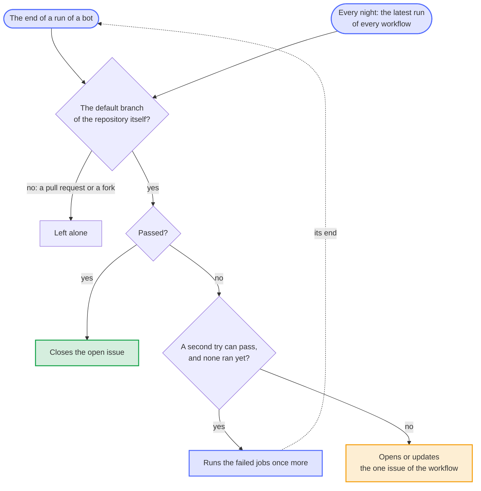

# A bot that fails keeps one issue open until it passes again

- Status: accepted
- Date: 2026-10-13

## Context

GitHub mails the failure of a scheduled run only to whoever last changed its schedule, and the failure of another run to whoever started it. In the repositories of the blueprint, the release app starts most runs on `main` and changed many schedules in the commits of the blueprint bot, so a failure often reaches no person: on 2026-10-12, 60 of 60 runs on `main` of paperless-sync had the release app as their actor. Findings failed every day from 2026-10-12, Mutation since it came, and Renovate skipped two lock files for days with no more than a warning in a run that passed; each showed only in the Actions tab and as a cell on the dashboard. The weekly report counts failed runs without saying which. Only the link check, Newest Python, the Next runner and the flaky-test bot kept an issue.

GitHub also runs a schedule late or not at all at busy times, and switches the schedules of a public repository off after 60 days without activity; a run that never starts fails nothing.

## Options

1. As before: the Actions tab, the dashboard and the weekly report.
2. A step at the end of every workflow that reports its own failure. Every workflow would need it, a project's own ones too, and a step can't report a run that GitHub couldn't start or that never ran.
3. One workflow that starts when a run of a bot ends, on `workflow_run`, and keeps one issue per workflow: open while it fails, closed when it passes again. A nightly look at the latest run of every workflow covers what the events can't: the checks that also run in pull requests, the workflows of a project, an event that GitHub lost, and a schedule that GitHub missed.
4. A service outside GitHub that watches the runs. The blueprint uses GitHub Actions and the apps it has, nothing else.

## Decision

Option 3, in `bot-health.yml` with the logic in `blueprint.py bot-health`, tested like the rest of the tool. A run counts when it ran on the default branch of the repository itself and not for a pull request, so that no pull request and no fork can open, update or close an issue. GitHub gives a run that the end of a check of a pull request starts, such as one of After the checks, the default branch as well: the nightly look counts only the other runs of such a workflow, and a listed one, such as Findings after CodeQL, skips those runs in its jobs. Before a failure becomes an issue, its failed jobs run once more, as the flaky-test bot does for the tests, if a second try can pass at all: Findings fails while an alert is open, Mutation measures the same again in hours, and the property tests and the fuzzing failed on an input that they found, so these are reported at once. The issue names the failed jobs, their steps and their first errors, so that it says what broke without a click; a later failure in the same place updates it without a notification, and one in another place adds a comment. The bot keeps its state in a comment in the body of the issue, not in a file or a cache, so a person who closes the issue resets it.

The `workflows` list of `workflow_run` names the bots, whose runs are the default branch's anyway; a workflow that runs for every pull request, such as the CI, would start a run of the bot for each of them. Those come into the nightly look instead, with the workflows of a project, which the list of the blueprint can't name. The nightly look starts a workflow whose latest schedule passed six hours ago without a run, at most four a night, and switches a schedule on again that GitHub switched off.

Renovate runs once for every repository, in the blueprint, and logs problems such as a lock file that it can't read as warnings in a run that passes. Its workflow writes the warnings and errors of each run to a file of their own and keeps one issue in the blueprint with those of the latest run that had any. It closes the issue after three runs in a row without a problem, not after the first, because Renovate runs every two hours and a problem of a registry can come and go. The issue is public, so it names public repositories only.

## Consequences

A failure of a bot reaches the maintainer as an issue within minutes, or within a night for the checks of `main` and the workflows of a project, and a fixed bot closes its issue on its own. Each end of a run of a listed bot on the default branch starts a short job, also for a run that passed, so that the issue closes at once. A project that wants a workflow of its own watched at once rather than every night needs it in the list of the blueprint. The label `bot-failure` comes from the bot where a project's own `.github/labels.toml` lacks it. A transient failure costs a second run of the failed jobs, never more than one. Should the end of a run and the nightly look open an issue for the same workflow at the same moment, the next run of the bot closes the older one with a link to the newer one.
