# Show every diagram as a picture drawn from its Mermaid source, because the GitHub app draws no Mermaid

- Status: accepted
- Date: 2026-10-13

## Context

The documentation of the blueprint and of every repository made from it explains with diagrams: 26 in the blueprint, about 81 in the five repositories. They were Mermaid in a `mermaid` block of the Markdown, which github.com and the website draw. The GitHub app for iOS and Android doesn't: it shows the source as code, as a screenshot of the README of paperless-unified-search in the iOS app showed on 2026-10-13. Neither do the other places where a README is read: HACS, the Nextcloud App Store, PyPI, the GitHub Marketplace, the notification e-mails and editors without an extension for Mermaid. Every renderer of Markdown shows a picture.

## Options

1. Keep the `mermaid` blocks. Nothing to do, and the readers outside github.com go on seeing code.
2. Pictures drawn by hand, or exported from an editor. They show everywhere, but nothing keeps them in step with what they explain, a second language doubles the work, and a review sees only that a binary changed.
3. The Mermaid source in a file of its own, and pictures that a script draws from it with the official mermaid-cli, checked in the CI and committed by a bot.
4. A service that draws Mermaid on request, such as mermaid.ink, linked as an image. The pictures follow the source, but every reader asks a service outside GitHub, and the README breaks when it is down.

## Decision

Option 3. A diagram is a source in `docs/diagrams/<name>.mmd`, `<name>.de.mmd` for a German page. `scripts/diagrams.sh`, which the blueprint keeps current in every repository, draws it in the image of mermaid-cli, pinned by its digest, which Renovate keeps current, as `docs/images/diagrams/<name>.svg` on a white card and `<name>.dark.svg` on the background of GitHub's dark theme. The Markdown shows them with a `<picture>`, with the title and the description of the diagram, `accTitle` and `accDescr`, as the text for screen readers.

<picture>
  <source media="(prefers-color-scheme: dark)" srcset="../images/diagrams/how-a-diagram-reaches-every-reader.dark.svg">
  
</picture>

- **Pictures that every renderer shows:** the labels are SVG text, not HTML in a `foreignObject`, which many renderers of pictures leave out. So a label breaks a line with ` ` alone, and a label in `` "`…`" `` takes `**bold**` and `*italic*`. The labels are measured with DejaVu Sans, which is wider than the fonts that readers have before it in the list, so that every label fits its box. The light picture has an opaque card, so that it stays readable where an app shows it on a dark background.
- **The same pictures every time:** the container has no network, the shapes with curves get a fixed seed, and the coordinates are rounded to hundredths, so that drawing again changes nothing and a review sees only the diagrams that changed.
- **The website draws the source:** the hook in `.github/mkdocs_blueprint.py` puts the live Mermaid of the source in place of each picture, in the colors of the theme that the reader switches to, sharp at every size and with text to search.
- **Checks:** `scripts/check.sh` checks without Docker that no `mermaid` block is left once a page shows a picture of a diagram, that every source has both pictures, and that every picture has its source. The required check *diagrams* of the Lint workflow runs `scripts/diagrams.sh --extract` on the head of a pull request that changes a diagram or adds a `mermaid` block, and fails when that changes a file; any other pull request passes at once, without the large image.
- **Fix first, explain second:** for a pull request from a branch of the repository, the diagram bot, a job of After the checks, commits what the check changed onto the branch, as the release app, so that its checks run again, and names the pages whose blocks became pictures in one comment. It runs no code of the pull request: `blueprint.py` of `main` takes only sources, SVG pictures and pages of Markdown, by plain paths, from the artifact of the check, deletes only pictures, and commits only onto the commit that the check drew. A pull request from a fork keeps the failing check, whose summary lists the files and the command, and whose run holds them as its artifact. A new version of mermaid-cli from Renovate is drawn on its branch the same way.
- **`main` heals itself:** after every change of `main` that touches a page or a diagram, and every week, the Diagrams workflow draws every diagram of `main` without secrets; after a change that touches no diagram and not the renderer, it only looks for a new `mermaid` block, without Docker, because the check of the pull request drew the rest. When a file changes, such as the blocks of a repository right after the update that brings this, or after a merge that went around the check, a second job keeps one pull request from `bot/diagrams` with the fix, which merges itself, and closes it when `main` is fixed otherwise. It makes each new commit on a branch of its own and then moves `bot/diagrams` to it, because GitHub closes a pull request whose head is a commit of `main`. A failed run opens an issue, which the weekly run closes once the bot passes again.
- **Moving existing diagrams:** `bash scripts/diagrams.sh --extract` turns every `mermaid` block into a source, named after its `accTitle`, or after the diagram at the same place of the English page with `.de`, and its picture, and then draws them. A diagram without `accTitle` takes the heading above it for its name, and the heading and the labels of its nodes for the text of its picture, so that a migration that merges itself still says what each picture shows. A `mermaid` block is only a warning until a page of a repository shows a picture of a diagram, so that the update of the blueprint passes before its diagrams moved. Until then, the checks leave the sources in `docs/diagrams/` alone, because a repository may already draw its own there in its own way.

## Consequences

Every reader sees the diagrams, in the app and in every store, and the website keeps its live diagrams. A change of a diagram is a change of its source, which a review reads as text, and the pictures follow by themselves on a branch of the repository. Drawing them needs Docker and pulls an image of about 2.4 GB, so the check draws only in a pull request that changes a diagram, and a contributor without Docker leaves it to the bot. The repositories made from the blueprint move their diagrams without a person: after the update that brings this, the Diagrams workflow opens the pull request that does it, and `bash scripts/diagrams.sh --extract` does the same by hand. The convention of the colors and of `accTitle` and `accDescr` stays as CONTRIBUTING.md describes it. A picture is a path from its page, which github.com and the GitHub app follow; HACS and PyPI show a README outside of the repository and don't, so a README published there needs absolute links to its pictures, which the checks and the hook of the website accept as well.
