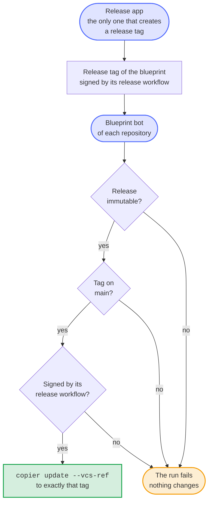

# Update only to a release that the release workflow made, and let only the release app create release tags

- Status: accepted
- Date: 2026-10-13

## Context

[0002](0002-copier-and-an-update-bot.md) brings every release of the blueprint to every repository made from it: the blueprint bot of each repository runs `copier update` to the latest published release, and an update without conflicts merges itself once the checks of that repository pass. Those checks run the workflows that the update brings, so whoever decides what the latest release is decides what runs on `main` of every repository, with the private key of the release app.

The bot took the latest published release as it was. The ruleset of the release tags blocked their update and deletion, but not their creation, and had no list of who may bypass it. Any token that may push to the blueprint could create the tag of a new version at a commit of its own: the job token with `contents: write` of a job that runs a third-party action, such as release-please, or a leaked token of the release app or of Renovate. A release published on such a tag would have reached every repository within the hour of the next Rollout. The release workflow signs every tag without a key (gitsign) and builds no release on a tag that it didn't sign, but only the blueprint checked that, and only for its own releases.

## Options

1. Trust GitHub: the release workflow publishes the releases, and only the maintainer can change it. It leaves the gap open: any token that can create a tag and a release is enough.
2. Pin every repository to a commit of the blueprint and update the pin by hand. Safe, but every release would need a pull request in every repository, which [0002](0002-copier-and-an-update-bot.md) set out to avoid.
3. Let the bot of each repository verify a release before it updates to it, the way its users can, and let only the release app create release tags.

## Decision

Option 3, in two parts.

Before `copier update`, the blueprint bot verifies the latest published release of its source, the blueprint or a fork of it that `.copier-answers.yml` names. The release must be immutable; its tag must point at a commit that is on `main` of the source, so that the comparison of that commit with `main` says `identical` or `ahead`; and the tag must be an annotated tag that the release workflow of the source, `.github/workflows/release.yml` on `refs/heads/main`, signed with gitsign. The check is the one with which the release workflow checks its own tags, `.github/sign-tag.sh verify`, given the source as the repository; it downloads gitsign pinned by version and checksum. Any other release fails the run before Copier renders anything, with the reason as an annotation and in the summary of the run, which says what it means and what to do; a question that GitHub or Sigstore leaves unanswered three times, or a gitsign that can't be downloaded, fails the run as well, but refuses nothing, and the next run asks again. The source is the repository on GitHub as GitHub spells its name, which the signature of the tag names; a source elsewhere can't be verified, and the bot doesn't update from it. Otherwise Copier updates to exactly the verified tag with `--vcs-ref`.

The settings bot adds a ruleset *Release tag creation* that blocks the creation of `v*.*.*` tags for everyone but the release app, whose App ID the variable `RELEASE_AUTOMATION_APP_ID` of `.github/repository.toml` names. It is a ruleset of its own, next to *Release tags*, which keeps blocking every update and deletion without any exception: the app may create a release tag, but like everyone else never move or delete one. Every path that creates a release tag already runs with the token of the app: `.github/sign-tag.sh` for the tags of releases and of betas, and release-please only creates a release on a tag that the workflow signed before. A repository whose settings name no App ID keeps the rules it had, and taking the App ID out of the settings deletes the ruleset again, so a pull request undoes it.

## Consequences

A tag that someone else pushed reaches no repository, and a release of the blueprint that its release workflow didn't make fails the bots of every repository by name, where the maintainer sees it. The job tokens of the workflows, and every token but the app's, can no longer create a release tag at all. The private key of the release app could still create one, but only the release workflow on `main` can sign it as the bot demands, so the key alone reaches no repository either; such a tag only blocks the version it names, since nobody may delete it.

The bot needs the network of Sigstore and GitHub for every update, and an outage of either holds the update back until the next run; the checks try again before they fail. A fork of the blueprint must sign its tags with its own release workflow, as the blueprint does, or its repositories don't update. The update that brings this release still runs the bot before it, which doesn't verify; every update after it does. The App ID is the one of the blueprint's release app, like its Client ID; a project that uses an app of its own sets both variables to that app in its `.github/repository.project.toml`, or its releases can't create their tags.
