# Cache what a check can verify, never a finding

- Status: accepted
- Date: 2026-10-13

## Context

`check (php)`, the required check of every Nextcloud app, took 75 to 90 seconds, and is the longest required check of a pull request that changes only documents or workflows once the end-to-end tests skip those. More than half of it were Psalm and its taint analysis, 23 seconds each in paperless-sync and 22 in paperless-unified-search: `psalm.xml` listed all of `vendor/` under `extraFiles`, so both runs read about 5,000 files of Psalm, PHPUnit and php-cs-fixer before they looked at the 13 to 22 files of the app. Every run also downloaded the same locked packages again: Composer's in the checks, pip's for the website in two jobs, npm's for the hints at the spelling. The CI of Python, Node, Home Assistant and GitHub Actions already kept their downloads in the cache of GitHub Actions, and [0011](0011-downloads-try-again-and-checks-cache-their-tools.md) did the same for krankerl.

A cache makes a check faster, and a wrong one makes it pass wrongly. Psalm's own cache keeps what it found in each file, and a change elsewhere, such as an update of a dependency, can leave a finding out; the checks have run it with `--no-cache` from the start.

## Options

1. Psalm's own cache in the CI. It saves the most, and a stale entry can hide a finding.
2. Psalm without a cache, but reading ahead only the code that Composer's autoloader can't find; everything else Psalm reads when the code uses it.
3. Option 2, and in the CI a cache for every download that a lock file pins, and for the tools that check every file by the hash of its content.

## Decision

Option 3. A check may start from a cache when it verifies what comes out of it:

- **Downloads,** under a key of the lock file that pins them, with the cache of the last lock file as a start after a change: Composer's packages, pip's packages for the website, which pip checks against their hashes from the cache too, and npm's for the spelling hints, which npm checks against the integrity of the lock file.
- **Work checked by content:** php-cs-fixer skips a file whose content has the hash that its cache knows as clean, and reads a cache only of its own version, rules and PHP. It stores the hash of the content as it should be, so a file that breaks the standard fails in every run, with the cache or without it.
- **Never a finding:** Psalm and its taint analysis run without a cache. `extraFiles` lists only `vendor/nextcloud/ocp`, the public API of Nextcloud, whose package has no autoloader; Psalm finds every other class through Composer's when the code uses it. A test keeps the list equal to the packages of `composer.lock` without an autoloader.

<picture>
  <source media="(prefers-color-scheme: dark)" srcset="../images/diagrams/what-the-checks-of-a-nextcloud-app-take-from-a-cache.dark.svg">
  
</picture>

GitHub keeps the cache of a pull request to that pull request: `main`, which publishes the website, starts only from caches of `main`, and a release builds without any cache, as [0011](0011-downloads-try-again-and-checks-cache-their-tools.md) says.

## Consequences

Psalm and its taint analysis take a tenth of the time, 4 to 6 seconds each instead of 37 to 42 for paperless-sync and paperless-unified-search on the same computer, with the same output, findings, share of inferred types and exit code, also for a controller with errors and tainted input; the PHP syntax check runs one PHP for each processor. The second run of a lock file installs from the cache. A package of `composer.lock` that ships code without an autoloader, as `nextcloud/ocp` does, fails the test until `psalm.xml` lists it. A tool that keeps findings in a cache, such as Psalm, stays without one in the CI.
