# Install the tools with uv from a cache of their lock files, and bound every step that installs, builds or downloads

- Status: accepted
- Date: 2026-10-13

## Context

The required checks that finish last spent most of their time on work that was the same in every run:

- **Variants:** a leg for a Home Assistant integration took 180 to 186 seconds. Of these, 62 went into `pip install` of the test tools of Home Assistant, 17 to 19 into the website, whose tools pip installed into a new environment without a cache, 24 to 30 into the validation of the rules of Renovate, and 3 to 11 into the image of the Hadolint action, which GitHub builds at the start of every job that names it. All fourteen legs validated Renovate and built the Hadolint image, though only a container lints a Dockerfile, and an update must give the same rules as a new repository, which its own step compares.
- **The CI of the Python stacks:** `check (home-assistant)` of ha-autodarts took 333 seconds in the median of 20 runs, about 50 of them in `pip install`, even with the cache of pip's downloads; the fuzzing, the property tests, the mutation tests and the dashboard had no cache at all. mypy started without its cache in every run: 21.3 seconds for ha-autodarts instead of 0.7.
- **Time limits:** the jobs had 15 to 30 minutes, and no step had a limit of its own. On 2026-10-12, a build of the website that normally takes 15 to 19 seconds hung, and held a pull request until the Variants ran out of their 30 minutes.

pip keeps the downloads in its cache, but still unpacks and installs every package; uv installs the same hash-pinned lock files from its cache of unpacked packages. Measured in Docker with four processors: the test tools of Home Assistant took pip 82.5 seconds without a cache and 54.1 with one, uv 27.6 without and 3.3 with one; the tools of the website 10.4 with pip, 0.6 with uv and its cache.

## Options

1. Keep pip with the cache of its downloads, and raise nothing. The slowest part, the installation, stays.
2. uv instead of pip in the CI, with its cache in the cache of GitHub Actions under a key of the lock files, the same lock files with their hashes, and the cache of mypy; Hadolint as an image that only the container pulls, Renovate validated once for each kind, and a limit for each step that installs, builds or downloads.
3. Option 2 with lock files of uv (`uv.lock`) instead of `requirements-*.txt`. It changes the files of every Python project and how Renovate keeps them; it is a change of its own.

## Decision

Option 2.

- **uv:** after setup-python, which keeps setting up the Python of `.python-version`, `astral-sh/setup-uv` sets up the uv that the workflow names, which Renovate keeps current, and restores its cache. The key is the hash of the lock files that the job installs, so that a change of them starts a new cache; the Variants keep one cache for each kind, which both of its legs share. `uv pip install --system --require-hashes -r …` installs every tool as pip did, and checks the hash of each package, also of one from the cache. The website of the Variants gets its own environment with `uv venv`. Locally, `pip install --require-hashes -r …` works as before.
- **mypy:** the CI restores `.mypy_cache` from the last run that passed with the same lock files, its own when no Python file changed. mypy checks a module from its cache again when it or a module that it uses changed, and keeps no module with an error, so the cache hides no finding; `test_mypy_keeps_no_finding_in_its_cache` keeps that, as [0017](0017-cache-what-a-check-can-verify-never-a-finding.md) asks of every cache.
- **Hadolint** runs in its image by tag and digest, which Renovate keeps current, in the step of the container alone, with the problem matcher of its action for the annotations and the `.hadolint.yaml` of the project.
- **Renovate** validates the rules of every kind in its new repository; the update gives the same rules of the blueprint, which its step compares, and keeps the project's own.
- **Time limits:** each job ends after a few times its longest run, the Variants after 10 minutes, `check (python)` and `check (github-action)` after 8 and `check (home-assistant)` after 15, and each step that installs, builds or downloads after five minutes. The flaky-test bot runs a job that ran out of time once more.

<picture>
  <source media="(prefers-color-scheme: dark)" srcset="../images/diagrams/how-a-job-of-the-ci-gets-its-tools.dark.svg">
  
</picture>

GitHub saves a cache only after a run that passed, keeps the caches of a pull request to that pull request, and lets `main` start only from caches of `main`. A release still builds without any cache, as [0011](0011-downloads-try-again-and-checks-cache-their-tools.md) says.

## Consequences

The installation of the test tools of Home Assistant takes seconds instead of a minute, the website of each variant installs its tools from the cache, and the update legs no longer validate Renovate; no leg builds the image of Hadolint. A step that hangs fails after five minutes instead of holding a pull request for half an hour, and a job that runs much longer than usual fails earlier, so a project whose checks grow far beyond them needs higher limits. The caches of uv count against the 10 GB that GitHub keeps for each repository; the clean-up removes those of closed pull requests every week. A new install, build or download in these workflows needs uv, its cache and a limit, which `tests/test_template.py` asks for.
