# Build the website once, in the job of the check, and keep the downloads of Material for a week

- Status: accepted
- Date: 2026-10-14

## Context

Every website of the blueprint comes from the Docs workflow. Measured in dennis-otto.github.io, whose only product is its website:

- **Three jobs on main.** On `main`, the job `docs` only decided whether to publish; a second job checked out, installed and built the website again, and a third one published it. Each job waited for a runner of its own: from the push to the live website took about 170 seconds in the median and 981 seconds at worst, where the three jobs waited 371, 286 and 251 seconds for their runners.
- **No cache of the downloads.** The privacy and social plugins of Material download about 32 fonts and scripts in every build. A build took 8.8 seconds with an empty `.cache` and 1.5 seconds with a warm one of 14 MB.
- **The downloads are what fails.** They are why `.github/mkdocs_blueprint.py` tries a download again, and a hiccup of Google Fonts failed a required check that no bot runs again.
- **No dot folders.** `actions/upload-pages-artifact` leaves out every file and folder whose name starts with a dot unless `include-hidden-files` is true, so no file that a hook writes into `site/.well-known/`, such as `security.txt`, could reach the website.

## Options

1. Keep the three jobs, and add a cache to both builds. The website is still built twice on `main`, and each job still waits for its runner.
2. One job, `docs`, builds the website in every run and, on `main`, hands the website that it built to GitHub Pages; a second job publishes it. Material's downloads come from a cache of the ISO week, as [the documentation of Material](https://squidfunk.github.io/mkdocs-material/publishing-your-site/#with-github-actions) recommends.
3. Option 2 with a cache that lives until the configuration changes. A font or a script that changed upstream would stay old for months.

## Decision

Option 2.

- **One build.** The job `docs`, whose name the required check keeps, builds the website strictly in every run that finds one. Where GitHub Pages publishes from the workflow, a run on `main` then hands the folder `site` to GitHub Pages with `include-hidden-files: true`, which still leaves out `.git` and `.github`, and the job `publish the website` publishes it. Handing it over needs no permission, so the job of the check still only reads. Where another workflow publishes GitHub Pages, as the Dashboard of the blueprint does, a run on `main` only builds the website, as before.
- **The cache of the week.** Before the build, the job restores `.cache` under the key `mkdocs-material-<ISO year>-<ISO week>-<hash of mkdocs.yml, .github/mkdocs-blueprint.yml and the lock file of the tools>`, or else the latest cache of the same week. The first run of a week downloads everything anew, so no file is older than a week. Every build drops the badges and pictures from the cache before it starts and keeps only fonts, stylesheets and scripts: the privacy plugin never downloads a file again that it has, and a status badge must show the state of now, not the one of Monday.
- **Saved from a push alone.** After the build, a push saves the cache once for each key. A cache of a pull request would stay with its branch anyway, and `main` starts only from caches of `main`, so a pull request can't put a file into the website of `main`.

<picture>
  <source media="(prefers-color-scheme: dark)" srcset="../images/diagrams/how-the-website-reaches-github-pages.dark.svg">
  
</picture>

The cache holds what the build downloads, never a finding: the strict build checks every page anew in each run, as [0017](0017-cache-what-a-check-can-verify-never-a-finding.md) asks of every cache.

## Consequences

A push to `main` reaches the website with two jobs instead of three, and the website that GitHub Pages publishes is the one that the check passed. From the second run of a week on, the build takes about 1.5 seconds instead of 9 and downloads nothing, so a hiccup of Google Fonts fails fewer checks. A file that a hook writes into `site/.well-known/`, such as `security.txt`, reaches the website; a file in `docs/.well-known/` needs `exclude_docs: '!.well-known/'` in `mkdocs.yml` as well, since MkDocs leaves out every file of `docs/` whose name starts with a dot. A font or a script that changed upstream reaches the website at the latest a week later. `tests/test_template.py` keeps the two jobs, the key of the week and the files with a dot.
