# A card of the website waits for the job of its layer, and a build that hangs says where

- Status: accepted
- Date: 2026-10-31

## Context

From 2026-10-13 to 2026-10-26, the step *Build the website of the project* of the Variants hung seven times until its five minutes ended, each time without an error. [0061](0061-a-download-that-hangs-ends-and-starts-again.md) took that for a download of the social plugin of Material with no time limit and gave every download one. Two of the seven came after that, so it wasn't the cause, or not all of it: the flaky-test bot wrote them into [issue 179](https://github.com/Dennis-Otto/repo-blueprint/issues/179) and [issue 491](https://github.com/Dennis-Otto/repo-blueprint/issues/491).

All seven logs end with the same line, the last of about 30 fonts that the privacy plugin downloads one after the other. A download that hangs would end a log at any of them. Whatever hung came after the last one, and a log says nothing about what it was.

So the generic project ran with the real tools of the website in a container without a network, over and over, with the cards of the last build removed. With 31 threads for the cards, as the 32 processors of that machine make it, six loops hung after 22, 60, 66, 85, 174 and 204 builds; with 3 threads, as the 4 processors of a runner of GitHub make it, three loops hung after 3, 94 and 151 builds. The stacks of the threads stood each time at the same two places: a thread of a card in `_generate` of `material/plugins/social/plugin.py`, at `self.card_layer_pool_jobs[h].result()`, and the build in `on_post_page`, waiting for that card. No network was there to wait for.

The plugin (Material 9.7.7) draws the layers of its cards in threads, and to start each layer once, it first puts an empty `Future` under the key of the layer with `setdefault`, and then replaces it with the job that `submit` returns. A second card that needs the same layer in between gets the placeholder, and nothing ever finishes that. Starting a job can start a thread, which lets the other threads run just then, and every card shares layers such as its background. Only the CI draws cards, so a local build never hung.

<picture>
  <source media="(prefers-color-scheme: dark)" srcset="../images/diagrams/how-a-card-waited-for-a-layer-that-nobody-finishes.dark.svg">
  
</picture>

## Options

1. Leave it to the flaky-test bot. Every hang costs a job of up to ten minutes again, in the Variants and in the Docs workflow of every repository.
2. Draw the cards with one thread, `concurrency: 1` in the settings of the plugin. That closes the gap with one line, and draws every card of a website one layer at a time, on a website of hundreds of pages too.
3. Wait for a fix of Material. It belongs there, but every repository keeps hanging until it comes.
4. Close the gap from the hooks of the website, where the retries of [0011](0011-downloads-try-again-and-checks-cache-their-tools.md) already are, and let a build say where it stands before its step ends.

## Decision

Option 4.

- **The placeholder finishes with its job:** the hook gives the plugin a dictionary of its own for these jobs, `Layers` of `.github/mkdocs_blueprint.py`. When a job takes the place of a placeholder, whoever waits for the placeholder gets the picture of the job, its error, or its cancellation. The cards keep their threads.
- **A build that hangs says where:** a build of the website still running after four minutes prints the stack of each of its threads into its log and goes on, with `faulthandler`, before the five minutes of its step end. The stacks cost nothing until then, and seven hangs without them sent the search in the wrong direction.

## Consequences

The same loops, with the hook of this decision, passed 4000 builds with 31 threads and 2000 with 3, without a hang. Tests prove each outcome of the placeholder without a network or Material. It reaches the website of every repository with the next release.

The hook reaches into the plugin: when a version of Material gives the jobs another name, the hook warns with what to look at, which fails the strict build, and Renovate's pull request with it, so that someone looks whether Material closed the gap and changes or removes `Layers`. The time limits of [0061](0061-a-download-that-hangs-ends-and-starts-again.md) stay, since a server that stops answering would hang the social plugin as well.

The other flake of issue 491, the job *keep the pull request of the release*, ended all its steps and then hung in *Cleaning up orphan processes*, which belongs to Harden-Runner, not to this decision.
