# A pull request checks the accessibility of the pages that it changes, and a new violation fails

- Status: accepted
- Date: 2026-11-01

## Context

[Decision 0041](0041-every-website-is-accessible-and-quick-and-a-check-proves-it.md) added the accessibility check to the check *docs*: it opens every page in Chrome, in both schemes, and runs axe-core on it. It was to report for one release, so that every repository could fix its pages, and then to fail. That was v0.13.0; it still only reported at v1.3. Two things came of that:

- **It took most of a required check.** The step took 141 of the 231 seconds of the check *docs* of the blueprint, 121 of 151 on dennis-otto.github.io and 71 of 106 on paperless-unified-search, in every pull request, also in one that changes no page. On the 247 pages of the blueprint, axe-core opens 149 in two schemes.
- **It couldn't fail.** New violations stayed on the websites unseen: the redirect pages of the hub without a title or a language, and contrast on seven elements of homedarts. An annotation of a page without Markdown had no file, so GitHub showed it on the folder `.github`.

The check itself ran only in the CI, with its tests and without any measure of what they cover, while all the Python of the repository needs every line and branch covered.

## Options

For the time:

1. Sample the pages, or check a fixed list. Quick, but a violation on another page stays unseen until it is one of those.
2. Ask git which files in `docs/` changed. It misses what a page takes from elsewhere, such as the parts of the README, the navigation and the hooks, and it would need its own rules for each of them.
3. Compare what was built: the pages that differ from what `main` built, with everything that every page shares as a reason to open them all.

For the gate:

1. Let it fail on everything from one release on. Every repository with a violation turns red, and each needs a person.
2. Fail only on what differs from a list that the check keeps for itself, such as in the digest. Nobody sees or reviews what it accepts.
3. A file of the project that names each accepted violation with its reason, written once by the blueprint for what each website has.

## Decision

Option 3 for both.

<picture>
  <source media="(prefers-color-scheme: dark)" srcset="../images/diagrams/which-pages-the-accessibility-check-opens.dark.svg">
  
</picture>

- **A digest of what was built.** `--write-digest` writes `site-digest.json`: the sha256 of each page without the date of its last change, and of what every page shares: the stylesheets and scripts of the website, `mkdocs.yml`, `.github/mkdocs-blueprint.yml`, `.github/a11y-accepted.toml`, `check.mjs` and the lock file of its tools. Two builds of the same files differ in nothing else, and one changed page changes one digest. A new axe-core may find more on any page, so it opens them all, and a Renovate pull request fails before its update reaches `main`.
- **The cache of `main` holds it.** A push to `main` and the run of each week open every page and save the digest under the commit; a pull request restores the one of the commit it merges into, or else the newest one, which at most opens more pages. A pull request can only read that cache, not write it. When there is no digest, or it has another format, or something shared differs, it opens every page, and the summary says why. So a mistake here costs minutes, not a violation: the run on `main` opens every page in any case.
- **The gate.** A serious or critical violation fails the step, `continue-on-error` and `REPORT_ONLY` are gone from `docs.yml`, and `.github/a11y-accepted.toml`, a file of the project, lists what stays, as `[[accepted]]` with `page`, `rule` and `reason`, as `osv-scanner.toml` does with advisories. An entry without a reason, or an unknown key, stops the check. It accepts that rule on that page, in both schemes; an entry that finds nothing any more gets a warning that names it.
- **Once, through the update.** The update of the blueprint brings the file with the line `baseline = true`. While it is there, the check fails on nothing. The first run of every page on `main` writes what it found there, with a reason that says so, takes the line away and passes, and the fix bot brings the file in its pull request with the fixes of main. So the bot must not wait for a red check on the pull request of the update: that bot runs from `main`, where it is the old one until the update merges, and on `main` it knows Docs from the merge on. Another check that passes keeps no fix, as an earlier attempt of it might have kept one. `blueprint.py create` takes the line out of a new repository, which has nothing to accept, and fails from its first run.
- **Annotations.** A page without Markdown has its annotation at `mkdocs.yml`, with the page in the title.
- **A parser instead of a part of TOML.** `smol-toml` joins the locked tools of `.github/a11y/`, because Node reads no TOML and a person writes this file. It has no dependencies of its own, and Renovate keeps it current with the others.
- **The tests of the check** are a step of `scripts/check.sh`, with Node 24 and a Chrome, and every line and branch of `check.mjs` covered, other than the functions that run in the page. The check *check (python)* sets up that Node; the check *docs* no longer runs them.

## Consequences

The accessibility of a pull request that changes one page takes about 5 seconds on a runner instead of 141, and the check *docs* of the blueprint falls below 100 seconds. A pull request that changes no page starts no browser. A run of every page now gets to its end, and that takes longer than before on the largest websites, where the old limit of 5 minutes ended it unseen behind `continue-on-error`. Measured on a runner, it takes 332 seconds on the blueprint and 437 seconds on homedarts, the slowest website, with 243 pages. So the limit of the step rises to 15 minutes and that of the job to 20, about twice the slowest, because a timeout now fails the check. Each push to `main` of those repositories waits that long before it publishes, and when the step fails, the website isn't published, as with a link that leads nowhere. If a website outgrows this, the run of every page can move to a job of its own or be split across runners.

A violation on a page that a pull request doesn't change can't fail that pull request; it shows on `main` and in the run of each week, where a failure opens an issue of the bot-health bot. What the first run writes into `.github/a11y-accepted.toml` stays until a person fixes it or gives it a better reason. Without the fix bot, in a repository without the release app, the line stays and the check keeps reporting, until a person runs the check after a build and commits the file. A title of a page that shows in the navigation changes every page, so such a pull request opens them all; taking the navigation out of the digest could save that later.

The website keeps being checked in the Docs workflow only when it has one, and a repository without a website pays nothing.
