# Each run of Renovate has a token for its repository alone

- Status: accepted
- Date: 2026-11-01

## Context

The Renovate workflow of the blueprint made one token of the release app for every repository of the installation and let Renovate find the repositories itself ([decision 0051](0051-every-owner-chooses-who-runs-renovate-and-whether-an-ai-reads-the-issues.md)). Renovate writes lock files with the package manager of each repository, so code of one repository's dependencies ran next to a token that can push to all the others, workflows included. `allowScripts: false` makes that harder and doesn't rule it out. [Decision 0075](0075-the-settings-bot-asks-for-only-what-it-needs-and-environments-bind-administrators.md) scoped the token of the settings bot and left this one for later ([#445](https://github.com/Dennis-Otto/repo-blueprint/issues/445)).

## Options

1. Keep the one token and rely on `allowScripts: false` and the review of the rules. A package manager that runs code anyway reaches every repository.
2. Run Renovate once for each repository, here and in a repository that runs Renovate itself, with the same three jobs. Both would run the same text, but such a repository, which has a token for itself already, would pay two more short jobs in every run, twelve times a day, in minutes of its plan if it is private.
3. Run Renovate once for each repository in the blueprint, where several repositories share an app, and keep one job in a repository that runs Renovate itself.

## Decision

Option 3.

<picture>
  <source media="(prefers-color-scheme: dark)" srcset="../images/diagrams/how-renovate-runs-for-each-repository.dark.svg">
  
</picture>

- **The list reads and writes nothing else.** The job `repositories` asks `installation/repositories` with a token that holds only `metadata: read`, the one token of the workflow that still reaches the whole installation and keeps the exception of zizmor. It leaves out the forks and the archived and disabled repositories, as Renovate did when it looked for them itself.
- **Only a clear 404 takes a repository off the list.** The question for `.github/renovate.json5` only saves a job, because Renovate itself skips a repository without its rules (`requireConfig`). So a private repository, whose files this token can't read, and a repository that GitHub doesn't answer for stay on the list, and a moment of trouble at GitHub costs no repository its updates.
- **Each run has its own token.** `repositories: ${{ matrix.repo }}` scopes the token, `RENOVATE_REPOSITORIES` names the repository, and no run looks for others.
- **The run looks at its token.** GitHub decides what a token reaches, so a step lists it in the log, and Renovate doesn't start when the token reaches more than the repository of its run. A repository that runs Renovate itself has the same step.
- **Two at a time, each repository for itself.** `max-parallel: 2` leaves the jobs of the free plan, about 20 at once for the whole account, to the checks. The group of concurrency is per repository, since GitHub cancels all but the newest job that waits in a group, and a run that fails stops no other.
- **One issue for all of them.** Each run keeps its log of problems as an artifact for a day, and the job `problems` reads them all with `bot-health renovate`. That job holds no private key and blocks every host that it doesn't need; the runs themselves no longer can write issues. A run in which a repository didn't finish doesn't count towards closing that issue, since the repository it missed may be the one with the problems.
- **A repository that runs Renovate itself stays as it was:** one job, a token for itself, its own report. `includes/replace.jinja` learned to cut parts of a file, so that the template doesn't have to quote jobs whose pins Renovate moves.

## Consequences

- A package manager that runs code in one run can push only to that repository, which it could do before as well, and nothing else of the owner.
- A run of the workflow takes longer: each repository pulls the image of Renovate and installs its tools anew, in place of the cache of the one run. It runs every two hours and doesn't hold up a pull request.
- A repository whose dependency is a private repository of the same owner can't read it with this token. No repository of the blueprint has one; such a dependency needs a token of its own for Renovate, in the rules of that repository.
- The names of the repositories show in the jobs of the public run, as they did in the log of Renovate. The issue still names no private repository.
- The token of a run can still change its own repository, workflows included. Pull requests can't do without that, and the review of the checks of that repository stays the guard.
