# A beta of a Nextcloud app goes to the App Store with its own version

- Status: accepted
- Date: 2026-11-04

## Context

[Decision 0006](0006-beta-channel.md) makes every change for users a beta of the next release where `BETA_CHANNEL` is `true`, built, signed and verified like a release. For a Nextcloud app, that beta would have replaced the last stable release in the App Store for every user ([#635](https://github.com/Dennis-Otto/repo-blueprint/issues/635)):

1. The beta tags `main`, whose `appinfo/info.xml` still has the version of the last release: release-please writes the next one only in its release pull request.
2. The build packed that checkout with krankerl as it was, so a beta `1.5.0-beta.1` shipped a package that said `1.4.0`. The build of a Home Assistant integration writes the version of the beta into its `manifest.json` ([decision 0065](0065-the-release-verification-checks-the-zip-that-hacs-installs.md)), that of a Chrome extension into its manifest; nothing did so for a Nextcloud app.
3. The job `nextcloud-appstore` of `release.yml` ran for a prerelease too and posted the package with `nightly: false`.
4. The App Store takes the version from the `info.xml` in the package, and its API creates a release or updates the one of the same version: it would have updated `1.4.0`, whose download then pointed at the package of the beta.
5. `verify-release.yml` would have passed, as it only looked for the link to the package on the page of the app.

What a real beta version does is safe. The App Store treats a version with a pre-release identifier, such as `-beta.1`, as a beta for the beta release channels, and `AppFetcher` of Nextcloud server offers a release whose version has a `-` only to a server on the channel beta, daily or git, or one that takes experimental apps. A nightly instead reaches only the daily and git channels, and each new nightly deletes the one before it.

## Options

1. Keep betas out of the App Store, as the job `github-action` keeps them away from the major tag: a beta would only be a prerelease on GitHub, and the testers couldn't get it through the beta channel of Nextcloud.
2. Write the version of the beta into the `info.xml` of the package before it is signed, and check the version of the package in the build, in the delivery and in the verification, so that a package of another version never reaches the App Store or passes as a release.
3. As 2, but post a beta as a nightly.

## Decision

Option 2.

- **The build writes the version** of the release into `appinfo/info.xml` of the package that it unpacks to sign, when it differs, as the build of HACS does for `manifest.json`: only the text of the one `<version>` changes, so that the comments, the order and the indentation stay as the project wrote them, and the signature covers it. The checkout gets the same, so that a project's `scripts/check-package.sh` that compares the package with the checkout still holds. An `info.xml` without a single `<version>` stops the release before anything is signed.
- **The build checks the signed package:** the step *Check the version of the signed Nextcloud app* fails when the `info.xml` in the package has another version than the release, before the draft.
- **The delivery checks it again** before it posts the package, with the same words as the build and the verification, so that the App Store can never get a package for the release of another version. A beta goes as no nightly: its version makes it a beta.
- **The verification checks it in the release,** and finds a beta among the unstable releases on the page of all releases of the app, as the page of the app shows only the newest release for each version of Nextcloud.

Option 1 is simpler, but keeps the testers of an app away from its betas. Option 3 would offer the beta only to the daily channel and delete each beta with the next.

## Consequences

A beta of a Nextcloud app reaches only the servers on the beta channel of Nextcloud and those that take experimental apps, and the stable release stays as it is for every other server. As the newest version, a beta brings its name, summary, description and screenshots to the page of the app in the App Store. The App Store takes the changelog of a beta from the section *Unreleased* of the `CHANGELOG.md` in its package, which stays empty in a project made from the blueprint, as its entries wait in `changelog.d/` until the release: a beta shows no changelog in the App Store, and its notes are those of its prerelease on GitHub.

`tests/test_workflow_steps.py` runs each step with the package of a beta that still says the last release, which fails, and with one of its own version, which passes; `tests/test_verify_release.py` verifies a beta and a package of another version; `tests/test_template.py` keeps the three checks in the same words. The beta of [#530](https://github.com/Dennis-Otto/repo-blueprint/issues/530) in paperless-sync can run now.

<picture>
  <source media="(prefers-color-scheme: dark)" srcset="../images/diagrams/a-beta-of-a-nextcloud-app-reaches-only-its-testers.dark.svg">
  
</picture>
