# Bots, ihre Kosten und das Dashboard

Die Bots der Issues und Pull Requests, was sie startet und was sie kosten, und das Dashboard aller Repositorys.

## Issues

Eine erste Analyse jedes neuen Issues durch eine KI, die nur liest, Labels, Duplikate, Erinnerungen und das Schließen mit dem Release, das den Fix enthält.

**Womit:** Der [Issue-Assistent](https://github.com/Dennis-Otto/issue-assistant).

## Willkommen

Der erste Pull Request einer Person bekommt einen Kommentar mit dem, was ihm weiterhilft: ein Titel, der ein Conventional Commit ist, der Sign-off jedes Commits und `scripts/check.sh`; neue Issues bekommen stattdessen die Analyse des Issue-Assistenten.

**Womit:** `welcome.yml`.

## Bereichs-Labels

Jeder Pull Request bekommt die Labels der Bereiche, deren Dateien er ändert, nach den Pfaden in `.github/labeler.yml`, die dem Projekt gehört.

**Womit:** `area-labels.yml`.

## Branches

Der Branch-Bot stellt die Pull Requests, die auf Auto-Merge warten, in eine Reihe, auch die von Renovate, und bringt einen nach dem anderen auf den Stand von `main`, gleich nach einem Merge und wenn Auto-Merge angeschaltet wird, damit jeder nach grünen Prüfungen merged und keine Prüfung für einen Pull Request läuft, der nicht als Nächster mergen kann.

**Womit:** `update-branches.yml`, `blueprint.py next-branch`.

## Pull Requests, die auf Auto-Merge warten

`main` nimmt einen Pull Request nur, wenn er auf dem neuesten Stand ist, also kann von den Pull Requests, die auf Auto-Merge warten, nur einer als Nächster mergen, und jeder Merge lässt die anderen wieder zurückfallen. Sie alle nach jedem Merge auf den neuesten Stand zu bringen, ließ jede Prüfung jedes einzelnen für den einen laufen, der merged: etwa n²/2 Läufe der Prüfungen für n Pull Requests, die die Runner des Kontos belegten und jeden Pull Request länger warten ließen. Der Branch-Bot stellt sie stattdessen in eine Reihe, wie Kodiak und Bulldozer, in der Reihenfolge, in der ihr Auto-Merge angeschaltet wurde, und bringt nur den ersten auf den neuesten Stand, der mergen kann:

<picture>
  <source media="(prefers-color-scheme: dark)" srcset="../images/diagrams/the-line-of-the-branch-bot.de.dark.svg">
  
</picture>

- **Einer nach dem anderen:** Solange die Prüfungen des Pull Requests vorne in der Reihe laufen, bringt der Bot keinen anderen auf den neuesten Stand. Sein Merge startet den nächsten Lauf des Bots, der den nächsten auf den neuesten Stand bringt; so mergen sie weiter nacheinander, ohne dass jemand eingreift. Jeder Pull Request musste seine Prüfungen nach dem Merge vor ihm ohnehin neu laufen lassen; so verzögert die Reihe einen Merge nur, wenn der Pull Request vor ihm scheitert, um einen Lauf der Prüfungen, und mit weniger Jobs gleichzeitig nehmen die Runner des Kontos jeden Job früher an.
- **Sofort:** Auto-Merge anzuschalten startet den Bot, sodass ein Pull Request, der zurückliegt und vorne in der Reihe steht, in etwa einer Minute auf den neuesten Stand kommt; ein Merge in `main`, Auto-Merge auszuschalten und eine vorgeschriebene Prüfung, die scheitert, starten ihn ebenfalls; ein gescheiterter Test erst, wenn er wieder scheitert, denn die Bots nach den Prüfungen lassen ihn noch einmal laufen. Der Zeitplan alle sechs Stunden ist nur ein Sicherheitsnetz, denn GitHub führt Zeitpläne aus, wie es kann, oft Stunden zu spät.
- **Eine gescheiterte Prüfung macht Platz:** Ein Pull Request, dessen vorgeschriebene Prüfung gescheitert ist, wartet auf eine Korrektur, und der nächste rückt auf; ebenso einer, der auf dem neuesten Stand ist und dessen Prüfungen geendet haben, den aber etwas anderes aufhält, etwa eine Unterhaltung, die noch zu klären ist. Einer, der auf ein Review wartet oder eine offene Unterhaltung hat, wo die Regeln von `main` sie geklärt verlangen, kommt auch nicht auf den neuesten Stand, denn er könnte nach seinen Prüfungen nicht mergen. Eine Prüfung, die nicht vorgeschrieben ist, hält nichts auf. Nach einer Korrektur nimmt der Pull Request im nächsten Lauf des Bots seinen Platz wieder ein.
- **Konflikte und Fehler:** Ein Pull Request mit Konflikten zu `main` bekommt das Label `merge-conflict` und einen Kommentar, und der nächste rückt auf; einen eigenen Branch mit Konflikten baut Renovate neu. Ein Update, das GitHub wegen eines Konflikts ablehnt, ist ebenfalls ein Konflikt, und einer, auf den seit der Liste jemand gepusht hat, lässt seine Prüfungen ohnehin laufen und ist damit der, der gerade läuft. Jede andere Anfrage, die GitHub ablehnt, ist eine Warnung zu diesem Pull Request, und der Bot macht mit dem nächsten weiter; der Lauf scheitert dann, damit der Bot-Health-Bot davon erfährt. Ein Lauf, weil Auto-Merge an- oder ausgeschaltet wurde, erscheint als Prüfung dieses Pull Requests, und der Bot-Health-Bot übergeht solche Läufe; er besteht daher mit den Warnungen, und der nächste Lauf meldet sie erneut.
- **Auch über Änderungen an Workflows hinweg:** Einen Pull Request auf den neuesten Stand zu bringen, merged `main` in seinen Branch, und hat `main` seitdem einen Workflow geändert, nimmt GitHub diesen Merge nur von einem Token an, das Workflows ändern darf. Das Token der Release-App des Bots darf es, wie das von Renovate, also kommt ein solcher Pull Request, etwa einer von Renovate, der die Actions aktualisiert, wie jeder andere auf den neuesten Stand statt mit einer Warnung in jedem Lauf.
- **Die Zusammenfassung jedes Laufs** zeigt die Reihe: welchen Pull Request der Bot auf den neuesten Stand gebracht hat oder dessen Prüfungen laufen, und warum jeder andere wartet. `blueprint.py next-branch` enthält die Logik, und der Workflow checkt dafür nur `main` aus, auch wenn Auto-Merge angeschaltet wird.

## Aufräumen

Jede Woche verschwinden die Branches, die `main` enthält, und die Caches geschlossener Pull Requests; ein Branch mit eigener Arbeit bleibt und wird nach einem Monat aufgelistet.

**Womit:** `cleanup.yml`.

## Was die Bots kosten

Jeder Bot startet von einem Ereignis, etwa einem Merge in `main`, einem Pull Request oder dem Ende einer Prüfung. Ein Merge, den Auto-Merge mit dem Token eines Workflows macht, startet keinen Workflow, also mergen Renovate, die Updates von Dependabot für den Dev-Container, der Release-Bot und der Branch-Bot als Release-App, und jeder Merge in `main` ist ein Push, der den Release-Bot und den Branch-Bot sofort startet:

<picture>
  <source media="(prefers-color-scheme: dark)" srcset="../images/diagrams/what-starts-the-bots.de.dark.svg">
  
</picture>

- **Zeitpläne sind nur ein Sicherheitsnetz:** GitHub führt sie aus, wie es kann, in Schüben alle vier bis sieben Stunden, oft Stunden zu spät und manchmal gar nicht. Vom 7. bis 12. Oktober 2026 führte es den stündlichen Zeitplan des Release-Bots des Blueprints 21-mal statt etwa 117-mal aus und den halbstündlichen des Branch-Bots 22-mal statt etwa 240-mal, und keiner von 279 geplanten Läufen des Release-Bots machte ein Release. Also sieht der Release-Bot nach seinem Zeitplan einmal am Tag nach und der Branch-Bot alle sechs Stunden, der Bot für den Zustand der Bots startet einen Workflow, dessen Zeitplan GitHub verpasst hat, kein Zeitplan startet zur vollen Stunde, wenn GitHub am meisten zu starten hat, und kein Kommentar eines Workflows verspricht eine Zeit (Entscheidung 0033 der [Entscheidungen](https://github.com/Dennis-Otto/repo-blueprint/blob/main/docs/decisions/README.md)).
- **Läufe pro Woche:** Die Zeitpläne eines Projekts starten 68 bis 78 Läufe pro Woche, etwa zehn am Tag, wo sie vorher etwa 540 starteten. Ein Test hält jede Art von Projekt bei höchstens zwölf am Tag.

| Workflow | Zeitplan, in UTC | Läufe pro Woche |
| --- | --- | --- |
| Update branches | alle sechs Stunden | 28, vorher 336 |
| Release | jeden Tag, zwischen 05:00 und 06:00 | 7, vorher 168 |
| Bot health, Findings, Issue lifecycle | jeden Tag | 21 |
| Property tests, in Python- und Home-Assistant-Projekten | jeden Tag | 7 |
| Die Scanner, die SBOM, die Mutationstests, die Prüfung des neuesten Releases, das Aufräumen, die Einstellungen, der Blueprint-Bot und die anderen wöchentlichen Bots | je einmal pro Woche | 12 bis 15 |
| Zusammen | | 68 bis 78, vorher etwa 540 |

- **Eigene Zeiten:** Die Repositorys eines Eigentümers teilen sich die Runner des Kontos, 20 auf einmal mit GitHub Free. Mit den Zeiten des Blueprints in jedem kamen die wöchentlichen Jobs aller zusammen an: Am 24. Oktober 2026 starteten die Mutationstests von fünf Repositorys innerhalb von sieben Minuten, und die Pull Requests jedes Repositorys warteten bis zu 41 Minuten auf einen Runner. Also hat jedes Repository einen eigenen Platz: der Blueprint 0, jedes Repository [des Verzeichnisses](https://github.com/Dennis-Otto/repo-blueprint/blob/main/.github/fleet.toml) seinen Platz im Rollout und jedes andere einen Platz aus dem Hash seines Namens. Das Template verschiebt jeden wöchentlichen Zeitplan der Workflows des Blueprints um so viele Tage und jeden Zeitplan um 8 Minuten für jeden, innerhalb seiner Stunde, sodass die schweren wöchentlichen Jobs zweier Repositorys, CodeQL, die SBOM, die Mutationstests, die Links, OSV-Scanner und die Scorecard, nie in derselben Stunde eines Tages laufen und jeder Job seine Stunde behält, sodass die Scanner weiter vor der täglichen Durchsicht der Befunde fertig sind. Der wöchentliche Lauf der Mutationstests nimmt zwei Runner auf einmal, ein Pull Request vier. Die Templates des Issue-Assistenten behalten ihre Zeiten, die sich im Issue-Assistenten ändern (Entscheidung 0082).

<picture>
  <source media="(prefers-color-scheme: dark)" srcset="../images/diagrams/when-the-schedules-of-a-repository-run.de.dark.svg">
  
</picture>

- **Der Blueprint:** Seine eigenen Zeitpläne kommen auf 259 Läufe pro Woche, mit Renovate für jedes Repository (84) und dem Dashboard (84), die in einem öffentlichen Repository nichts kosten.
- **Private Repositorys:** Öffentliche Repositorys nutzen Actions kostenlos. Ein privates mit GitHub Free hat 2.000 Minuten im Monat, und GitHub rundet jeden Job auf eine ganze Minute auf. Jeder Lauf eines Bots startet danach einen kurzen Lauf des Bots für den Zustand der Bots, und jeder Lauf des Release-Bots einen von Issue lifecycle, der die geplanten jetzt überspringt, also kamen die Zeitpläne jede Stunde und jede halbe Stunde auf fast 200 Läufe am Tag, etwa 6.000 im Monat, hätte GitHub sie alle ausgeführt, das Dreifache der freien Minuten. Alle Zeitpläne eines Projekts und die Läufe, die sie starten, kommen jetzt auf etwa 20 am Tag, etwa 600 im Monat. Die Prüfungen der Pull Requests kosten mehr; die Entscheidungen 0009 und 0027 halten ihre Jobs gering.

## Dashboard

![Das Dashboard: eine Tabelle mit jedem öffentlichen Repository des Besitzers, seiner Art, dem Release des Blueprints, auf dem es steht, seinem Release, seinem nächsten Release, seinen Pull Requests und dem Zustand von CI, CodeQL, Release, Prüfung, Website, Einstellungen, Findings, Links, Mutationstests und Renovate mit seinem Scorecard, und eine zweite Tabelle mit der Gesundheit jedes Repositorys: Abdeckung, gefangene Mutanten, Releases in 90 Tagen, die erste Antwort eines Menschen, die Dauer der CI und die Verspätung der geplanten Läufe](../images/dashboard.png)

[Das Dashboard](https://dennis-otto.github.io/repo-blueprint/dashboard/) zeigt jedes öffentliche Repository des Besitzers auf einen Blick: das Release des Blueprints, auf dem es steht, und den Pull Request des Blueprint-Bots, der es aktualisiert, in der Farbe seiner Prüfungen; sein letztes Release und den Pull Request des nächsten; seine offenen Pull Requests und die mit Konflikten; den letzten Lauf seiner wichtigsten Workflows auf `main`, darunter den Docs-Workflow, der die Website baut und, außer im Blueprint, veröffentlicht, die Mutationstests und im Blueprint Renovate, wobei ein Lauf, den GitHub übersprungen hat, nicht zählt und die Prüfung des Releases die neuere aus ihrem wöchentlichen Lauf und ihrem Job im Lauf ist, der das letzte Release gemacht hat; und sein OpenSSF Scorecard. Eine zweite Tabelle zeigt die Gesundheit jedes Repositorys: die Zeilenabdeckung und den Anteil der Mutanten, die die Tests fangen, oder ✘ mit dem Lauf, wo keiner bekannt ist und der letzte Lauf scheiterte, die stabilen Releases und die mittlere Zeit bis zur ersten Antwort eines Menschen, nicht eines Bots, auf ein Issue über 90 Tage, die mittlere Dauer der CI und die mittlere Verspätung, mit der GitHub die geplanten Läufe über 7 Tage startete, ab der Zeit, zu der der Cron des Workflows jedes Laufs zuletzt fällig war, bevor GitHub ihn anlegte, nur für Zeitpläne, deren Zeiten 12 Stunden oder mehr auseinanderliegen, weil GitHub die meisten Läufe eines häufigeren auslässt und die übrigen Stunden später startet, sodass sich ein Lauf seiner Zeit nicht zuordnen lässt, jeweils mit einem Pfeil, wenn sich der Wert seit einer Woche bewegt hat, aus dem Verlauf, den das veröffentlichte Dashboard aufbewahrt. Der Dashboard-Workflow baut es alle zwei Stunden und nach einer Änderung des Changelogs mit `dashboard.py` und veröffentlicht es auf GitHub Pages, unter der Website des Blueprints, die diese Dokumentation ist. Lässt sich der Verlauf des veröffentlichten Dashboards nicht lesen, scheitert der Lauf, und die Website behält ihre Seite und ihre Trends statt eines Verlaufs von einem Tag; ein Bericht eines Repositorys, der sich nicht lesen lässt, lässt nur diesen einen Wert aus. Es zeigt nur, was ohnehin öffentlich ist, keine Findings des Code Scannings und keine Alerts von Dependabot.

<picture>
  <source media="(prefers-color-scheme: dark)" srcset="../images/diagrams/how-the-dashboard-reaches-its-readers.de.dark.svg">
  
</picture>

**Die Daten des Dashboards bleiben unter ihren Adressen,** für die Website des Besitzers, die daraus die Version und die Zahlen jedes Projekts zeigt, für Feedreader und für eigene Skripte, auch wenn sich die Seite ändert. GitHub Pages liefert sie von der Website des Blueprints aus, ohne Token und ohne ein Limit der API von GitHub:

- [`dashboard/`](https://dennis-otto.github.io/repo-blueprint/dashboard/) oder `dashboard/index.html`: die Seite.
- [`dashboard/repos.json`](https://dennis-otto.github.io/repo-blueprint/dashboard/repos.json): was die Seite zeigt, als JSON: sein `schema`, jetzt `1`, das eine Änderung erhöht, die ein Feld wegnimmt oder seine Bedeutung ändert; wann es entstand, `generated`; der Besitzer, `owner`; das letzte Release des Blueprints, `blueprint`; und in `repos`, nach Namen, jedes Repository mit `name`, seinem vollen Namen `repo` (Besitzer/Name), `url`, `description`, `homepage` und `stars`, seiner Art, `kind`, und dem Release des Blueprints, auf dem es steht, `blueprint`, dem offenen Update des Blueprint-Bots, `update`, mit `target`, `number`, `url` und dem Zustand seiner Checks, `state`, seinem `release`, dem Tag, an dem es erschien, `released`, und seiner `release_url`, seinem `next_release` und der Adresse seines Release-Pull-Requests, `next_url`, seinen `pulls` und `conflicts`, der Datei seines CI-Workflows, `ci`, den letzten Läufen seiner Workflows, `runs`, nach den Namen der Spalten, jeder mit `state`, `url` und seinem Start, `started`, seinem `scorecard` und seiner Gesundheit, `health`: der Abdeckung, `coverage`, und dem Mutation-Score, `mutation`, in Prozent, der Zahl der Releases der letzten 90 Tage, `releases`, dem Median der Stunden bis zur ersten Antwort auf ein Issue, `answer_hours`, dem Median der Minuten seiner CI, `ci_minutes`, und dem Median der Minuten, um die GitHub seine geplanten Läufe zu spät startete, `schedule_minutes`. Ein Wert, der nicht bekannt oder nicht da ist, ist `null`.
- [`dashboard/history.json`](https://dennis-otto.github.io/repo-blueprint/dashboard/history.json): die Gesundheit, `health`, jedes Repositorys für jeden der letzten 120 Tage, mit der die Pfeile der Seite vergleichen.
- [`dashboard/releases.atom`](https://dennis-otto.github.io/repo-blueprint/dashboard/releases.atom): die 30 neuesten Releases aller Repositorys, ohne Vorabversionen, als Atom-Feed, jedes mit den ersten 500 Zeichen seiner Notes; die Seite nennt ihn in ihrem Kopf, sodass ein Feedreader ihn über die Adresse der Seite findet.

Der Job, der das Dashboard veröffentlicht, fragt nach jeder Bereitstellung jede der vier ab und scheitert, wenn eine fehlt oder etwas anderes enthält.

Jeden Montag veröffentlicht der Workflow Weekly report in den [Discussions](https://github.com/Dennis-Otto/repo-blueprint/discussions), was die öffentlichen Repositorys des Besitzers in den sieben Tagen vor seinem Lauf, auf die Minute genau, veröffentlicht, gemergt und behoben haben, mit den Summen der Suche von GitHub: ihre Releases, gemergten Pull Requests und die Updates darunter, geöffnete und geschlossene Issues, fehlgeschlagene Läufe auf `main` und die mittlere Dauer ihrer CI (`weekly.py`). Wie das Dashboard berichtet er nur, was öffentlich ist.
