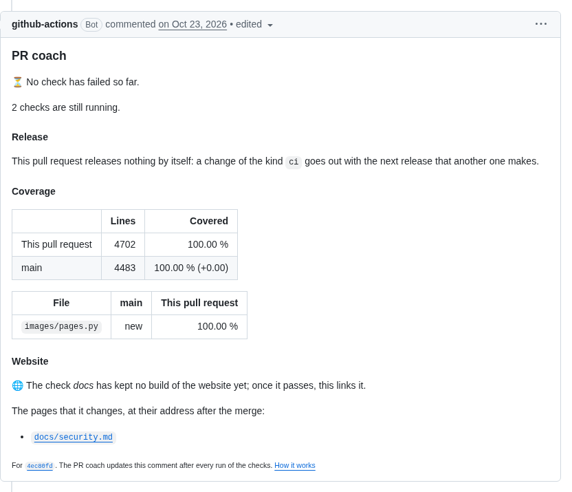

# Checks and the PR coach

What runs in every pull request and on `main`, how long it takes, and how a check that fails explains itself.

## Checks

`scripts/check.sh` on every change, the same locally and in the CI: tests with full coverage, on every core in Python projects, types, lint, packaging; the text files in one pass, in about a second for hundreds of files also on Windows, with the conflict markers that a merge left; ShellCheck, which the CI never skips; a passing error of a download fails no run, because every download of the workflows tries again; the CI installs the Python tools with uv in seconds and keeps the packages of Composer and npm, krankerl and what mypy knows of the code in its cache, php-cs-fixer checks only the files that changed, Psalm reads the code of a Nextcloud app and what it uses, not all of `vendor/`, and a step that installs, builds or downloads ends after five minutes instead of holding a pull request.

**How:** The tools of each kind of project, hash-pinned.

## Lint

The workflows (actionlint), the license of every file (REUSE), the Markdown of every document (markdownlint), hints at the spelling in English and German (cspell) and at the style of the English (Vale) of the changed documents, the sign-off of every commit (DCO), the list of the allowed actions, which must let every action that a workflow runs start, also those that these run in turn, the title of every pull request (Conventional Commits), an entry in the changelog for every change for users, a fragment in `changelog.d/` or a line under *Unreleased*, checked as the release takes it in; every linter in one job, *lint*, and the title with the changelog in one, *conventional title*, which report every finding at once.

**How:** `lint.yml`, `pull-request-title.yml`.

## Coverage

The coverage of the tests of a pull request against that of `main`, file by file, for its latest commit, in the report of the PR coach, and no comment for it when no file changes its coverage; the name of each file is plain code, so a report from a fork can't post Markdown, links or mentions with it.

**How:** `after-checks.yml`.

## Fast checks

A check runs only where it can change a result: a scanner in the pull requests that change what it reads, on `main` only what keeps a baseline or publishes, the rest every week, and in the release pull request no scanner at all; the newest Python and the newest Node check the `main` of a Python or a Node project after every change and every week.

**How:** The triggers and path filters of the workflows, `newest-python.yml`, `newest-node.yml`.

## When the checks run

A check runs only where it can change a result, because an account of GitHub runs about 20 jobs at once, and each job that can't fail keeps a pull request waiting for a runner:

<picture>
  <source media="(prefers-color-scheme: dark)" srcset="../images/diagrams/when-the-checks-run.dark.svg">
  
</picture>

- **After a merge:** `main` takes a pull request only when it is up to date with it, so the merge gives `main` the files that the checks of the pull request passed. `main` runs only the tests, whose coverage the report of every pull request compares its own with, the analyses that code scanning compares with, and what publishes, such as the website and the release. Lint runs in the pull requests, the secret scan and the fuzzing there and every week, and the SBOM every week; every release has an SBOM of its own.
- **Few jobs, each with several checks:** each job of a push waits for a runner of its own, and the quick checks waited far longer than they worked. So one job, *lint*, runs every linter, the workflows, the licenses (REUSE, from its image), the Markdown, the issue assistant, the sign-off of every commit and the hints at the prose; *conventional title* checks the title and the entry in the changelog; *codeql* analyzes every language one after the other, each under the category of its alerts; and *home-assistant* runs HACS and hassfest. Each step runs also when one before it failed, so that a check reports everything at once, and the PR coach explains each check of a job that failed, with its own fix. A pull request of the blueprint starts eight jobs fewer, one of another kind of project seven to nine (decision 0027 of the [decisions](https://github.com/Dennis-Otto/repo-blueprint/blob/main/docs/decisions/README.md)), and no job of one of these checks alone is left to wait for a runner, since the rules of every repository require the jobs that run several.

<picture>
  <source media="(prefers-color-scheme: dark)" srcset="../images/diagrams/the-jobs-of-a-pull-request.dark.svg">
  
</picture>

- **The release pull request** changes only the changelog and the version, which can't change what a scanner finds. In the blueprint, the required check *variants* stands for the variants and updates of every kind of project: it passes when each passed, or when none had to run, as in the release pull request.
- **The newest Python** runs the checks of a Python project after every change of `main` and every week, in a workflow of its own that keeps the CI of `main` green: the newest release, which `check-latest` fetches as soon as it is out, not the older Python that the runner keeps in its cache, and the summary of the run names it. A new Python breaks every pull request alike, and none waits for it. A failure keeps an issue open, which names the Python that failed and which the weekly run closes once the checks pass again.
- **The newest Node** does the same for a Node package, in `newest-node.yml`: the CI checks the Node of `.nvmrc`, this workflow the newest release of Node, which the users of the package may already run within the range of `engines.node` in `package.json`.
- **The runners** are named with their version, `ubuntu-24.04`, not `ubuntu-latest`: GitHub moves that label to a new image one job at a time over weeks, as to Ubuntu 26.04 from 19 October 2026, so that the runs of one workflow would land on either image at random, with another Python, ShellCheck and Docker, and fail like a flaky test. In the blueprint, the Next runner workflow runs the variants on the next runner every week, and a failure keeps an issue open; once they pass there, a release of the blueprint moves every job to it. A workflow of your own, which an update leaves alone, keeps the runner it names: with `ubuntu-latest`, it moves with GitHub's label.

## The PR coach

Every check that fails says what it found, why that matters and how to fix it, with the commands to run: in the summary of the check, as its annotation and in one comment on the pull request that follows every push, also on a pull request from a fork; a title that is no Conventional Commit gets one that passes, and `scripts/check.sh` explains the step that stopped it on your machine too. The same comment says what a pull request of a person makes: the next version and the entry of the changelog, the coverage, the website that it built with the pages that it changes, and the parts that the workflows of the project add.

**How:** `.github/checks.toml`, `.github/checks.project.toml`, `after-checks.yml`, `docs.yml`.

A check that fails explains itself, to you and to everyone who sends a pull request, also from a fork: what it found, why that matters and how to fix it, with the commands to run.

<picture>
  <source media="(prefers-color-scheme: dark)" srcset="../images/diagrams/the-pr-coach.dark.svg">
  
</picture>

- **In the check:** a job that fails ends with a step that writes the explanation of its check into the summary and as an annotation, which the list of the checks shows. `scripts/check.sh` does the same for the step that stopped it, on your machine as well, and in the CI the files of the pull request show each finding of a tool at its line, which the comment lists as well: those of the text files, Ruff, ShellCheck, mypy, pytest and actionlint, of PHP CS Fixer, Psalm and PHPUnit, and of Biome, the TypeScript compiler and the tests of Node. `blueprint.py annotate` makes the annotations from what a tool writes, or from the report of JUnit of the tests, and passes the log on as it is (decision 0071).
- **One comment, also for a fork:** the runs of a pull request from a fork can't write to it, so the coach runs after the checks, in the repository itself. It keeps one comment with a section for each check that failed, the findings of its annotations and a link to its log, and a suggested title when the title is no Conventional Commit. Once every check passes, a comment that listed failures turns into a short all-clear.
- **Safe with any pull request:** the coach reads the check runs and their annotations from the API and checks out only the explanations of the default branch; it runs no code of the pull request. Text that a pull request controls, such as a file name, a message or a title, appears only as code, cut to a short length, so it can't mention anybody, link anywhere or break the comment.
- **Every check explains itself:** the explanations are in `.github/checks.toml`, which the blueprint keeps current, and those of a project's own checks in `.github/checks.project.toml`, which belongs to the project and wins. The step *Explanations of the checks* of `scripts/check.sh` fails for a required check or a step without an explanation, in the blueprint and in every repository made from it, and `python3 .github/blueprint.py coach verify` lists them.
- **What the pull request makes:** on a pull request of a person, the same comment says, after the checks that failed, what the merge does to the next release, such as *makes the next release 0.13.0, a minor release after 0.12.0*, from the title, a `BREAKING CHANGE:` or `Release-As:` line of the description and the release-please files of `main`; the entry that it adds to the changelog, as the release takes it in; the coverage of its tests against that of `main`, file by file; and, when it changes the website, a link to the website that the check *docs* built, kept for a week as the artifact `website`, with the address of each page that it changes. A pull request whose checks pass gets the comment only when it has something of this to say, and one of a bot only for a check that failed (decision 0030 of the [decisions](https://github.com/Dennis-Otto/repo-blueprint/blob/main/docs/decisions/README.md)).
- **The files of the blueprint:** the same comment names the files of the blueprint that a pull request of a person changes, with where the change belongs instead, because the next update that changes the same lines conflicts with it; [Dependencies and updates](updates.md#what-belongs-to-a-project) says more.
- **The parts of the project's workflows:** a workflow of the project, such as the visual tests of a card or the size of a module, adds a part of its own to the same comment instead of a comment of its own. It keeps the artifact `pr-report-<name>` with the file `report.md` for the head of the pull request, and `[report.<name>]` in `.github/checks.project.toml` of the default branch gives the part its title, a text and, in `replaces`, the marker of the old comment, which the coach then deletes. The coach downloads an artifact of at most 256 kB into a folder of its own and runs nothing of it: it shows the Markdown of `report.md` only as code, a table with code in each cell and a block of code in a fence that none of its lines can close, at most 8,000 characters of it, with a link to the artifact. A part whose first line is `<!-- quiet -->`, such as a size that stays as it was, brings no comment while the checks pass (decision 0066).

<picture>
  <source media="(prefers-color-scheme: dark)" srcset="../images/diagrams/the-report-of-a-pull-request.dark.svg">
  
</picture>

The comment of the PR coach on a pull request of issue-assistant, while two checks were still running: what the merge does to the next release, the coverage of the tests against `main` with the file it added, and the pages of the website that it changes:

<picture>
  <source media="(prefers-color-scheme: dark)" srcset="../images/github-pr-coach.dark.png">
  
</picture>
