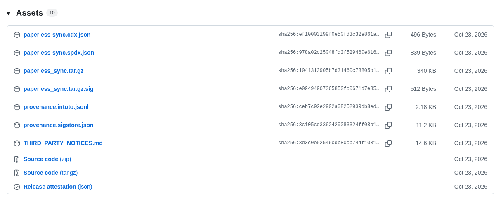

# Releases und Sicherheit

Wie aus einer Änderung ein signiertes Release wird, und die Sicherheitsprüfungen jedes Repositorys.

## Releases

Ein Pull Request mit der nächsten Version, bestimmt aus den Titeln der gemergten Pull Requests (`fix` ein Patch, `feat` ein Minor, `!` ein Major, unter 1.0.0 ein Minor), und dem Text der Fragmente in `changelog.d/` und von *Unreleased* im Changelog als Notes; sein Merge veröffentlicht das Release mit Paket, SBOM und der signierten Provenance eines isolierten Builds, der kein Secret hält, außer eine Nextcloud-App braucht den Schlüssel, der sie signiert (SLSA Build Level 3; ein Container-Image hat einen eigenen isolierten Build, `build-image.yml`), liefert es aus und prüft es danach so, wie es seine Nutzer können, auch jede Woche und sobald jemand anderes ein Release veröffentlicht; ein Release, das nur Abhängigkeiten aktualisiert, merged sich einmal am Tag selbst, auch neben einem Commit eines Bots, der kein Release macht, etwa neuen Bildern, während eine Änderung einer Person auf den Maintainer wartet, damit die Updates eines Tages ein Release ergeben, und sofort, wenn es eine Schwachstelle behebt; wo die Repository-Variable `BETA_CHANNEL` auf true steht, wird außerdem jede Änderung für Nutzer zu einer Beta des nächsten Releases, einem Prerelease für Tester.

**Womit:** Release-please, die Release-App, unveränderliche Releases, `verify-release.yml`.

## Von einer Änderung zum Release

Der Titel eines Pull Requests bestimmt die nächste Version, und der Merge des Release-Pull-Requests erledigt den Rest:

<picture>
  <source media="(prefers-color-scheme: dark)" srcset="../images/diagrams/from-a-change-to-a-release.de.dark.svg">
  
</picture>

Ein Pull Request beschreibt, was er für Nutzer ändert, in einer eigenen Datei, einem Fragment in `changelog.d/`, etwa `changelog.d/dark-mode.md`, unter der Überschrift seiner Art von Änderung, etwa `### Features`. Eine neue Datei kollidiert mit nichts, also mergen Pull Requests, die gleichzeitig laufen, nacheinander, ohne dass jemand `main` in jeden von ihnen mergt, und ein Release kollidiert nicht mehr mit den wartenden Pull Requests. Die Prüfung des Titels, *conventional title*, prüft jedes Fragment eines Pull Requests so, wie das Release es übernimmt, und zählt nur ein neues als seinen Eintrag, `scripts/check.sh` prüft auch jedes Fragment, das auf `main` wartet, und der Release-Bot verschiebt jedes Fragment in den Abschnitt des Releases und löscht es im selben Commit. Eine Überschrift, die sicher eine Art von Änderung meint, etwa `### Fixes` für `### Fixed` oder `## Features` für `### Features`, benennt der Fix-Bot auf dem Branch des Pull Requests um und schlägt sie auf einem aus einem Fork vor; eine, die einer Art so nahe ist wie einer anderen, etwa `### Change`, bleibt ihrem Autor. Bis zum Release zeigt eine Seite der Website, die `CHANGELOG.md` einbindet, etwa der Changelog dieser, die Einträge der Fragmente unter *Unreleased*, gruppiert wie das Release sie gruppiert. Eine Zeile unter `## Unreleased` in `CHANGELOG.md` funktioniert weiterhin.

Die Aufzeichnungen der Entscheidungen nehmen denselben Weg: Ein Pull Request benennt seine Aufzeichnung nach seiner eigenen Nummer oder der des Issues, das er behebt, und lässt den Index in Ruhe, und der Commit, der den Changelog schreibt, schreibt die Zeile jeder neuen Aufzeichnung und den Status jeder Aufzeichnung in `docs/decisions/README.md`, während die Website sie sofort aufführt (Entscheidung 1033).

release-please liest den Titel jedes gemergten Pull Requests, nicht seine ganze Beschreibung. Der Squash-Commit trägt die Beschreibung, und eine Zeile darin, die der strenge Parser von release-please für einen Footer hält, etwa `**[(Full` aus den Release Notes, die Renovate zitiert, ließ ihn den Commit in einem grünen Lauf überspringen, sodass ein Fix auf ein anderes Release wartete, das ihn nicht nannte. Darum schreibt der Release-Bot, bevor release-please läuft, den Titel und die Zeilen `Release-As:` und `BREAKING CHANGE:` jedes Pull Requests seit dem letzten Release, der es ändern kann, an das Ende seiner Beschreibung, als Override in einem HTML-Kommentar, den die Seite nicht zeigt; eine Änderung, die GitHub ablehnt, ist eine Warnung, und release-please läuft trotzdem. Der Release-Pull-Request ändert sich nur noch, wenn sich seine Notes ändern; zuvor baute release-please ihn in jedem Lauf neu, und jede seiner Prüfungen startete von vorn (Entscheidung 0060 der [Entscheidungen](https://github.com/Dennis-Otto/repo-blueprint/blob/main/docs/decisions/README.md)).

<picture>
  <source media="(prefers-color-scheme: dark)" srcset="../images/diagrams/the-changelog-without-conflicts.de.dark.svg">
  
</picture>

Ein Merge, der die Notes des Release-Pull-Requests ändert, etwa ein `feat`, ein `fix` oder ein `perf`, lässt release-please ihn sofort neu auf `main` bauen, was auch die Version weiterbewegt, aus der die Nummer einer Beta kommt. Ein Merge, der nichts an dem ändert, was er veröffentlicht, etwa `docs`, `chore`, `ci` oder `test`, lässt ihn hinter `main` zurück, was nichts aufhält: Der Release-Bot baut ihn neu auf `main`, sobald Auto-Merge für ihn an ist, und im täglichen Lauf und in einem Lauf von Hand. Schaltest du Auto-Merge für einen Release-Pull-Request an, der hinter `main` liegt, startet der Release-Bot binnen Minuten: Der Branch-Bot startet ihn, außer ein Lauf von ihm, der seitdem kam, läuft noch, und aktualisiert den Branch nie selbst. So wird ein Release-Pull-Request einmal neu gebaut, bevor er merged, nicht nach jedem Merge eines Tages, der jede seiner Prüfungen für ein Release neu startete, das gleich blieb; er merged eine Runde Prüfungen später, etwa 15 bis 25 Minuten. Ein Release von Abhängigkeits-Updates merged weiter von selbst, täglich und sofort mit dem Fix einer Schwachstelle, da der Lauf, der Auto-Merge für ihn anschaltet, ihn zuerst neu baut. Der Changelog des Release-Pull-Requests nimmt weiter in jedem Lauf die Fragmente und den Text von Unreleased aus `main` auf, auch solange er zurückliegt, und die Zusammenfassung des Branch-Bots zeigt einen Release-Pull-Request, der zurückliegt, als einen, der auf seinen Neubau wartet, nicht als festgefahren. *Update branch* auf ihm kann nur Änderungen bringen, die keine Notes nennen ([Entscheidung 0175](../decisions/0175-the-release-pull-request-is-rebuilt-once-before-it-merges.md)).

<picture>
  <source media="(prefers-color-scheme: dark)" srcset="../images/diagrams/when-the-release-pull-request-is-rebuilt.de.dark.svg">
  
</picture>

### Einmal am Tag

Jedes Release des Blueprints kostet jedes Repository, das ihm folgt, einen Update-Pull-Request mit allen seinen Prüfungen, darum released der Blueprint höchstens einmal am Tag ([Entscheidung 0180](../decisions/0180-the-blueprint-releases-at-most-once-a-day.md)): seine `.github/repository.toml` setzt die Variable `RELEASE_MERGE` auf `daily`. Der Release-Pull-Request sammelt wie bisher, was seit dem letzten Release gemergt wurde, und der Release-Bot merged ihn in seinem täglichen Lauf um 02:25 UTC, sobald seine Prüfungen bestehen, nachdem er ihn auf `main` neu gebaut hat; ein täglicher Lauf an einem Tag (UTC), an dem schon ein Release hinausging, überlässt ihn dem nächsten. Ein Kommentar im Release-Pull-Request sagt, wann er geht. Der Lauf jedes anderen Merges hält ihn nur aktuell, und sein Log sagt, warum er wartet.

- **Sofort:** Für einen Fix, der nicht warten kann, etwa einen für die Repositorys, die ein Release kaputt gemacht hat, starte den Workflow *Release* von Hand, unter *Actions → Release → Run workflow* oder mit `gh workflow run release.yml`: Er baut den Release-Pull-Request neu und merged ihn, sobald seine Prüfungen bestehen. Ein Fix einer Schwachstelle, den Renovate mit `[security]` kennzeichnet, geht von selbst sofort, im Lauf seines Merges. Ein Lauf, den ein Bot startet, etwa der Bot-Health-Bot für einen täglichen Lauf, den GitHub ausließ oder der fehlschlug, hält sich an den Tag wie der tägliche Lauf: Nur der Start einer Person macht ein zweites Release an einem Tag.
- **Warum 02:25 UTC:** 03:25 in Berlin im Winter, 04:25 im Sommer. Der Rollout und die Prüfungen jedes Repositorys, das er aktualisiert, laufen in der Nacht Europas, wo niemand auf sie wartet und sie keinem Pull Request einer Person einen Runner wegnehmen, nach dem täglichen Blick des Bot-Health-Bots und vor den wöchentlichen Jobs der Repositorys, die ab 03:20 beginnen, und nicht zu einer vollen Stunde, zu der GitHub die meisten Zeitpläne startet. GitHub startet einen Zeitplan manchmal spät, und das Release geht dann später.
- **Ein Repository aus dem Blueprint** beginnt mit `RELEASE_MERGE = "maintainer"`: Sein Maintainer merged den Release-Pull-Request, und nur ein Release aus Abhängigkeits-Updates merged sich einmal am Tag selbst. `RELEASE_MERGE = "daily"` unter `[variables]` seiner `.github/repository.project.toml` wählt das tägliche Release, das der Settings-Bot mit dem Merge setzt.

<picture>
  <source media="(prefers-color-scheme: dark)" srcset="../images/diagrams/when-the-release-pull-request-merges.de.dark.svg">
  
</picture>

Jedes Release beschreibt in seinen SBOMs, als SPDX und als CycloneDX, was es ausliefert: das Paket, das seine Nutzer installieren, oder die Dateien seines Tags ohne die, die das Projekt nur prüfen, testen und dokumentieren, unter dem Namen des Repositorys und der Version des Releases. Ein Scanner eines Nutzers meldet nur die Advisories dessen, was das Release ausliefert, und wendet sein OpenVEX-Dokument darauf an (Entscheidung 0034 der [Entscheidungen](https://github.com/Dennis-Otto/repo-blueprint/blob/main/docs/decisions/README.md)):

<picture>
  <source media="(prefers-color-scheme: dark)" srcset="../images/diagrams/what-the-sboms-of-a-release-describe.de.dark.svg">
  
</picture>

Die Prüfung nach einem Release nennt jedes Problem, das sie findet, in einer Annotation und in der Zusammenfassung ihres Laufs, und der Bot-Health-Bot meldet den fehlgeschlagenen Lauf in einem Issue. Das gilt auch für das, was die Prüfung vorzeitig beendet, etwa einen Entwurf, der noch kein veröffentlichtes Release ist, oder einen Download von gitsign mit einer anderen Prüfsumme.

Nur ein Lauf des Release-Bots, der ein Release veröffentlicht hat, startet die Bots, die einem Release folgen ([Entscheidung 0173](../decisions/0173-only-a-run-that-published-a-release-starts-its-followers.md)). Ein Release, das der Release-Bot mit dem Token seines Jobs veröffentlicht, startet keinen Workflow über `release: published`, und die meisten Läufe von *Release* veröffentlichen nichts: Sie halten nur den Release-Pull-Request aktuell. Also startet der letzte Job eines Laufs, *start the bots after the release*, sie von Hand, sobald der Lauf ein Release veröffentlicht hat, auch eines, das er aus einem Entwurf fertiggestellt hat, und sobald der ganze Lauf bestanden hat, die Prüfung eingeschlossen:

- **Issue lifecycle** schließt die Issues, die das Release behebt, mit seinem Link. Ein Prerelease schließt keines, also startet es keinen Durchlauf.
- **Screenshots** rendert die Bilder der neuen Version, aber nicht nach einer Beta und nicht, wo das Repository kein `scripts/screenshots.sh` hat.
- **Ein Aufruf, an dem GitHub dreimal scheitert,** ist eine Warnung, und das Release bleibt grün: Der morgendliche Durchlauf von *Issue lifecycle* und der wöchentliche Lauf von *Screenshots* holen es nach.
- **Vorerst zweimal:** Bis ein Release des Issue-Assistenten dem Blueprint erlaubt, ihn wegzulassen, behält *Issue lifecycle* auch seinen eigenen Start nach jedem Lauf von *Release*, sodass ein Release die Issues zweimal durchgeht, einen Durchlauf nach dem anderen, was nicht schadet.

<picture>
  <source media="(prefers-color-scheme: dark)" srcset="../images/diagrams/what-starts-after-a-release.de.dark.svg">
  
</picture>

Ein Projekt, das etwas ausliefert, das keine Registry baut, etwa das Zip einer Browser-Erweiterung, baut es mit einem eigenen `scripts/release-assets.sh`. Der Build des Releases führt `bash scripts/release-assets.sh ORDNER VERSION` am Commit des Releases aus, in einem eigenen Job, der nichts schreiben darf und kein Secret hat, mit Node.js und zuerst `npm ci --ignore-scripts`, wo das Projekt eine `package.json` hat. Er attestiert jede Datei, die das Skript schreibt, mit dem Rest des Releases und hängt sie an den Entwurf, bevor das Release veröffentlicht wird; seine SBOMs beschreiben diese Zips und Tarballs, wo keine Registry das Projekt ausliefert, und die Release-Prüfung schlägt bei einem Asset ohne seine signierte Provenance fehl (Entscheidung 0084 der [Entscheidungen](https://github.com/Dennis-Otto/repo-blueprint/blob/main/docs/decisions/README.md)):

<picture>
  <source media="(prefers-color-scheme: dark)" srcset="../images/diagrams/how-a-project-adds-its-own-release-assets.de.dark.svg">
  
</picture>

Scheitert das Skript, bleibt das Release ein Entwurf, und der Job erklärt in der Zusammenfassung seines Laufs, was fehlschlug und wie man es behebt. Nach einer Störung startet man die fehlgeschlagenen Jobs dieses Laufs neu, das stellt den Entwurf fertig. Eine Korrektur des Skripts kommt mit dem nächsten Release, denn der Build läuft auf dem Commit des Releases. Ihr Pull Request braucht daher einen Titel mit `fix:`, und sobald dieses Release draußen ist, löscht man den alten Entwurf von Hand mit `gh release delete vX.Y.Z --yes`, was den signierten Tag behält.

Ein Release von paperless-sync, wie GitHub seine Assets zeigt: die signierte App, ihre Signatur, ihre SBOMs als CycloneDX und SPDX, die Provenance ihres Builds mit ihrem Sigstore-Bundle, die Hinweise zu ihren Abhängigkeiten und die Attestation des Releases:

<picture>
  <source media="(prefers-color-scheme: dark)" srcset="../images/github-release.dark.png">
  
</picture>

## Sicherheit

CodeQL, und für das PHP einer Nextcloud-App die Taint-Analyse von Psalm, die die Controller, Dateien und den HTTP-Client von Nextcloud kennt und mit einem Canary in jedem Lauf beweist, dass sie noch sieht, OpenSSF Scorecard, Dependency Review, Secret Scan, SBOMs dessen, was ein Release ausliefert, als SPDX und CycloneDX, mit seinem Namen und seiner Version, OpenVEX, schlüssellos signierte und vor jedem Build geprüfte Release-Tags (gitsign), Findings-Wächter, die Sicherheitsprüfung der Workflows (zizmor), jede Lock-Datei gegen die OSV-Datenbank (OSV-Scanner), der Netzwerkverkehr jedes Jobs (Harden-Runner), gesperrt in jedem Job mit einem Secret oder Schreibrechten bis auf die Hosts, die er braucht, außer in den wenigen, die `SECURITY.md` mit ihrem Grund nennt, die Antworten von OpenSSF Best Practices und der OSPS Baseline, die der Blueprint garantiert (`.bestpractices.json`).

**Womit:** Jede Action auf einen Commit-Hash gepinnt.

## App Store

Für eine Nextcloud-App: die Registrierung ihrer ID mit ihrem Zertifikat, einmal, von Hand.

**Womit:** `register-app.yml`.

## Chrome Web Store

Für eine Chrome-Erweiterung: jedes Release kommt in den Chrome Web Store, als das Zip, das das Release bezeugt, nach einer Prüfung seiner Provenance, bei Google angemeldet mit dem OIDC-Token von GitHub und ohne gespeichertes Geheimnis. Ein täglicher Lauf liefert ein Release nach, dessen Prüfung warten musste, und meldet eine Ablehnung oder eine Warnung von Google mit der Lösung.

**Womit:** `publish-store.yml`, `scripts/store-status.mjs`, [die Seite der Art](../kinds/chrome-extension.md).

## Cloudflare

Für einen Cloudflare Worker: Workers Builds von Cloudflare baut jeden Commit von `main` und liefert nur den Merge des Release-Pull-Requests aus, als die Version des Releases; jeder andere Commit wird eine Version ohne Verkehr. Kein Schlüssel von Cloudflare liegt in GitHub, und die Geheimnisse des Workers liegen bei Cloudflare.

**Womit:** `scripts/deploy-worker.sh`, [die Seite der Art](../kinds/cloudflare-worker.md).
