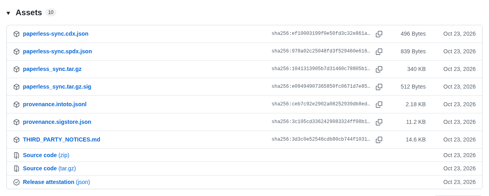

# Releases und Sicherheit

Wie aus einer Änderung ein signiertes Release wird, und die Sicherheitsprüfungen jedes Repositorys.

## Releases

Ein Pull Request mit der nächsten Version, bestimmt aus den Titeln der gemergten Pull Requests (`fix` ein Patch, `feat` ein Minor, `!` ein Major, unter 1.0.0 ein Minor), und dem Text der Fragmente in `changelog.d/` und von *Unreleased* im Changelog als Notes; sein Merge veröffentlicht das Release mit Paket, SBOM und der signierten Provenance eines isolierten Builds (SLSA Build Level 3), liefert es aus und prüft es danach so, wie es seine Nutzer können, auch jede Woche; wo die Repository-Variable `BETA_CHANNEL` auf true steht, wird außerdem jede Änderung für Nutzer zu einer Beta des nächsten Releases, einem Prerelease für Tester.

**Womit:** Release-please, die Release-App, unveränderliche Releases, `verify-release.yml`.

## Von einer Änderung zum Release

Der Titel eines Pull Requests bestimmt die nächste Version, und der Merge des Release-Pull-Requests erledigt den Rest:

<picture>
  <source media="(prefers-color-scheme: dark)" srcset="../images/diagrams/from-a-change-to-a-release.de.dark.svg">
  
</picture>

Ein Pull Request beschreibt, was er für Nutzer ändert, in einer eigenen Datei, einem Fragment in `changelog.d/`, etwa `changelog.d/dark-mode.md`, unter der Überschrift seiner Art von Änderung, etwa `### Features`. Eine neue Datei kollidiert mit nichts, also mergen Pull Requests, die gleichzeitig laufen, nacheinander, ohne dass jemand `main` in jeden von ihnen mergt, und ein Release kollidiert nicht mehr mit den wartenden Pull Requests. Die Prüfung des Titels, *conventional title*, prüft jedes Fragment eines Pull Requests so, wie das Release es übernimmt, und zählt nur ein neues als seinen Eintrag, `scripts/check.sh` prüft auch jedes Fragment, das auf `main` wartet, und der Release-Bot verschiebt jedes Fragment in den Abschnitt des Releases und löscht es im selben Commit. Eine Überschrift, die sicher eine Art von Änderung meint, etwa `### Fixes` für `### Fixed` oder `## Features` für `### Features`, benennt der Fix-Bot auf dem Branch des Pull Requests um und schlägt sie auf einem aus einem Fork vor; eine, die einer Art so nahe ist wie einer anderen, etwa `### Change`, bleibt ihrem Autor. Bis zum Release zeigt eine Seite der Website, die `CHANGELOG.md` einbindet, etwa der Changelog dieser, die Einträge der Fragmente unter *Unreleased*, gruppiert wie das Release sie gruppiert. Eine Zeile unter `## Unreleased` in `CHANGELOG.md` funktioniert weiterhin.

release-please liest den Titel jedes gemergten Pull Requests, nicht seine ganze Beschreibung. Der Squash-Commit trägt die Beschreibung, und eine Zeile darin, die der strenge Parser von release-please für einen Footer hält, etwa `**[(Full` aus den Release Notes, die Renovate zitiert, ließ ihn den Commit in einem grünen Lauf überspringen, sodass ein Fix auf ein anderes Release wartete, das ihn nicht nannte. Darum schreibt der Release-Bot, bevor release-please läuft, den Titel und die Zeilen `Release-As:` und `BREAKING CHANGE:` jedes Pull Requests seit dem letzten Release, der es ändern kann, an das Ende seiner Beschreibung, als Override in einem HTML-Kommentar, den die Seite nicht zeigt; eine Änderung, die GitHub ablehnt, ist eine Warnung, und release-please läuft trotzdem. Der Release-Pull-Request ändert sich nur noch, wenn sich seine Notes ändern; zuvor baute release-please ihn in jedem Lauf neu, und jede seiner Prüfungen startete von vorn (Entscheidung 0060 der [Entscheidungen](https://github.com/Dennis-Otto/repo-blueprint/blob/main/docs/decisions/README.md)).

<picture>
  <source media="(prefers-color-scheme: dark)" srcset="../images/diagrams/the-changelog-without-conflicts.de.dark.svg">
  
</picture>

Jedes Release beschreibt in seinen SBOMs, als SPDX und als CycloneDX, was es ausliefert: das Paket, das seine Nutzer installieren, oder die Dateien seines Tags ohne die, die das Projekt nur prüfen, testen und dokumentieren, unter dem Namen des Repositorys und der Version des Releases. Ein Scanner eines Nutzers meldet nur die Advisories dessen, was das Release ausliefert, und wendet sein OpenVEX-Dokument darauf an (Entscheidung 0034 der [Entscheidungen](https://github.com/Dennis-Otto/repo-blueprint/blob/main/docs/decisions/README.md)):

<picture>
  <source media="(prefers-color-scheme: dark)" srcset="../images/diagrams/what-the-sboms-of-a-release-describe.de.dark.svg">
  
</picture>

Ein Release von paperless-sync, wie GitHub seine Assets zeigt: die signierte App, ihre Signatur, ihre SBOMs als CycloneDX und SPDX, die Provenance ihres Builds mit ihrem Sigstore-Bundle, die Hinweise zu ihren Abhängigkeiten und die Attestation des Releases:

<picture>
  <source media="(prefers-color-scheme: dark)" srcset="../images/github-release.dark.png">
  
</picture>

## Sicherheit

CodeQL, und für das PHP einer Nextcloud-App die Taint-Analyse von Psalm, die die Controller, Dateien und den HTTP-Client von Nextcloud kennt und mit einem Canary in jedem Lauf beweist, dass sie noch sieht, OpenSSF Scorecard, Dependency Review, Secret Scan, SBOMs dessen, was ein Release ausliefert, als SPDX und CycloneDX, mit seinem Namen und seiner Version, OpenVEX, schlüssellos signierte und vor jedem Build geprüfte Release-Tags (gitsign), Findings-Wächter, die Sicherheitsprüfung der Workflows (zizmor), jede Lock-Datei gegen die OSV-Datenbank (OSV-Scanner), der Netzwerkverkehr jedes Jobs (Harden-Runner), die Antworten von OpenSSF Best Practices und der OSPS Baseline, die der Blueprint garantiert (`.bestpractices.json`).

**Womit:** Jede Action auf einen Commit-Hash gepinnt.

## App Store

Für eine Nextcloud-App: die Registrierung ihrer ID mit ihrem Zertifikat, einmal, von Hand.

**Womit:** `register-app.yml`.
