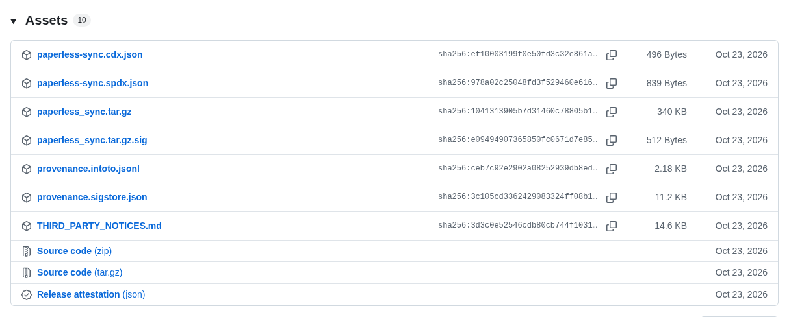

# Releases and security

How a change becomes a signed release, and the security checks of every repository.

## Releases

A pull request with the next version, decided from the titles of the merged pull requests (`fix` a patch, `feat` a minor, `!` a major version, or a minor one while the version is below 1.0.0), and the text of the fragments in `changelog.d/` and of *Unreleased* in the changelog as its notes; merging it publishes the release with its package, SBOM and the signed provenance of an isolated build, which holds no secret unless a Nextcloud app needs the key that signs it (SLSA Build Level 3; a container image has an isolated build of its own, `build-image.yml`), delivers it, and then verifies it as its users can, also every week and as soon as someone else publishes a release; a release of nothing but dependency updates merges itself once a day, also beside a bot's commit that makes no release, such as new pictures, while a change of a person waits for the maintainer, so that the updates of a day make one release, and at once when it fixes a vulnerability; where the repository variable `BETA_CHANNEL` is true, every change for users also becomes a beta of the next release, a prerelease for testers.

**How:** Release-please, the release app, immutable releases, `verify-release.yml`.

## From a change to a release

The title of a pull request decides the next version, and merging the release pull request does the rest:

<picture>
  <source media="(prefers-color-scheme: dark)" srcset="../images/diagrams/from-a-change-to-a-release.dark.svg">
  
</picture>

A pull request describes what it changes for users in a file of its own, a fragment in `changelog.d/`, such as `changelog.d/dark-mode.md`, below the heading of its kind of change, such as `### Features`. A new file conflicts with nothing, so pull requests that run at the same time merge one after another, without a person who merges `main` into each of them, and a release no longer conflicts with the pull requests that wait. The check of the title, *conventional title*, checks each fragment of a pull request as the release takes it in and counts only a new one as its entry, `scripts/check.sh` checks every fragment that waits on `main` as well, and the release bot moves every fragment into the section of the release and deletes it in the same commit. A heading that surely means a kind of change, such as `### Fixes` for `### Fixed` or `## Features` for `### Features`, the fix bot renames on the branch of the pull request and suggests on one from a fork; one as close to one kind as to another, such as `### Change`, stays for its author. Until the release, a page of the website that includes `CHANGELOG.md`, such as the changelog of this one, shows the entries of the fragments under *Unreleased*, grouped as the release groups them. A line under `## Unreleased` in `CHANGELOG.md` still works.

The records of decisions take the same way: a pull request names its record after its own number, or that of the issue that it fixes, and leaves the index alone, and the commit that writes the changelog writes the row of each new record and the status of each record into `docs/decisions/README.md`, while the website lists them at once (decision 1033).

release-please reads the title of each merged pull request, not its whole description. The squash commit carries the description, and a line of it that the strict parser of release-please takes for a footer, such as `**[(Full` of the release notes that Renovate quotes, made it skip the commit in a run that passed, so that a fix waited for another release, which didn't list it. So before release-please runs, the release bot writes the title and the lines `Release-As:` and `BREAKING CHANGE:` of each pull request since the last release that can change it into the end of its description, as an override in an HTML comment that the page doesn't show; an edit that GitHub refuses is a warning, and release-please runs anyway. The release pull request changes only when its notes change; release-please rebuilt it in every run before, and every check of it started again (decision 0060 of the [decisions](https://github.com/Dennis-Otto/repo-blueprint/blob/main/docs/decisions/README.md)).

<picture>
  <source media="(prefers-color-scheme: dark)" srcset="../images/diagrams/the-changelog-without-conflicts.dark.svg">
  
</picture>

A merge that changes the notes of the release pull request, such as a `feat`, a `fix` or a `perf`, has release-please rebuild it on `main` at once, which also moves the version that the number of a beta comes from. A merge that changes nothing that it releases, such as `docs`, `chore`, `ci` or `test`, leaves it behind `main`, which holds up nothing: the release bot rebuilds it on `main` once auto-merge is on for it, and in the daily run and a run by hand. Turning auto-merge on for a release pull request that is behind `main` starts the release bot within minutes: the branch bot starts it, unless a run of it that came since still runs, and never updates the branch itself. So a release pull request is rebuilt once before it merges, not after every merge of a day, which started every check of it again for a release that stayed the same; it merges one round of checks later, about 15 to 25 minutes. A release of dependency updates still merges by itself, daily and at once with the fix of a vulnerability, since the run that turns auto-merge on for it rebuilds it first. The changelog of the release pull request still takes in the fragments and the text of Unreleased of `main` in every run, also while it is behind, and the summary of the branch bot shows a release pull request that is behind as one that waits for its rebuild, not as stuck. Pressing *Update branch* on it can only bring in changes that no notes list ([decision 0175](../decisions/0175-the-release-pull-request-is-rebuilt-once-before-it-merges.md)).

<picture>
  <source media="(prefers-color-scheme: dark)" srcset="../images/diagrams/when-the-release-pull-request-is-rebuilt.dark.svg">
  
</picture>

### Once a day

Each release of the blueprint costs every repository that follows it an update pull request with all its checks, so the blueprint releases at most once a day ([decision 0180](../decisions/0180-the-blueprint-releases-at-most-once-a-day.md)): its `.github/repository.toml` sets the variable `RELEASE_MERGE` to `daily`. The release pull request collects what merged since the last release, as before, and the release bot merges it in its daily run at 02:25 UTC once its checks pass, after it rebuilt it on `main`; a daily run on a day (UTC) on which a release went out already leaves it to the next one. A comment in the release pull request says when it goes. The run of every other merge only keeps it current, and its log says why it waits.

- **At once:** for a fix that can't wait, such as one for the repositories that a release broke, start the workflow *Release* by hand, under *Actions → Release → Run workflow* or with `gh workflow run release.yml`: it rebuilds the release pull request and merges it once its checks pass. A fix of a vulnerability that Renovate marks with `[security]` goes at once by itself, in the run of its merge. A run that a bot starts, such as the bot-health bot for a daily run that GitHub missed or that failed, keeps to the day as the daily run does: only a person's start makes a second release on a day.
- **Why 02:25 UTC:** 03:25 in Berlin in winter, 04:25 in summer. The Rollout and the checks of every repository that it updates run in the night of Europe, where nobody waits for them and they take no runner from a person's pull request, after the daily look of the bot-health bot and before the weekly jobs of the repositories, which start from 03:20 on, and not on a full hour, when GitHub starts the most schedules. GitHub may start a schedule late, and the release goes later with it.
- **A repository made from the blueprint** starts with `RELEASE_MERGE = "maintainer"`: its maintainer merges the release pull request, and only a release of dependency updates merges itself, once a day. `RELEASE_MERGE = "daily"` under `[variables]` of its `.github/repository.project.toml` chooses the daily release, which the settings bot sets with the merge.

<picture>
  <source media="(prefers-color-scheme: dark)" srcset="../images/diagrams/when-the-release-pull-request-merges.dark.svg">
  
</picture>

Each release describes what it ships in its SBOMs, as SPDX and as CycloneDX: the package that its users install, or the files of its tag without those that only check, test and document it, under the name of the repository and the version of the release. A scanner of a user reports only the advisories of what the release ships, and applies its OpenVEX document to them (decision 0034 of the [decisions](https://github.com/Dennis-Otto/repo-blueprint/blob/main/docs/decisions/README.md)):

<picture>
  <source media="(prefers-color-scheme: dark)" srcset="../images/diagrams/what-the-sboms-of-a-release-describe.dark.svg">
  
</picture>

The verification after a release names every problem that it finds in an annotation and in the summary of its run, and the bot-health bot reports the failed run in an issue. That holds for what ends the verification early too, such as a draft, which is no published release yet, or a download of gitsign with another checksum.

Only a run of the release bot that published a release starts the bots that follow one ([decision 0173](../decisions/0173-only-a-run-that-published-a-release-starts-its-followers.md)). A release that the release bot makes public with the token of its job starts no workflow by `release: published`, and most runs of *Release* publish nothing: they only keep the release pull request current. So the last job of a run, *start the bots after the release*, starts them by hand once the run published a release, also one that it finished from a draft, and once the whole run passed, the verification included:

- **Issue lifecycle** closes the issues that the release fixes, with its link. A prerelease closes none, so it starts no sweep.
- **Screenshots** renders the pictures of the new version, but not after a beta, and not where the repository has no `scripts/screenshots.sh`.
- **A call that GitHub fails** three times is a warning, and the release stays green: the morning sweep of *Issue lifecycle* and the weekly run of *Screenshots* catch up.
- **Twice for now:** until a release of the issue assistant lets the blueprint leave it out, *Issue lifecycle* also keeps its own start after every run of *Release*, so a release sweeps the issues twice, one sweep after the other, which does no harm.

<picture>
  <source media="(prefers-color-scheme: dark)" srcset="../images/diagrams/what-starts-after-a-release.dark.svg">
  
</picture>

A project that ships something that no registry builds, such as the zip of a browser extension, builds it with a `scripts/release-assets.sh` of its own. The build of the release runs `bash scripts/release-assets.sh FOLDER VERSION` at the commit of the release, in a job of its own that may write nothing and holds no secret, with Node.js and `npm ci --ignore-scripts` first where the project has a `package.json`. It attests each file that the script writes with the rest of the release and attaches it to the draft before the release is published; its SBOMs describe those zips and tarballs where no registry delivers the project, and the verification of the release fails for an asset without its signed provenance (decision 0084 of the [decisions](https://github.com/Dennis-Otto/repo-blueprint/blob/main/docs/decisions/README.md)):

<picture>
  <source media="(prefers-color-scheme: dark)" srcset="../images/diagrams/how-a-project-adds-its-own-release-assets.dark.svg">
  
</picture>

When the script fails, the release stays a draft, and the job explains in the summary of its run what failed and how to fix it. After a hiccup, re-run the failed jobs of that run, which finishes the draft. A fix of the script ships with the next release, as the build runs at the commit of the release, so give its pull request a `fix:` title, and once that release is out, delete the old draft by hand with `gh release delete vX.Y.Z --yes`, which keeps the signed tag.

A release of paperless-sync, as GitHub shows its assets: the signed app, its signature, its SBOMs as CycloneDX and SPDX, the provenance of its build with its Sigstore bundle, the notices of its dependencies, and the attestation of the release:

<picture>
  <source media="(prefers-color-scheme: dark)" srcset="../images/github-release.dark.png">
  
</picture>

## Security

CodeQL, and for the PHP of a Nextcloud app the taint analysis of Psalm, which knows the controllers, files and HTTP client of Nextcloud and proves with a canary in every run that it still sees, OpenSSF Scorecard, dependency review, secret scan, SBOMs of what a release ships as SPDX and CycloneDX, by its name and version, OpenVEX, release tags signed without a key (gitsign) and checked before every build, findings watcher, the security audit of the workflows (zizmor), every lock file against the OSV database (OSV-Scanner), the network traffic of every job (Harden-Runner), blocked but for the hosts it needs in each job that holds a secret or may write, other than the few that `SECURITY.md` names with their reasons, the answers of OpenSSF Best Practices and of the OSPS Baseline that the blueprint guarantees (`.bestpractices.json`).

**How:** Every action pinned to a commit hash.

## App Store

For a Nextcloud app: the registration of its id with its certificate, once, by hand.

**How:** `register-app.yml`.

## Chrome Web Store

For a Chrome extension: every release goes to the Chrome Web Store as the zip that the release attests, after a check of its provenance, signed in to Google with the OIDC token of GitHub and no stored secret. A daily run delivers a release whose review had to wait, and reports a rejection or a warning of Google with the fix.

**How:** `publish-store.yml`, `scripts/store-status.mjs`, [the page of the kind](../kinds/chrome-extension.md).

## Cloudflare

For a Cloudflare Worker: Cloudflare's Workers Builds builds every commit of `main` and deploys only the merge of the release pull request, as the version of the release; every other commit becomes a version without traffic. No key of Cloudflare is stored in GitHub, and the secrets of the Worker live in Cloudflare.

**How:** `scripts/deploy-worker.sh`, [the page of the kind](../kinds/cloudflare-worker.md).
