# Einstellungen als Code

Die Einstellungen eines Repositorys als Datei, die ein Pull Request ändert.

Die Einstellungen des Repositorys als Code: Merges, Rulesets, Sicherheit, Actions, Environments, Variablen, Labels, GitHub Pages und jede Datei der Community-Standards von GitHub; der Settings-Bot wendet sie nach jeder Änderung und jede Woche an.

**Womit:** `.github/repository.toml` und `blueprint.py`.

<picture>
  <source media="(prefers-color-scheme: dark)" srcset="../images/diagrams/the-settings-as-code.de.dark.svg">
  
</picture>

`.github/repository.toml` enthält die Einstellungen eines Repositorys; `blueprint.py settings check` vergleicht sie mit GitHub, `settings apply` gleicht GitHub an:

- **Repository:** Squash-Merges mit dem Titel des Pull Requests, Auto-Merge, Branch-Updates, gelöschte Branches, Sign-off auch für Commits im Web, kein Wiki, keine Projects.
- **Sicherheit:** unveränderliche Releases, private Meldung von Schwachstellen, Dependabot-Alerts mit den Sicherheitsupdates von Renovate, Secret Scanning mit Push-Schutz und mit den allgemeinen Mustern privater Schlüssel, Verbindungszeichenfolgen und Passwörter.
- **Actions:** standardmäßig nur lesende Tokens, keine Freigaben von Pull Requests durch Workflows, Actions nur per Commit-Hash, nur die Actions von GitHub und die der Liste in `[actions.selected]`, Freigabe der Workflows jedes externen Beitragenden. `settings check` folgt jeder Action, die ein Workflow ausführt, auch in einer Composite-Action oder einem wiederverwendbaren Workflow, und nennt jede, die der Liste fehlt; bis sie dort steht, ergänzt `settings apply` die Liste auf GitHub nur, damit kein Workflow stehen bleibt. Die Prüfung *lint* jedes Pull Requests folgt ihnen genauso, allein aus den Dateien, mit `settings actions` und dem Token des Pull Requests: Ein Update einer Action, die ihrerseits eine neue ausführt, lässt seinen Pull Request mit dem fehlenden Muster scheitern, nicht die Workflows nach dem Merge, und die Variants prüfen jede Art von Projekt vor einem Release. Ein Schritt, der ein Image mit `docker://` startet, ist ebenfalls eine Action, die kein Muster erlaubt: `settings check` nennt ihn mit dem `docker run`, das ihn ersetzt.
- **Event-Richtlinie:** Ab dem 2. Dezember 2026 blockiert GitHub in einem öffentlichen Repository jeden Workflow, der mit `pull_request_target` startet, außer eine Actions-Richtlinie für Events erlaubt ihn. `pull_request_target` in `[actions]` nennt die Workflows des Blueprints, die das Event brauchen: die Prüfung des Titels, die Bereichslabels, die Begrüßung, das Auto-Merge der Updates von Dependabot, den Branch-Bot und den Lebenszyklus der Issues, die ein schreibendes Token oder die Release-App brauchen, auch für einen Pull Request aus einem Fork oder bevor ein Maintainer seine Läufe freigegeben hat, und nichts aus dem Pull Request ausführen. Die Einstellungen halten eine Richtlinie, *Allow pull_request_target*, die genau diese Workflows damit starten lässt, jeden mit allen anderen Events, die ihn starten, denn eine Event-Regel erlaubt nur die Events, die sie nennt; kein anderer Workflow darf mit `pull_request_target` starten. `settings check` zeigt, wenn sie abweicht, auch sobald ein Workflow seine Events ändert, und nennt einen Workflow mit `pull_request_target`, der der Liste fehlt, wie die Prüfung *lint* jedes Pull Requests, mit der Zeile des Events; ein Projekt ergänzt einen eigenen in `.github/repository.project.toml` oder startet ihn mit `pull_request`. Einem privaten Repository mit GitHub Free bietet GitHub keine Richtlinien an, es braucht auch keine, da GitHub dort nichts blockiert: Der Lauf nennt das und scheitert nicht (Entscheidung 0138).
- **Rulesets:** *Protect main* (nur Pull Requests, Squash, lineare Historie, signierte Commits, alle Pflichtprüfungen, kein neuer Alarm von CodeQL hoher oder kritischer Schwere und keiner von zizmor, kein Löschen und kein Force-Push), *Release tags* (`v*.*.*` bewegt sich nie) und *Release tag creation* (nur die Release-App, deren App-ID `RELEASE_AUTOMATION_APP_ID` nennt, legt einen `v*.*.*`-Tag an, den der Release-Workflow signiert).
- **Variablen und Environments:** `PUBLISH_TO`, die Release-App (`RELEASE_APP`, `RELEASE_AUTOMATION_CLIENT_ID` und `RELEASE_AUTOMATION_APP_ID`) und Environments, die nur `main` nutzen darf und deren Regeln auch die Administratoren binden, mit den Secrets, die sie brauchen.
- **Pages:** GitHub Pages veröffentlicht die Website, die der Docs-Workflow baut.

`blueprint.py` braucht Python 3.12 und die GitHub CLI ab 2.48, angemeldet als Administrator, sonst nichts. Es liest und zeigt nie den Wert eines Secrets. Jedes Repository hat eine Kopie in `.github/blueprint.py` und `.github/blueprint/`, und der Settings-Bot (`settings.yml`) vergleicht seine Einstellungen jede Woche, nach jeder Änderung und nach jedem Update seines eigenen Codes mit den Einstellungen als Code, damit kein Repository abdriftet. Eine Änderung, die GitHub ablehnt, lässt den Lauf fehlschlagen, der den Teil und die Berechtigung der Release-App nennt, die sie braucht; nach einem Fehler von GitHub selbst, einem 5xx oder einem Aufruf ohne Antwort, versucht eine Anfrage es noch dreimal, im Abstand von 10, 20 und 40 Sekunden, und nach einem Rate-Limit noch einmal, nach der Wartezeit, die GitHub verlangt (Entscheidungen 0036 und 0136 der [Entscheidungen](https://github.com/Dennis-Otto/repo-blueprint/blob/main/docs/decisions/README.md)). Ein Schalter der Sicherheit, den GitHub für das Repository nicht anbietet oder annimmt und trotzdem aus lässt, wie die allgemeinen Muster des Secret Scannings auf einem Repository eines Benutzers, lässt nichts fehlschlagen: Der Lauf nennt ihn mit der Zeile in `.github/repository.project.toml`, mit der er nicht mehr danach fragt, und fragt jedes Mal wieder, damit ein Repository, dessen Plan den Schalter bekommt, ihn auch bekommt (Entscheidung 0055).
