# Settings as code

The settings of a repository as a file that a pull request changes.

The settings of the repository as code: merges, rulesets, security, Actions, environments, variables, labels, GitHub Pages, and every file of the community standards of GitHub; the settings bot applies them after every change and every week.

**How:** `.github/repository.toml` and `blueprint.py`.

<picture>
  <source media="(prefers-color-scheme: dark)" srcset="../images/diagrams/the-settings-as-code.dark.svg">
  
</picture>

`.github/repository.toml` holds the settings of a repository; `blueprint.py settings check` compares them with GitHub and `settings apply` makes GitHub match:

- **Repository:** squash merges with the title of the pull request, auto-merge, branch updates, deleted branches, signed-off web commits, no wiki or projects.
- **Security:** immutable releases, private vulnerability reporting, Dependabot alerts with the security updates of Renovate, secret scanning with push protection and with the generic patterns of private keys, connection strings and passwords.
- **Actions:** read-only tokens by default, no approvals of pull requests by workflows, actions pinned to commit hashes, only the actions of GitHub and those of the list in `[actions.selected]`, approval for the workflows of every outside contributor. `settings check` follows every action that a workflow runs, also inside a composite action or a reusable workflow, and names each one that the list lacks; until it is listed, `settings apply` only adds to the list on GitHub, so no workflow stops. The check *lint* of every pull request follows them the same way, from the files alone, with `settings actions` and the token of the pull request: an update of an action that runs a new one in turn fails its pull request with the pattern to add, not the workflows after the merge, and the Variants check every kind of project before a release. A step that runs an image with `docker://` is an action too, which no pattern allows: `settings check` names it with the `docker run` that replaces it.
- **Event policy:** from 2 December 2026, GitHub blocks every workflow that starts on `pull_request_target` in a public repository, unless an Actions event policy allows it. `pull_request_target` of `[actions]` lists the workflows of the blueprint that need the event: the title check, the area labels, the welcome, the auto-merge of Dependabot's updates, the branch bot and the issue lifecycle, which need a token that writes, or the release app, also for a pull request of a fork or before a maintainer has approved its runs, and run nothing of the pull request. The settings keep one policy, *Allow pull_request_target*, which lets exactly these workflows start on it, each with every other event that starts it, since an event rule allows only the events that it names; no other workflow may start on `pull_request_target`. `settings check` shows when it differs, also once a workflow changes its events, and names a workflow on `pull_request_target` that the list lacks, as the check *lint* of every pull request does, with the line of the event; a project adds one of its own in `.github/repository.project.toml`, or starts it on `pull_request`. GitHub offers no policies to a private repository on GitHub Free, which needs none, as GitHub blocks nothing there: the run names it and fails nothing (decision 0138).
- **Rulesets:** *Protect main* (pull requests only, squashed, linear history, signed commits, every required check, no new alert of CodeQL of high or critical severity and none of zizmor, no deletion or force push), *Release tags* (`v*.*.*` never moves) and *Release tag creation* (only the release app, whose App ID `RELEASE_AUTOMATION_APP_ID` names, creates a `v*.*.*` tag, which the release workflow signs). A classic branch protection of `main`, which an existing repository may still have from before, is named with what it requires and the command that removes it, also as a step of the checklist; the settings never remove it themselves, as a person may have set it on purpose.
- **Reviews:** *Protect main* asks for no review, which is right for one maintainer. A team sets `required_approvals` (0 to 10) and `code_owner_review` of `[branch]` in `.github/repository.project.toml`, which make the ruleset *Reviews of main*: that many approvals of each change of a person, the code owners of `.github/CODEOWNERS` where `code_owner_review` is true, and a new approval after every push, by someone else than who pushed. Only the release app passes it, in pull requests: the branch bot merges a pull request that the bots made, every commit theirs and signed, once its required checks passed, so the updates still merge by themselves. The variable `REVIEWS_OF_MAIN` comes with it (decision 0157), and after an apply it says what GitHub has: `on` only while *Reviews of main* is there. Where `code_owner_review` is true, `settings check` also names a default branch on GitHub without a `CODEOWNERS` file, as GitHub reads the code owners there and without them the rule binds nobody.
- **Variables and environments:** `PUBLISH_TO`, the release app (`RELEASE_APP`, `RELEASE_AUTOMATION_CLIENT_ID` and `RELEASE_AUTOMATION_APP_ID`), and environments that only `main` may use, whose rules bind the administrators too, with the secrets they need. An empty value says that the repository has no such variable: GitHub keeps none with an empty value, so an apply deletes it. A repository without the release app, which GitHub refuses as the bypass actor of a ruleset where it isn't installed, says so under `[variables]` in `.github/repository.project.toml` with `RELEASE_APP = ""`, `RELEASE_AUTOMATION_CLIENT_ID = ""` and `RELEASE_AUTOMATION_APP_ID = ""`: no ruleset names the app, the environment `release` asks for no private key, and `settings check` is clean.
- **Pages:** GitHub Pages publishes the website that the Docs workflow builds.

`blueprint.py` needs Python 3.12 and GitHub CLI 2.48 or later, signed in as an administrator, and nothing else. It never reads or prints the value of a secret. Every repository has a copy in `.github/blueprint.py` and `.github/blueprint/`, and the settings bot (`settings.yml`) compares its settings with the settings as code every week, after every change of them and after every update of its own code, so that no repository drifts. A change that GitHub refuses fails the run, which names the part, GitHub's own reason and the permission of the release app that it needs. Each ruleset and each variable goes by itself: one that GitHub refuses keeps no other from being set, unwanted rulesets go all the same, and the run says what happened to each; after an error of GitHub itself, a 5xx or a call without an answer, a request tries again three more times, 10, 20 and 40 seconds apart, and after a rate limit once more, after the wait that GitHub asks for (decisions 0036 and 0136 of the [decisions](https://github.com/Dennis-Otto/repo-blueprint/blob/main/docs/decisions/README.md)). A switch of the security that GitHub doesn't offer for the repository, or that it accepts and keeps off, as it does with the generic patterns of secret scanning on a repository of a user, fails nothing: the run names it with the line of `.github/repository.project.toml` that stops asking for it, and asks again every time, so that a repository whose plan gains the switch gets it (decision 0055).
