# Settings as code

The settings of a repository as a file that a pull request changes.

The settings of the repository as code: merges, rulesets, security, Actions, environments, variables, labels, GitHub Pages, and every file of the community standards of GitHub; the settings bot applies them after every change and every week.

**How:** `.github/repository.toml` and `blueprint.py`.

<picture>
  <source media="(prefers-color-scheme: dark)" srcset="../images/diagrams/the-settings-as-code.dark.svg">
  
</picture>

`.github/repository.toml` holds the settings of a repository; `blueprint.py settings check` compares them with GitHub and `settings apply` makes GitHub match:

- **Repository:** squash merges with the title of the pull request, auto-merge, branch updates, deleted branches, signed-off web commits, no wiki or projects.
- **Security:** immutable releases, private vulnerability reporting, Dependabot alerts with the security updates of Renovate, secret scanning with push protection and with the generic patterns of private keys, connection strings and passwords.
- **Actions:** read-only tokens by default, no approvals of pull requests by workflows, actions pinned to commit hashes, only the actions of GitHub and those of the list in `[actions.selected]`, approval for the workflows of every outside contributor. `settings check` follows every action that a workflow runs, also inside a composite action or a reusable workflow, and names each one that the list lacks; until it is listed, `settings apply` only adds to the list on GitHub, so no workflow stops. The check *lint* of every pull request follows them the same way, from the files alone, with `settings actions` and the token of the pull request: an update of an action that runs a new one in turn fails its pull request with the pattern to add, not the workflows after the merge, and the Variants check every kind of project before a release. A step that runs an image with `docker://` is an action too, which no pattern allows: `settings check` names it with the `docker run` that replaces it.
- **Rulesets:** *Protect main* (pull requests only, squashed, linear history, every required check, no new alert of CodeQL of high or critical severity and none of zizmor, no deletion or force push), *Release tags* (`v*.*.*` never moves) and *Release tag creation* (only the release app, whose App ID `RELEASE_AUTOMATION_APP_ID` names, creates a `v*.*.*` tag, which the release workflow signs).
- **Variables and environments:** `PUBLISH_TO`, the release app (`RELEASE_APP`, `RELEASE_AUTOMATION_CLIENT_ID` and `RELEASE_AUTOMATION_APP_ID`), and environments that only `main` may use, whose rules bind the administrators too, with the secrets they need.
- **Pages:** GitHub Pages publishes the website that the Docs workflow builds.

`blueprint.py` needs Python 3.12 and GitHub CLI 2.48 or later, signed in as an administrator, and nothing else. It never reads or prints the value of a secret. Every repository has a copy in `.github/blueprint.py` and `.github/blueprint/`, and the settings bot (`settings.yml`) compares its settings with the settings as code every week, after every change of them and after every update of its own code, so that no repository drifts. A change that GitHub refuses fails the run, which names the part and the permission of the release app that it needs; after a gateway that timed out or a rate limit, a request tries once more, after the wait that GitHub asks for (decision 0036 of the [decisions](https://github.com/Dennis-Otto/repo-blueprint/blob/main/docs/decisions/README.md)). A switch of the security that GitHub doesn't offer for the repository, or that it accepts and keeps off, as it does with the generic patterns of secret scanning on a repository of a user, fails nothing: the run names it with the line of `.github/repository.project.toml` that stops asking for it, and asks again every time, so that a repository whose plan gains the switch gets it (decision 0055).
