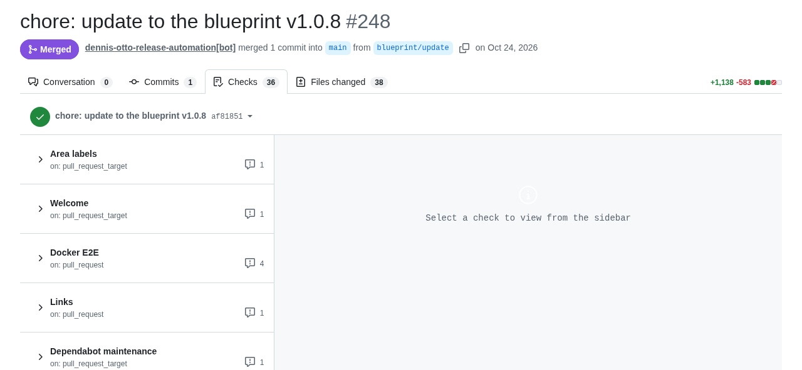

# Abhängigkeiten und Updates

Wie die Abhängigkeiten und die Dateien des Blueprints aktuell bleiben, und welche Dateien dem Projekt gehören.

## Abhängigkeiten

Renovate, mehrmals am Tag als Release-App des Eigentümers, für jedes Repository: Der Renovate-Workflow des Blueprints führt es für die Repositorys seines Eigentümers aus und der jedes Repositorys für jeden anderen Eigentümer, oder der Eigentümer installiert die Mend-Renovate-App, wie [dein eigenes Konto](../guide.md#dein-eigenes-konto) zeigt; Actions, Abhängigkeiten, Images und die Pins der Workflows, eine Woche nach ihrem Release, montags, und sofort ein Update, das eine Schwachstelle behebt, oder den neuen Commit eines Branches, dem eine Action folgt; Routine-Updates und Releases, die nur Abhängigkeiten aktualisieren, mergen sich selbst, sobald alle Prüfungen grün sind, während die wöchentliche Auffrischung jeder Lock-Datei, die die neuesten Versionen ohne die Woche Wartezeit bringt, auf den Maintainer wartet; ein Update dessen, was die Nutzer ausführen, etwa der Requirements einer Home-Assistant-Integration, der Abhängigkeiten eines Python-Pakets oder des Basis-Images eines Containers, führt zu einem Patch-Release; Renovate hält kein Issue offen: Was auf den Maintainer wartet, ist ein Pull Request, und was fehlschlägt, landet im Issue *Renovate logs problems*; die Werkzeuge, die die Workflows anhand ihrer SHA-256 herunterladen, etwa gitsign, ziehen mit ihrer Prüfsumme nach; der Blueprint prüft, dass Renovate jede Lock-Datei liest, die er mitbringt, und der Schritt *Lock files* von `scripts/check.sh`, dass Renovate jede Lock-Datei von pip-compile im Repository neu kompilieren kann, auch eine des Projekts selbst, die Renovate sonst mit nicht mehr als einer Warnung übergeht, und `blueprint.py locks --fix` setzt das `=` zwischen eine Option ihres Befehls und ihren Wert; eine Version, die ein anderes Paket genau festlegt, etwa das Pillow, das Home Assistant für die Tests festlegt, ist mit jedem Advisory in `osv-scanner.toml` akzeptiert, mit ihrem Grund und bis zu einem Datum, und `blueprint.py advisories` schreibt eine Regel für sie, sodass Renovate keine Behebung versucht, die die Lock-Datei nicht aufnehmen kann. Dependabot pflegt die Features des Dev-Containers.

**Womit:** `renovate.json5`, `renovate-blueprint.json5`, `renovate-accepted.json5`, `osv-scanner.toml`, `dependabot.yml`.

## Updates

Gleich nach jedem Release des Blueprints, und jede Woche, führt der Blueprint-Bot `copier update` aus und öffnet einen Pull Request.

**Womit:** `blueprint-update.yml`.

<picture>
  <source media="(prefers-color-scheme: dark)" srcset="../images/diagrams/how-an-update-of-the-blueprint-arrives.de.dark.svg">
  
</picture>

Der Blueprint-Bot (`blueprint-update.yml`) führt jede Woche `copier update` aus, und gleich nach jedem Release des Blueprints, dessen Rollout-Workflow ihn in jedem Repository der Release-App startet. Er nimmt das neueste veröffentlichte Release des Blueprints, den `.copier-answers.yml` nennt, vielleicht eines Forks davon, nie einen Tag, dessen Release noch ein Entwurf ist. Vor dem Update prüft er das Release: Es muss unveränderlich sein, sein Tag muss auf einen Commit von `main` des Blueprints zeigen, der nicht älter ist als die Version des Repositorys, und der Release-Workflow des Blueprints muss den Tag signiert haben (gitsign, wie [SECURITY.md](https://github.com/Dennis-Otto/repo-blueprint/blob/main/SECURITY.md#verify-a-release) zeigt). Jedes andere Release lässt den Lauf fehlschlagen, bevor Copier etwas rendert, mit dem Grund und dem, was zu tun ist, in der Zusammenfassung des Laufs, sodass ein Tag, den jemand anderes gepusht hat, kein Repository erreicht; antworten GitHub oder Sigstore nicht, fragt der Bot dreimal und wartet dann auf seinen nächsten Lauf. Einen Blueprint, der nicht auf GitHub liegt, kann er nicht prüfen, also aktualisiert er nicht von ihm. Der Bot hält einen Pull Request auf dem Branch `blueprint/update`: Ein neueres Release bringt diesen Pull Request weiter, mit seiner Nummer und seinem Auto-Merge, statt ihn zu ersetzen. Seine Beschreibung zeigt die Notizen jedes Releases, das er bringt, auch der übersprungenen, jedes in einem eigenen Abschnitt zum Aufklappen, das neueste zuerst, mit Verweisen auf die Issues des Blueprints, die Links auf sie bleiben, einen Link, der die Version davor mit der neuen vergleicht, und die Dateien, die er ändert; mit Konflikten eine Checkliste der Dateien, die aufzulösen sind, und wie; und ob er sich selbst merged und wie `BLUEPRINT_AUTOMERGE` das ändert. Ohne Konflikte merged er sich selbst, sobald alle Prüfungen grün sind. Konflikte bleiben als Markierungen für den Maintainer darin, in den Dateien, die das Update geändert hat; sie schalten sein Auto-Merge ab und setzen das Label `merge-conflict`. Die Repository-Variable `BLUEPRINT_AUTOMERGE` mit dem Wert `off` lässt jedes Update auf den Maintainer warten. Von Hand startet er unter *Actions → Blueprint update*, lokal mit dem Copier, den er nutzt, in einer virtuellen Umgebung: `pip install --require-hashes -r .github/copier-requirements.txt && copier update --defaults --conflict inline`.

<picture>
  <source media="(prefers-color-scheme: dark)" srcset="../images/diagrams/how-a-release-of-the-blueprint-rolls-out.de.dark.svg">
  
</picture>

Der Rollout-Workflow des Blueprints bringt jedes Release nacheinander in die Repositorys der Release-App, die mit den schnellsten Prüfungen zuerst: Er startet den Blueprint-Bot eines Repositorys und gibt dem Bot und den Prüfungen seines Update-Pull-Requests bis zu 15 Minuten, bevor er den nächsten startet, damit die Update-Pull-Requests nicht alle zugleich auf die Runner des Kontos warten. Ein Repository, dessen Bot er nicht starten kann oder dessen Bot scheitert, lässt den Lauf mit seinem Namen fehlschlagen; die anderen bekommen das Release trotzdem. Er rollt jedes Release aus, das ein Lauf des Release-Workflows veröffentlicht hat, ob der Merge des Release-Pull-Requests diesen Lauf gestartet hat, der tägliche Zeitplan oder ein Start von Hand; ein Release, das der Lauf eines späteren Merges fertiggestellt hat, weil der Lauf seines eigenen Merges verloren ging, wartet auf einen Start von Hand (Actions → Rollout) oder den wöchentlichen Lauf der Bots. Selbst von Hand gestartet, rollt er das neueste Release aus. Rollouts von Releases, die kurz nacheinander kommen, überlappen sich, aber nie im selben Repository: Dort nimmt das neuere Release den Platz eines älteren ein, das noch wartet. Jedes Release geht gleich nach seiner Prüfung hinaus, und der wöchentliche Lauf bleibt als Sicherheitsnetz, damit eine Korrektur jedes Repository in Minuten statt in einer Woche erreicht (Entscheidungen 0052 und 0010 der [Entscheidungen](https://github.com/Dennis-Otto/repo-blueprint/blob/main/docs/decisions/README.md)).

Ein Update des Blueprints in paperless-sync, wie der Rollout es gebracht hat: Der Pull Request der Release-App hat sich selbst gemerged, sobald seine 36 Workflows mit Prüfungen bestanden hatten:

<picture>
  <source media="(prefers-color-scheme: dark)" srcset="../images/github-update-pull-request.dark.png">
  
</picture>

Sobald du auf den Branch des Pull Requests committest, etwa um die Markierungen aufzulösen, überlässt der Bot dir den Branch: Ist ein neueres Release erschienen, sagt er das in einem Kommentar, und nachdem du den Pull Request gemerged oder geschlossen hast, bringt sein nächster Lauf den Rest. Ein Merge von `main` mit dem Button *Update branch* zählt nicht als dein Commit, und ein Auto-Merge, das du abschaltest, bleibt aus. Ein Update, das nur ein neues Release in `.copier-answers.yml` festhält, kommt ebenfalls als Pull Request, und die Updates bringen auch die Modi von Dateien mit, etwa ein Skript, das ausführbar wird.

Dem Blueprint gehören die Workflows, `scripts/check.sh` und die Community-Dateien: ihre Änderungen kommen mit den Updates. Dateien des Projekts werden nie überschrieben: README, Changelog, das Sicherheitsdesign in `docs/security.md`, Manifeste und Lock-Dateien der Abhängigkeiten (die hält Renovate aktuell), Code und Tests, `mkdocs.yml` und die Seiten der Website, Issue-Formulare, Labels, akzeptierte Findings und die Notizen für Coding-Agents. Prüfungen, die nur ein Projekt braucht, gehören in `scripts/check-project.sh`, das `scripts/check.sh` zuletzt ausführt.

### Der Issue-Assistent

<picture>
  <source media="(prefers-color-scheme: dark)" srcset="../images/diagrams/how-a-release-of-the-issue-assistant-reaches-every-repository.de.dark.svg">
  
</picture>

Die vier Workflows des [Issue-Assistenten](https://github.com/Dennis-Otto/issue-assistant) und seine Firewall-Regeln sind Vorlagen seines Releases, mit denen die Prüfung des Issue-Assistenten, ein Schritt von `lint`, jedes Repository vergleicht; ein Pin der Action, der allein weiterrückt, ließe diese Prüfung also fehlschlagen, und Renovate lässt die Action in Ruhe. Stattdessen übernimmt der Sync-Bot des Blueprints (`sync-issue-assistant.yml`, nur im Blueprint) jedes neue Release. Jeden Morgen nimmt er das neueste veröffentlichte Release des Issue-Assistenten und prüft es so, wie der Blueprint-Bot ein Release des Blueprints prüft: Das Release muss unveränderlich sein, GitHubs Attestierung muss stimmen (`gh release verify`), sein Tag muss auf einen Commit des `main` des Issue-Assistenten zeigen, und sein Release-Workflow muss den Tag signiert haben. Jedes andere Release lässt den Lauf mit dem Grund in seiner Zusammenfassung fehlschlagen, und nichts ändert sich; ebenso ein Release, das älter ist als das des Blueprints, denn GitHub nennt ein Release nach seinem Datum das neueste, nicht nach seiner Version. Dann führt der Bot `install` genau des geprüften Commits im Wurzelverzeichnis des Blueprints aus, übernimmt die Firewall-Regeln des Releases, stellt jeden Pin der Action darauf um, auch den der Prüfung im Lint-Workflow, und gibt einem Workflow, der im Release neu ist, die Datei der Vorlage, die ihn in jedem Repository erzeugt; ein Release, dessen `install` noch etwas anderes ändert, lässt den Lauf fehlschlagen, und der Maintainer übernimmt es von Hand. Der Bot hält einen Pull Request auf dem Branch `bot/issue-assistant`, `fix(deps): update the issue assistant to vX.Y.Z`, der sich selbst merged, sobald alle Prüfungen grün sind, und zu einem neueren Release weiterrückt; sobald jemand anderes auf seinen Branch committet, lässt der Bot den Branch in Ruhe, bis der Pull Request gemerged oder geschlossen ist. Das nächste Release des Blueprints, das sich selbst veröffentlicht, wenn es nur Updates enthält, bringt das Release in jedes Repository. Die Installation läuft ohne Secrets; nur der Job des Pull Requests hat die Release-App, und er führt nichts aus dem Release aus. Von Hand startest du ihn unter *Actions → Issue assistant sync*; mit *dry_run* prüft und installiert er das neueste Release und zeigt ohne Pull Request, was sich ändern würde, wie in jedem Pull Request, der den Bot ändert. Der Bot für den Zustand der Bots (`bot-health.yml`) hält zu einem fehlgeschlagenen Lauf ein Issue offen, mit dem Grund einer Ablehnung, und schließt es, sobald ein Lauf besteht.

## Upstream

Für eine Nextcloud-App, jede Woche: hat Nextcloud eine neue Hauptversion, hebt ein Pull Request `max-version` an und merged sich selbst, sobald jede Prüfung, auch die End-to-End-Tests, dagegen besteht; von Hand als Probelauf gestartet, zeigt er den Pull Request, den er öffnen würde, und ändert nichts.

**Womit:** `upstream.yml`.

## Was einem Projekt gehört

<picture>
  <source media="(prefers-color-scheme: dark)" srcset="../images/diagrams/what-belongs-to-the-blueprint-and-what-to-the-project.de.dark.svg">
  
</picture>

Der Blueprint hält die gemeinsamen Teile aller Repositories gleich; ein Projekt ergänzt seine eigenen, ohne sie abzuspalten:

- **Änderungen an den Dateien des Blueprints überstehen Updates:** `copier update` führt die Änderungen des Blueprints und die des Repositorys Zeile für Zeile zusammen und markiert nur dort einen Konflikt, wo beide dieselben Zeilen geändert haben.
- **Einstellungen nur dieses Projekts** gehören in `.github/repository.project.toml`, etwa die Prüfungen seiner End-to-End-Tests, ein Environment mit seinen Secrets oder die Muster der Actions, die nur seine eigenen Workflows ausführen. `blueprint.py` und der Settings-Bot ergänzen damit `.github/repository.toml`.
- **Prüfungen nur dieses Projekts** gehören in `scripts/check-project.sh`, das `scripts/check.sh` zuletzt ausführt, und die seiner Website, etwa ihrer `robots.txt`, in `scripts/check-site.sh`, das der Check *docs* mit dem Ordner der gebauten Website ausführt; **Workflows nur dieses Projekts** sind eigene Workflow-Dateien.
- **Notizen für Coding-Agents** gehören in `.github/agents.project.md`, etwa die Architektur des Projekts und die Befehle seiner eigenen Prüfungen. `AGENTS.md`, das der Blueprint aktuell hält, enthält die Regeln jedes Repositorys und verweist darauf, und `CLAUDE.md` bringt beides zu Claude Code.
- **Erklärungen der Prüfungen nur dieses Projekts,** die der PR-Coach zeigt, wenn eine scheitert, gehören in `.github/checks.project.toml`; sie haben Vorrang vor denen von `.github/checks.toml`.
- **Mehrere Copyright-Inhaber,** etwa die Autoren eines Forks, sind die Antwort `copyright`, durch Semikolons getrennt; LICENSE und REUSE.toml nennen jeden von ihnen.
- **Dateien unter einer anderen Lizenz,** etwa Grafiken Dritter, bekommen eine `.license`-Datei daneben, wie REUSE es beschreibt.
- **Das Paket einer Nextcloud-App** prüft `scripts/check-package.sh ARCHIV unsigned|signed`, wenn das Projekt eines hat: `scripts/check.sh` führt es für das Paket aus, das krankerl baut, das Release für das Paket vor und nach dem Signieren.
- **Die Version in anderen Zeilen einer Datei des Releases,** etwa das Tag in der URL eines Screenshots in `appinfo/info.xml`, folgt jedem Release, wenn die Zeile mit dem Kommentar `x-release-please-version` endet, etwa `<!-- x-release-please-version -->`.
