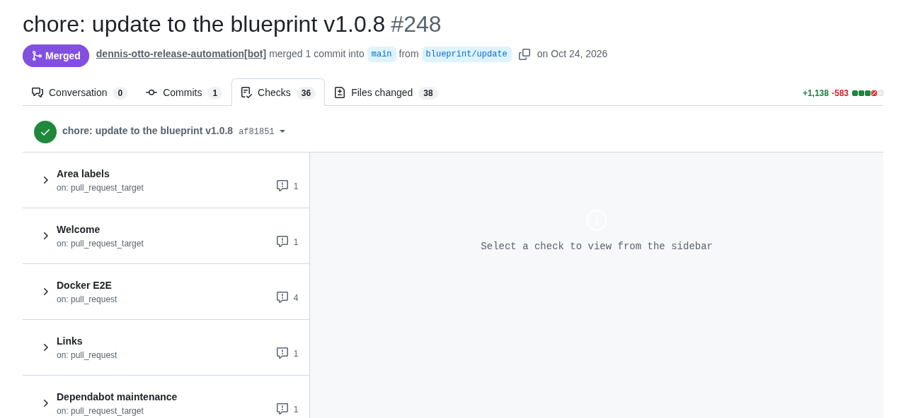

# Dependencies and updates

How the dependencies and the files of the blueprint stay current, and which files belong to the project.

## Dependencies

Renovate, a few times a day as the release app of the owner, for every repository: the Renovate workflow of the blueprint runs it for the repositories of its owner, and that of each repository for every other owner, or the owner installs the Mend Renovate app, as [your own account](../guide.md#your-own-account) shows; the actions, the dependencies and the pins of the workflows, a week after their release, and the images, for which no registry gives Renovate the date of a release, at their next run, on Mondays, the new digest of a tag that stays in a pull request apart from the new versions, and at once an update that fixes a vulnerability or the new commit of a branch that an action follows; routine updates merge themselves once every check passes, and a release of dependency updates, also beside a bot's commit that makes no release, once a day, in the daily run of the release bot, or at once when it fixes a vulnerability, while the weekly refresh of the lock files merges itself only from versions at least a week old: that of npm and pip-compile keeps to them, and the check dependency-review holds it when a younger one comes anyway, and that of Composer or another package manager, which can't, waits for the maintainer; an update of what the users run, such as the requirements of a Home Assistant integration, the dependencies of a Python package or the base image of a container, leads to a patch release; Renovate keeps no issue open: what waits for the maintainer is a pull request, and what fails reaches the issue *Renovate logs problems*, as does each update that Renovate drops because another update of the same dependency met it in one branch; the tools that the workflows download by their sha256, such as gitsign, move with their checksum; the blueprint checks that Renovate reads every lock file that it brings, and the step *Lock files* of `scripts/check.sh` that Renovate can compile again every lock file of pip-compile in the repository, also one of the project itself, which Renovate would skip with no more than a warning, and `blueprint.py locks --fix` puts the `=` between an option of its command and its value; a version that another package pins exactly, such as the Pillow that Home Assistant pins for the tests, is accepted with every advisory in `osv-scanner.toml`, with its reason and until a date, and `blueprint.py advisories` writes a rule for it, so that Renovate tries no fix that the lock file can't take, while the job *dependabot alerts* of the OSV-Scanner workflow closes its Dependabot alerts with the reason and the end, and opens them again once the acceptance ends; two weeks before that end, the same job warns and keeps an issue that names the package, the version and the date. Dependabot keeps the Features of the dev container.

**How:** `renovate.json5`, `renovate-blueprint.json5`, `renovate-accepted.json5`, `osv-scanner.toml`, `dependabot.yml`.

<picture>
  <source media="(prefers-color-scheme: dark)" srcset="../images/diagrams/how-the-weekly-refresh-of-the-lock-files-merges.dark.svg">
  
</picture>

## Updates

Right after every release of the blueprint, and every week, the blueprint bot runs `copier update` and opens a pull request.

**How:** `blueprint-update.yml`.

<picture>
  <source media="(prefers-color-scheme: dark)" srcset="../images/diagrams/how-an-update-of-the-blueprint-arrives.dark.svg">
  
</picture>

The blueprint bot (`blueprint-update.yml`) runs `copier update` every week, and right after every release of the blueprint, whose Rollout workflow starts it in every repository of the release app. It takes the latest published release of the blueprint that `.copier-answers.yml` names, a fork of it perhaps, never a tag whose release is still a draft. Before it updates, it verifies the release: the release must be immutable, its tag must point at a commit of the blueprint's `main` no older than the version the repository has, and the release workflow of the blueprint must have signed the tag (gitsign, as [SECURITY.md](https://github.com/Dennis-Otto/repo-blueprint/blob/main/SECURITY.md#verify-a-release) shows). Any other release fails the run before Copier renders anything, with the reason and what to do in the summary of the run, so a tag that someone else pushed reaches no repository; when GitHub or Sigstore doesn't answer, the bot asks three times and then waits for its next run. A blueprint that isn't on GitHub can't be verified, so the bot doesn't update from one. The bot keeps one pull request on the branch `blueprint/update`: a newer release moves that pull request on, with its number and its auto-merge, instead of replacing it. Its description shows the notes of every release that it brings, the releases that it skipped too, each in a section of its own to open, the newest first, with references to the issues of the blueprint that stay links to them, a link that compares the version before with the new one, and the files that it changes; with conflicts, a checklist of the files to resolve and how; and whether it merges itself, and how `BLUEPRINT_AUTOMERGE` changes that. Without conflicts it merges itself once every check passes. Conflicts stay in it as markers for the maintainer, in the files that the update touched; they turn its auto-merge off and add the label `merge-conflict`. A file that the release deletes, renames or replaces as binary gets no markers, as Copier takes it from the release as it is: the bot compares each one with what the blueprint rendered for the version before, and one that the repository had changed is listed in the description, under *Changes of this repository that the update drops*, with what to do, and holds the pull request in the same way. The repository variable `BLUEPRINT_AUTOMERGE` set to `off` makes every update wait for the maintainer. Run it by hand under *Actions → Blueprint update*, or locally with the Copier that it uses, in a virtual environment: `pip install --require-hashes -r .github/copier-requirements.txt && copier update --defaults --conflict inline`.

<picture>
  <source media="(prefers-color-scheme: dark)" srcset="../images/diagrams/how-a-release-of-the-blueprint-rolls-out.dark.svg">
  
</picture>

The Rollout workflow of the blueprint brings each release to the repositories of the release app one after the other, those with the quickest checks first: it starts the blueprint bot of a repository and gives the bot and the checks of its update pull request up to 15 minutes before it starts the next one, so that the update pull requests don't all wait for the runners of the account at once. A repository whose bot it can't start, or whose bot fails, fails the run by its name; the others still get the release. A bot whose file is there but that GitHub hasn't registered, as after a first push that registered no workflow that only a schedule or a person starts ([#652](https://github.com/Dennis-Otto/repo-blueprint/issues/652)), fails at once, without the three attempts that a moment of GitHub gets, and its summary names the case and `python3 .github/blueprint.py workflows register`, which registers the workflows in that repository. It rolls out every release that a run of the Release workflow published, whether the merge of the release pull request started that run, the daily schedule or a start by hand, and in whichever attempt of the run the release went public: one that GitHub made public although it failed the job, which an attempt after it ran again, goes out as well. A release that the run of a later merge finished, because the run of its own merge was lost, waits for a start by hand (Actions → Rollout) or the weekly run of the bots. Started by hand itself, it rolls out the latest release. Rollouts of releases that come close together overlap, but never in the same repository: there, the newer release takes the place of an older one that still waits. Every release goes out right after it is verified, and the weekly run stays as a safety net, so that a fix reaches every repository within minutes instead of a week (decisions 0052 and 0010 of the [decisions](https://github.com/Dennis-Otto/repo-blueprint/blob/main/docs/decisions/README.md)).

An update of the blueprint in paperless-sync, as the Rollout brought it: the pull request of the release app merged itself once its 36 workflows of checks had passed:

<picture>
  <source media="(prefers-color-scheme: dark)" srcset="../images/github-update-pull-request.dark.png">
  
</picture>

Once you commit to the branch of the pull request, to resolve the markers for example, the bot leaves the branch to you: when a newer release is out, it says so in one comment, and after you merge or close the pull request, its next run brings the rest. A merge of `main` with the button *Update branch* doesn't count as your commit, and an auto-merge that you switch off stays off. An update that only records a new release in `.copier-answers.yml` comes as a pull request too, and the updates carry the modes of files, such as a script that becomes executable.

The blueprint owns the workflows, `scripts/check.sh` and the community files: their changes arrive with the updates. Files that belong to the project are never overwritten: the README, the changelog, the security design in `docs/security.md`, the dependency manifests and lock files (Renovate keeps them current), the code and the tests, the website's `mkdocs.yml` and pages, the issue forms, the labels and their paths, accepted findings, and the notes for coding agents. Checks of a project alone belong in `scripts/check-project.sh`, which `scripts/check.sh` runs last.

### What a release moves in a file of the project

<picture>
  <source media="(prefers-color-scheme: dark)" srcset="../images/diagrams/a-release-moves-a-file-of-the-project.dark.svg">
  
</picture>

An update never overwrites a file of the project, so a release that needs such a file changed names the change in `blueprint/migrate.py`. The pull request of the update fails the step *Files of the project* of `scripts/check.sh`, its check runs `python3 .github/blueprint.py migrate --fix`, and the fix bot commits the result onto the pull request, which then merges itself like any other update ([decision 0111](../decisions/0111-a-release-moves-a-file-of-the-project-through-a-check-that-fixes-itself.md)). The bot commits the move only of a file that `MOVABLE` of that module names, such as `.github/labels.toml`, and leaves any other fix of a file that decides what a workflow runs to a person, as nobody reads the update before it merges ([decision 0142](../decisions/0142-the-fix-bot-commits-nothing-that-runs-with-rights-where-nobody-reads-its-commit.md)).

The first such move takes the labels `good first issue` and `help wanted` to the group `contribution`, for which the [issue assistant](https://github.com/Dennis-Otto/issue-assistant) names candidates in its morning digest. A project that doesn't want this writes a comment behind the line `group = "decision"` of the label, and the step leaves it alone. The second adds the label `no-bot-fixes` to the group `decision`, which keeps the fix bot away from a pull request and which release 1.1.0 gave only to a new repository; a comment that names the label, such as `# no-bot-fixes: not here`, declines it.

A step that the bot may not commit unread, such as a license that `.github/dependency-review.yml` allows for a tool of the blueprint bot, is a line of the checklist instead: `python3 .github/blueprint.py checklist` names what the file lacks and how to add it, in a pull request that a person reads ([decision 0143](../decisions/0143-a-step-that-the-changelog-asks-of-an-existing-repository-is-a-migration-a-line-of-the-checklist-or-a-note.md)).

### The issue assistant

<picture>
  <source media="(prefers-color-scheme: dark)" srcset="../images/diagrams/how-a-release-of-the-issue-assistant-reaches-every-repository.dark.svg">
  
</picture>

The four workflows of the [issue assistant](https://github.com/Dennis-Otto/issue-assistant) and its firewall policy are templates of its release, with which the check of the issue assistant, a step of `lint`, compares every repository, so a pin of the action that moved alone would fail that check; Renovate leaves the action alone. The sync bot of the blueprint (`sync-issue-assistant.yml`, in the blueprint alone) takes over each new release instead, within a few hours of its release, as GitHub runs its hourly schedule ([decision 0128](../decisions/0128-the-sync-bot-looks-for-a-release-of-the-issue-assistant-every-hour.md)). Every hour it takes the latest published release of the issue assistant and verifies it as the blueprint bot verifies a release of the blueprint: the release must be immutable, GitHub's attestation of it must hold (`gh release verify`), its tag must point at a commit of the issue assistant's `main`, and its release workflow must have signed the tag. Any other release fails the run with the reason in its summary, and nothing changes; so does a release older than the one that the blueprint has, since GitHub calls a release latest by its date, not by its version. Then the bot runs `install` of exactly the verified commit in the root of the blueprint, takes over the firewall policy of the release, moves every pin of the action to it, that of the check in the Lint workflow too, and gives a workflow that is new in the release the file of the template that renders it in every repository; a release whose `install` changes anything else fails the run, and the maintainer takes it over by hand. The bot keeps one pull request on the branch `bot/issue-assistant`, `fix(deps): update the issue assistant to vX.Y.Z`, which merges itself once every check passes and moves on to a newer release; once someone else commits to its branch, the bot leaves the branch alone until the pull request is merged or closed. The next release of the blueprint, which publishes itself in the daily run of the release bot when it holds only updates, or at once when the maintainer starts the Release workflow by hand, brings the release to every repository. A look that finds the latest release in the blueprint and no branch of the bot ends after its first job, without the release app. Installing runs without secrets; only the job of the pull request has the release app, and it runs nothing of the release. Run it by hand under *Actions → Issue assistant sync*; with *dry_run*, it verifies and installs the latest release and shows what would change without a pull request, as it does in every pull request that changes the bot. The bot-health bot (`bot-health.yml`) keeps one issue open about a failed run, with the reason of a refusal, and closes it once a run passes.

## Upstream

For a Nextcloud app, every week: when Nextcloud has a new major version, a pull request raises `max-version` and merges itself once every check, the end-to-end tests included, passes against it; started by hand as a dry run, it shows the pull request it would open and changes nothing.

**How:** `upstream.yml`.

## What belongs to a project

<picture>
  <source media="(prefers-color-scheme: dark)" srcset="../images/diagrams/what-belongs-to-the-blueprint-and-what-to-the-project.dark.svg">
  
</picture>

The blueprint keeps the shared parts of every repository equal; a project adds its own without forking them:

- **Changes in the blueprint's files survive updates, or wait for you:** `copier update` merges the changes of the blueprint with those of the repository, line by line, and marks a conflict where both changed the same lines. A file that the release deletes, renames or replaces as binary it can't merge, and takes the release's version: when the repository had changed such a file, the blueprint bot names it in its pull request, turns auto-merge off and adds the label `merge-conflict`. Bring the change to the file that takes its place, or propose it to the blueprint.
- **A pull request hears when it changes one:** the check *lint* annotates each file that `.github/blueprint/owned.txt` lists, and the report of the PR coach says where the change belongs instead, links a new issue in the blueprint filled in with the files and adds the label `blueprint-file`. A notice, or a failure with the repository variable [`BLUEPRINT_OWNERSHIP`](../reference/variables.md#blueprint_ownership) set to `fail`; the bots get none.
- **The tests of the project leave the blueprint's files to the blueprint:** a test or a check of the project that walks the workflows skips those that `.github/blueprint/owned.txt` lists and names none of their jobs or steps, since the tests of the blueprint hold its rules for them in every kind and any update may change them; `AGENTS.md` tells coding agents so. A rule that a workflow of the blueprint should follow goes into the tests of the blueprint, and an update that changes one of its workflows passes the checks of the project as it is.
- **Settings of the project alone** go into `.github/repository.project.toml`, such as the checks of its end-to-end tests, an environment with its secrets or the patterns of the actions that only its own workflows run. `blueprint.py` and the settings bot add them to `.github/repository.toml`.
- **Checks of the project alone** go into `scripts/check-project.sh`, which `scripts/check.sh` runs last, and those of its website, such as of its `robots.txt`, into `scripts/check-site.sh`, which `scripts/check.sh` and the check *docs* run with the folder of the built website; **workflows of the project alone** are workflow files of their own, which the bot-health bot looks after every night too; one that keeps an issue of its own about its failures says so in a comment line `# bot-health: own-issue`.
- **Notes for coding agents** go into `.github/agents.project.md`, such as the architecture of the project and the commands of its own checks. `AGENTS.md`, which the blueprint keeps current, has the rules of every repository and points to them, and `CLAUDE.md` brings both to Claude Code.
- **Text about the releases of the project** goes between the two marked lines of `## Releases` in `CONTRIBUTING.md`, such as a link to its release guide. Every update keeps these lines, the check *lint* takes no notice of a change that stays between them, and a change of the blueprint's sentences around them can't conflict with it.
- **Explanations of the checks of the project alone,** which the PR coach shows when one fails, go into `.github/checks.project.toml`; they win over those of `.github/checks.toml`.
- **Several copyright holders,** such as the authors of a fork, are the answer `copyright`, separated by semicolons; LICENSE and REUSE.toml name each of them.
- **Files under another license,** such as third-party artwork, get a `.license` file next to them, as REUSE describes.
- **The package of a Nextcloud app** is checked by `scripts/check-package.sh ARCHIVE unsigned|signed` if the project has one: `scripts/check.sh` runs it on the package that krankerl builds, the release on the package before and after signing.
- **The version in other lines of a file of the release,** such as the tag in the URL of a screenshot in `appinfo/info.xml`, follows each release when the line ends with the comment `x-release-please-version`, such as `<!-- x-release-please-version -->`.
