# Vorlage für Nextcloud-Apps mit der Taint-Analyse von Psalm, PHPUnit und signierten Releases im App Store

Eine App für Nextcloud in PHP, mit der Analyse von Psalm, die den Daten einer Anfrage durch den Code folgt, und einem signierten Paket, das der Release-Bot in den App Store schickt.

## Eines anlegen

```sh
uvx --from copier==9.19.1 copier copy --data project_type=nextcloud-app gh:Dennis-Otto/repo-blueprint my-app
cd my-app
python3 .github/blueprint.py create
```

Mit [uv](https://docs.astral.sh/uv/) und der GitHub CLI, wie [der Schnellstart](../guide.md#ein-repository-anlegen) zeigt. Copier fragt nach dem Namen, dem Eigentümer und den anderen Antworten, und `create` legt das Repository auf GitHub an, wendet die Einstellungen als Code an und zeigt die Checkliste.

## Was du bekommst

- **Das Beispiel:** `appinfo/info.xml`, `lib/AppInfo/Application.php`, die PHPUnit-Tests in `tests/Unit/` mit dem `tests/bootstrap.php` und den `tests/stubs/`, die sie laden, `psalm.xml`, `phpunit.xml`, `composer.json` mit seiner Lock-Datei und `krankerl.toml`, das das Paket baut. Die Lizenz beginnt als AGPL-3.0-or-later, die Lizenz von Nextcloud. Ersetze es durch den echten Code; seine Tests zeigen, wie.
- **Bilder der App:** `scripts/screenshots.sh` startet Nextcloud in Docker mit dem Repository als App, schaltet sie ein und fotografiert sie in den Apps der Einstellungen, als `docs/images/screenshots/nextcloud.png` und `.dark.png`, neben der Startseite der Website; der Screenshot-Bot erneuert sie, wenn sich ihre Pixel ändern, und Renovate hält die Nextcloud des Skripts innerhalb der `max-version` von `appinfo/info.xml` aktuell.
- **Die Schritte von `scripts/check.sh` für diese Art,** auf deinem Rechner wie in der CI: Composer, die Metadaten der App, die Syntax von PHP, der Code und seine Pakete auf dem ältesten PHP, php-cs-fixer, Psalm, ein Kanarienvogel, der zeigt, dass die Taint-Analyse noch sieht, die Taint-Analyse selbst, PHPUnit in zufälliger Reihenfolge mit jeder Zeile abgedeckt und das Paket. Das Plugin, das der Taint-Analyse Nextcloud beibringt, läuft mit Psalm 6 und Psalm 7, also wechselt eine App zu Psalm 7, wenn ihre eigene `composer.json` es tut.
- **Die Schritte jeder Art:** die Textdateien, die Diagramme, die Seiten in einer Spalte, die Dateien des Projekts, die Fragmente des Changelogs, die akzeptierten Advisories, die Lock-Dateien, die Version, die Git-Hooks, ShellCheck für die Shell-Skripte und der strenge Build der Website.
- **Workflows dieser Art:** die Mutationstests mit Infection jede Woche (`mutation.yml`), der Upstream-Bot, der `max-version` anhebt, wenn Nextcloud eine neue Major-Version hat (`upstream.yml`), und die Registrierung der App im App Store (`register-app.yml`).
- **Alles, was jedes Repository bekommt:** den PR-Coach und den Fix-Bot, den Release-Bot, Renovate, die Einstellungen als Code, den Issue-Assistenten, die Website auf Deutsch und Englisch, die Sicherheitsprüfungen und den Blueprint-Bot, wie [die Anleitung](../guide.md#was-ein-neues-repository-bekommt) sie nennt.

## Die Prüfungen, die ein Pull Request braucht

Das Ruleset *Protect main* aus `.github/repository.toml` lässt einen Pull Request mergen, sobald diese Prüfungen grün sind:

- `check (php)`: `scripts/check.sh` mit den Werkzeugen von PHP.
- `lint`, `diagrams`, `docs`, `conventional title`, `codeql`, `dependency-review` und `gitleaks`, die jede Art braucht: jeder Linter in einem Job, die Bilder der Diagramme, der strenge Build der Website, der Titel des Pull Requests mit seinem Eintrag im Changelog, CodeQL, die Prüfung neuer Abhängigkeiten und der Secret-Scan.

## Auslieferung

Der Merge des Release-Pull-Requests baut das Paket mit krankerl, signiert es mit dem Schlüssel der App und veröffentlicht es im App Store, mit seiner SBOM und der signierten Provenance nach SLSA Build Level 3. Der Schlüssel `APP_PRIVATE_KEY` ist das einzige Secret des Environments `signing`, das nur der Build und der Job von *Register the app* betreten, der die ID der App signiert, und das Token `APPSTORE_TOKEN` das einzige Secret von `appstore`, das nur die Auslieferung in den App Store und der Job von *Register the app* betreten, der die Registrierung sendet: Der Build erreicht nur den Schlüssel, der die App signiert, nie das Token oder den privaten Schlüssel der Release-App ([#530](https://github.com/Dennis-Otto/repo-blueprint/issues/530)). Der Einstellungs-Bot legt beide nur für `main` an, und bis du ihre Secrets gesetzt hast, schlägt er fehl und nennt die Befehle, wie die Checkliste auch. Das Environment `release` hält keines von beiden, sodass release-please und die übrigen Jobs dort keines erreichen. Ein Repository, das sie früher in `release` gesetzt hat, behält diese Kopien, da die Einstellungen kein Secret löschen, das sie nicht mehr nennen: `gh secret delete APP_PRIVATE_KEY --env release` und `gh secret delete APPSTORE_TOKEN --env release` entfernen sie.

<picture>
  <source media="(prefers-color-scheme: dark)" srcset="../images/diagrams/which-job-of-a-nextcloud-app-holds-which-secret.de.dark.svg">
  
</picture>

### Eine Beta

Mit der Repository-Variable `BETA_CHANNEL` auf `true` wird jede Änderung für Nutzer zu einer Beta des nächsten Releases, etwa `1.5.0-beta.1`, die ebenfalls in den App Store geht, mit ihrer eigenen Version. Die Beta taggt `main`, dessen `appinfo/info.xml` noch das letzte Release nennt, da release-please die nächste Version nur in seinen Pull Request schreibt. Der App Store nimmt die Version eines Releases aus der `info.xml` in dessen Paket und aktualisiert sein Release dieser Version, sodass das Paket der Beta das des letzten Releases für jeden Nutzer ersetzen würde. Der Build schreibt deshalb die Version der Beta in die `info.xml` des Pakets, bevor er es signiert, und in den Checkout, mit dem ein `scripts/check-package.sh` das Paket vergleichen kann. Eine solche Prüfung muss `appinfo/info.xml` mit dem Checkout vergleichen, nicht mit `git archive HEAD`, dessen `info.xml` noch das letzte Release nennt: Sonst hält sie die Beta vor ihrem Entwurf an. Eine Version mit einer Pre-Release-Kennung ist im App Store ein eigenes Release, das Nextcloud nur Servern im Beta-Kanal anbietet oder solchen, die experimentelle Apps nehmen; die Beta geht dorthin als kein Nightly, das nur der Daily-Kanal bekommt.

Der Build prüft das signierte Paket, die Auslieferung prüft das Paket noch einmal, bevor sie es sendet, und die Verifikation prüft es im Release: Jeder schlägt fehl, wenn die `info.xml` des Pakets eine andere Version als die seines Tags hat. Die Verifikation findet eine Beta unter den instabilen Releases auf der Seite aller Releases der App ([Entscheidung 0116](../decisions/0116-a-beta-of-a-nextcloud-app-goes-to-the-app-store-with-its-own-version.md), [#635](https://github.com/Dennis-Otto/repo-blueprint/issues/635)). Als neueste Version bringt eine Beta auch ihren Namen, ihre Zusammenfassung, ihre Beschreibung und ihre Screenshots auf die Seite der App im App Store.

<picture>
  <source media="(prefers-color-scheme: dark)" srcset="../images/diagrams/a-beta-of-a-nextcloud-app-reaches-only-its-testers.de.dark.svg">
  
</picture>

## Einmal von Hand

`python3 .github/blueprint.py checklist` hakt jeden Schritt ab, den es sehen kann, und nennt den Rest, jeweils mit seinem Link: die Release-App des Eigentümers mit ihrem privaten Schlüssel, wie [dein eigenes Konto](../own-account.md) zeigt, das Token des Issue-Assistenten, außer seine KI ist aus, OpenSSF Best Practices, die REUSE-API und die Social Preview.

Diese Art bringt diese Schritte dazu:

- Das Zertifikat der App beantragen: <https://nextcloudappstore.readthedocs.io/en/latest/developer.html>.
- Danach *Actions → Register the app* mit der ID der App starten.

## Ein echtes Repository

<!-- --8<-- [start:real-repository] -->

Diese öffentlichen Repositories dieser Art sind aus dem Blueprint entstanden:

- **[Paperless Sync](https://github.com/Dennis-Otto/paperless-sync)**: die Dokumente von Paperless-ngx in Nextcloud Files, nach Korrespondent, Typ und Jahr.
- **[Paperless Unified Search](https://github.com/Dennis-Otto/paperless-unified-search)**: die Volltextsuche von Paperless-ngx in der Suche von Nextcloud.

Der Workflow Variants probiert jeden Pull Request des Blueprints, der ändert, was die Antworten von Paperless Sync und Paperless Unified Search rendern, mit ihnen aus, bevor er merged.

<!-- --8<-- [end:real-repository] -->

Wie sich der Blueprint mit anderen Vorlagen vergleicht: [der Vergleich](../compare.md).
