# Nextcloud app template with Psalm taint analysis, PHPUnit and signed App Store releases

An app for Nextcloud in PHP, with the analysis of Psalm that follows the data of a request through the code, and a signed package that the release bot sends to the App Store.

## Start one

```sh
uvx --from copier==9.19.1 copier copy --data project_type=nextcloud-app gh:Dennis-Otto/repo-blueprint my-app
cd my-app
python3 .github/blueprint.py create
```

With [uv](https://docs.astral.sh/uv/) and the GitHub CLI, as [the quick start](../guide.md#start-a-repository) shows. Copier asks for the name, the owner and the other answers, and `create` makes the repository on GitHub, applies the settings as code and prints the checklist.

## What you get

- **The example:** `appinfo/info.xml`, `lib/AppInfo/Application.php`, the PHPUnit tests in `tests/Unit/` with the `tests/bootstrap.php` and the `tests/stubs/` that they load, `psalm.xml`, `phpunit.xml`, `composer.json` with its lock file, and `krankerl.toml`, which builds the package. The license starts as AGPL-3.0-or-later, the license of Nextcloud. Replace it with the real code; its tests show how.
- **Pictures of the app:** `scripts/screenshots.sh` starts Nextcloud in Docker with the repository as its app, enables it and photographs it in the apps of the settings, as `docs/images/screenshots/nextcloud.png` and `.dark.png`, beside the home page of the website; the screenshot bot renews them when their pixels change, and Renovate keeps the Nextcloud of the script current within the `max-version` of `appinfo/info.xml`.
- **The steps of `scripts/check.sh` for this kind,** the same on your machine and in the CI: Composer, the metadata of the app, the syntax of PHP, the code and its packages on the oldest PHP, php-cs-fixer, Psalm, a canary that proves that the taint analysis still sees, the taint analysis itself, PHPUnit in random order with every line covered, and the package. The plugin that teaches the taint analysis Nextcloud works with Psalm 6 and Psalm 7, so an app moves to Psalm 7 when its own `composer.json` does.
- **The steps of every kind:** the text files, the diagrams, the pages in one column, the files of the project, the fragments of the changelog, the accepted advisories, the lock files, the version, the Git hooks, ShellCheck for the shell scripts and the strict build of the website.
- **Workflows of this kind:** the mutation tests with Infection every week (`mutation.yml`), the upstream bot, which raises `max-version` when Nextcloud has a new major version (`upstream.yml`), and the registration of the app in the App Store (`register-app.yml`).
- **Everything that every repository gets:** the PR coach and the fix bot, the release bot, Renovate, the settings as code, the issue assistant, the website in English and German, the security checks and the blueprint bot, as [the guide](../guide.md#what-a-new-repository-gets) lists them.

## The checks that a pull request needs

The ruleset *Protect main* of `.github/repository.toml` lets a pull request merge once these checks pass:

- `check (php)`: `scripts/check.sh` with the tools of PHP.
- `lint`, `diagrams`, `docs`, `conventional title`, `codeql`, `dependency-review` and `gitleaks`, which every kind needs: every linter in one job, the pictures of the diagrams, the strict build of the website, the title of the pull request with its entry in the changelog, CodeQL, the review of new dependencies and the secret scan.

## Delivery

Merging the release pull request builds the package with krankerl, signs it with the key of the app and publishes it in the App Store, with its SBOM and the signed provenance of SLSA Build Level 3. The key `APP_PRIVATE_KEY` is the one secret of the environment `signing`, which only the build and the job of *Register the app* that signs the app id enter, and the token `APPSTORE_TOKEN` the one secret of `appstore`, which only the delivery to the App Store and the job of *Register the app* that posts the registration enter: the build reaches only the key that signs the app, never the token or the private key of the release app ([#530](https://github.com/Dennis-Otto/repo-blueprint/issues/530)). The settings bot creates both for `main` alone, and until you set their secrets, it fails and names the commands, as the checklist does. The environment `release` holds neither of them, so release-please and the other jobs there reach neither. A repository that set them in `release` before keeps those copies, as the settings delete no secret that they no longer name: `gh secret delete APP_PRIVATE_KEY --env release` and `gh secret delete APPSTORE_TOKEN --env release` remove them.

<picture>
  <source media="(prefers-color-scheme: dark)" srcset="../images/diagrams/which-job-of-a-nextcloud-app-holds-which-secret.dark.svg">
  
</picture>

### A beta

With the repository variable `BETA_CHANNEL` set to `true`, every change for users becomes a beta of the next release, such as `1.5.0-beta.1`, which goes to the App Store as well, with its own version. The beta tags `main`, whose `appinfo/info.xml` still says the last release, as release-please writes the next version only in its pull request. The App Store takes the version of a release from the `info.xml` in its package and updates its release of that version, so the package of the beta would replace that of the last release for every user. The build therefore writes the version of the beta into the `info.xml` of the package before it signs it, and into the checkout, with which a `scripts/check-package.sh` may compare the package. Such a check must compare `appinfo/info.xml` with the checkout, not with `git archive HEAD`, whose `info.xml` still says the last release: otherwise it stops the beta before its draft. A version with a pre-release identifier is a release of its own in the App Store, which Nextcloud offers only to servers on the beta channel, or to those that take experimental apps; the beta goes there as no nightly, which only the daily channel gets.

The build checks the signed package, the delivery checks the package again before it posts it, and the verification checks it in the release: each fails when the `info.xml` of the package has a version other than that of its tag. The verification finds a beta among the unstable releases on the page of all releases of the app ([decision 0116](../decisions/0116-a-beta-of-a-nextcloud-app-goes-to-the-app-store-with-its-own-version.md), [#635](https://github.com/Dennis-Otto/repo-blueprint/issues/635)). As the newest version, a beta also brings its name, summary, description and screenshots to the page of the app in the App Store.

<picture>
  <source media="(prefers-color-scheme: dark)" srcset="../images/diagrams/a-beta-of-a-nextcloud-app-reaches-only-its-testers.dark.svg">
  
</picture>

## Once by hand

`python3 .github/blueprint.py checklist` ticks off each step that it can see and names the rest, each with its link: the release app of the owner with its private key, as [your own account](../own-account.md) shows, the token of the issue assistant unless its AI is off, OpenSSF Best Practices, the REUSE API and the social preview.

This kind adds these steps:

- Request the certificate of the app: <https://nextcloudappstore.readthedocs.io/en/latest/developer.html>.
- Then run *Actions → Register the app* with the id of the app.

## A real repository

<!-- --8<-- [start:real-repository] -->

These public repositories of this kind are made from the blueprint:

- **[Paperless Sync](https://github.com/Dennis-Otto/paperless-sync)**: the documents of Paperless-ngx in Nextcloud Files, by correspondent, type and year.
- **[Paperless Unified Search](https://github.com/Dennis-Otto/paperless-unified-search)**: the full-text search of Paperless-ngx in the unified search of Nextcloud.

The Variants workflow tries every pull request of the blueprint that changes what the answers of Paperless Sync and Paperless Unified Search render on them, before it merges.

<!-- --8<-- [end:real-repository] -->

How the blueprint compares with other templates: [the comparison](../compare.md).
