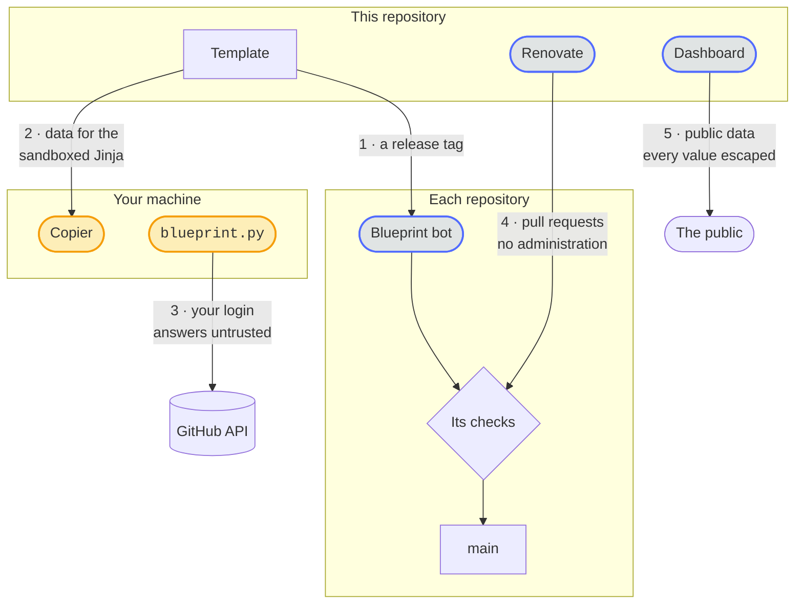

# Security design

What the blueprint protects, what it trusts and which risks remain. [SECURITY.md](https://github.com/Dennis-Otto/repo-blueprint/blob/main/SECURITY.md) says how to report a vulnerability and how to verify a release, and argues why the repositories and their releases are safe; this page covers the blueprint itself: the template, `blueprint.py` with its code in `blueprint/`, the bots that run from this repository and the dashboard.

## What you can expect

- Copying or updating a repository from the blueprint runs no code of the blueprint on your machine. The template has no tasks, migrations or Jinja extensions, so Copier renders it in its sandboxed Jinja environment and needs no `--trust`.
- `blueprint.py` never reads, prints or stores the value of a secret. It names the secrets that are missing and the `gh secret set` command that sets each one; you type the value into the prompt of the GitHub CLI.
- `blueprint.py settings apply` changes only the settings of the repository it is run in, and only those that `.github/repository.toml` names.
- A new release of the blueprint reaches a repository only as a pull request of the blueprint bot in that repository, which passes every check of the repository before it merges, or waits for the maintainer.
- The dashboard shows only what is public anyway: no finding of code scanning and no alert of Dependabot.

## What is protected

| Asset | Where it lives | Protection |
| --- | --- | --- |
| The template, which reaches every repository made from it | `template/`, `copier.yml` and the shared files of this repository | Pull requests with every required check, and the Variants workflow, which renders every kind of project and runs its checks with its real tools; a release that is not only dependency updates waits for the maintainer |
| The settings of every repository | `.github/repository.toml` of each repository | Applied only by `blueprint.py`, by an administrator or by the settings bot on `main`; the bot compares them every week, so that a weaker setting shows |
| The private key of the release app, which can write the administration of the repositories it is installed on | The secret `RELEASE_AUTOMATION_PRIVATE_KEY` of the environment `release` of each repository | Only workflows on `main` can use the environment; each job asks for a token with the permissions it needs, which expires after an hour |

## Trust boundaries

1. **This repository → every repository made from it.** The blueprint bot of each repository runs `copier update` to the latest published release of the blueprint and opens a pull request there, every week and right after a release, when the Rollout workflow of this repository starts it, one repository after the other, with a token of the release app for that repository alone, which can only start workflows and read. It commits the update with its own code from `main`, not with the code that the update brings, and never overwrites a commit of anyone else on its branch. The checks of that repository decide whether it merges; a conflict, which also turns its auto-merge off, or the repository variable `BLUEPRINT_AUTOMERGE` set to `off`, makes it wait for the maintainer.
2. **The template → Copier on your machine.** The template is data for Copier's sandboxed Jinja; the answers of the questions are checked by their validators.
3. **`blueprint.py` → GitHub.** It runs the GitHub CLI with the login of whoever starts it, or with the token of the settings bot, and treats every answer of GitHub as untrusted: an answer it can't read stops the run with an error.
4. **Renovate → every repository.** It runs from this repository every two hours, as the release app, with a token that can write contents, pull requests and workflows but not the administration. Its updates are pull requests that pass the checks of each repository; the weekly refresh of the lock files waits for the maintainer.
5. **The dashboard → the public.** It reads public data of GitHub and publishes a static page on GitHub Pages; every value it shows is escaped.

## Threats and countermeasures

| Threat | Countermeasure | Evidence |
| --- | --- | --- |
| A harmful change of the template reaches every repository | Pull requests with every required check here; every kind rendered and checked with its real tools, also after an update from the latest release; a release that is not only dependency updates waits for the maintainer; in each repository, the update passes its own checks | the Variants workflow, `tests/test_template.py` |
| Copying or updating the blueprint runs code on the user's machine | No tasks, migrations or Jinja extensions in `copier.yml`, so Copier needs no `--trust` | `test_copying_runs_no_code_of_the_blueprint` in `tests/test_template.py`; the Variants workflow updates every kind without `--trust` |
| A rendered workflow loses its pins or runs with more permissions | Every action pinned to the commit hash of a version, never of a branch, which zizmor would report as soon as the branch moves on; the workflows of a new repository are the blueprint's own, which zizmor and actionlint audit | `test_every_action_is_pinned_to_a_commit`, `test_no_workflow_pins_an_action_to_a_branch`, `test_the_workflows_are_the_blueprints_own` |
| A version published minutes ago, perhaps from a hijacked account, reaches every repository with the weekly refresh of the lock files, which moves every indirect dependency to its newest version without the week of waiting | The refresh waits for the maintainer instead of merging on its own, and Renovate builds it anew only in its weekly window, so the diff the maintainer reviewed is the one that merges; a cooldown of the package managers isn't possible for the refresh alone, as Renovate sets their environment for the whole repository and would hold back the fixes of vulnerabilities too ([decision 0012](decisions/0012-lock-refresh-waits-for-the-maintainer.md)) | `test_the_weekly_refresh_of_the_lock_files_waits_for_the_maintainer` in `tests/test_template.py` |
| A lock file stops getting updates, also the fixes of vulnerabilities, because Renovate can't read the command in its header and skips it with no more than a warning in its log | Every lock file of the blueprint and of each kind of project is read as Renovate reads it; in every pull request that changes the rules or a lock file, Renovate itself reads every file, and a warning or a lock file that it skips fails the check | `test_renovate_reads_every_lock_file_of_the_blueprint` and `test_renovate_reads_every_lock_file_of_a_project` in `tests/test_template.py`; the job `renovate rules` of `.github/workflows/renovate.yml` |
| `blueprint.py` leaks a secret | It never reads the value of a secret; it only names the missing ones | `test_apply_sets_everything_but_the_secrets` in `tests/test_blueprint.py` |
| An unexpected answer of GitHub makes `blueprint.py` apply wrong settings | Every answer is read strictly; anything else stops the run with an error before a change | `test_errors_of_github_stop_the_run`; coverage-guided fuzzing with Atheris in `fuzz/fuzz_blueprint.py` |
| The settings of a repository are weakened by hand | The settings bot compares them with the settings as code after every change and every week, and applies them | the Settings workflow of each repository |
| A release stands on a tag that the release workflow didn't sign: one that someone created first, at a commit of their own, or one that release-please created after the run of the merge was lost | Every run of the Release workflow, not only the one of the merge, signs the tag of a merged release pull request before the release is created on it, and release-please creates a release only in a run that signed its tag; a tag that exists already must be the release workflow's own, signed at the commit of the merge, and the isolated build checks that again before it builds or signs anything | `.github/sign-tag.sh`, `tests/test_sign_tag.py` |
| The private key of the release app is abused | The environment `release` only for `main`; tokens per job with the least permissions; no administration for Renovate | `.github/workflows/renovate.yml`, `.github/repository.toml` |
| A name or a description on the dashboard runs as script | Every value is escaped before it becomes HTML | `dashboard.py` |

## Residual risks

- The maintainer's account and the private key of the release app are the keys to every repository made from the blueprint; whoever holds them can change all of them.
- A change that is wrong but passes every check reaches every repository with the next release of the blueprint. The maintainer's review of every release that is not only dependency updates is the last guard.
- Copier and the GitHub CLI run with the permissions of whoever starts them.
- The rules of the release tags block their update and deletion, not their creation: a token that may push can create the tag of a version that no release has yet. The release workflow builds no release on such a tag, and the blueprint bot takes only the tag of the latest published release; but a token that may create releases could publish one on such a tag, and the bot doesn't check the signature of the tag.
- The checks of a Home Assistant integration run the current images of hassfest and HACS, not an image by digest, so that they validate against the rules of today, as the actions of both projects do. hassfest sees the checkout read-only, and HACS a token that can only read.
- The refresh of the lock files has no check of the age of the versions it brings yet: the maintainer's review of its diff, which shows every new version, is the guard. A refresh that Renovate builds anew in its next window needs a new review.
- An action that a project pins to a branch follows that branch without the week of waiting and merges on its own, so a bad commit there reaches the workflows of that project within hours. Pin an action to a release where it has one; the workflows of the blueprint pin none to a branch.
